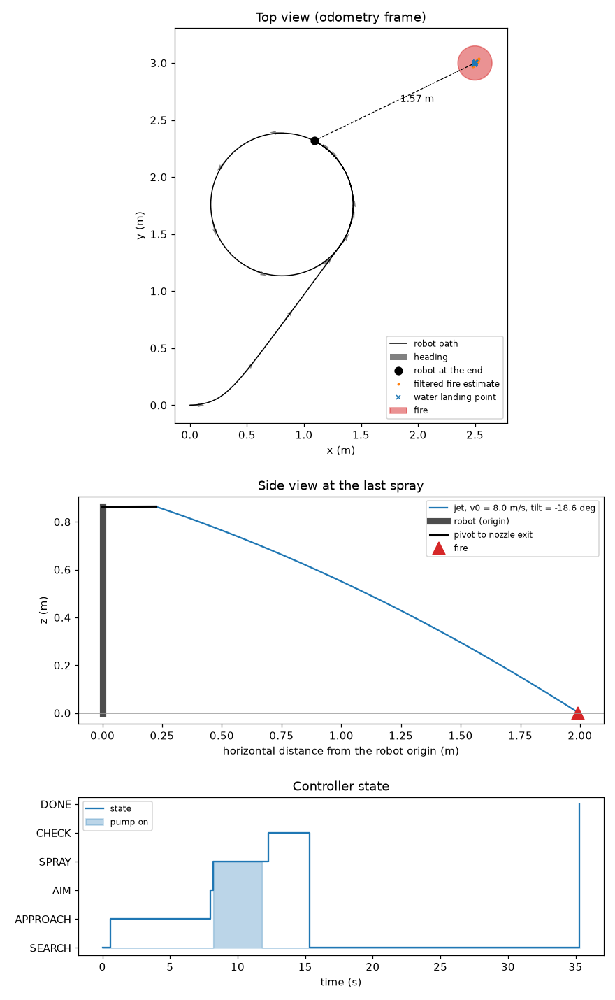
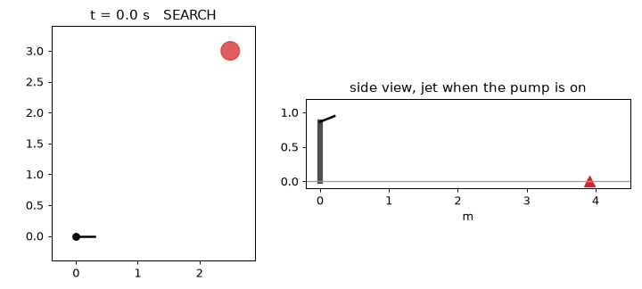

# Aim: from fire detection to water jet

This folder holds the code between the fire detector and the actuators.
It covers roadmap steps 3 to 5: find the fire position, aim the water jet, and switch the water on and off.
The core uses only Python and numpy.

**Assumed:** The concept A pan-tilt and camera come from the printable module CAD (`cad/parts/out/assembly.json`, `cad/parts/README.md`, DS3218 version).
**Assumed:** The concept A nozzle tip (0.248, 0, 0.084) in the tilting frame is an estimate. The gun is not chosen, so I placed the `concepts.py` barrel on the CAD gun box.
**Assumed:** The concept B cameras and nozzle come from `head_b` in `cad/parts/README.md`. The B pivot is still the `concepts.py` value.
**Assumed:** The concept E RGB pose comes from the camera study (`cad/camera_views/README.md`, Table 4). The E thermal pose is the `concepts.py` pose.
**Not verified:** Nobody has tested if the walking policy steps back. The controller sends vx = -0.25 m/s when the fire is too close.

## Interface v2 (proposal)

This is a backward-compatible extension of the interface below. It is a proposal, to agree with Marc.

The detector MAY send one frame message for each camera image, also when it sees no fire:

```json
{"timestamp": 12345.678, "camera": "rgb", "frame": true, "detections": [{"u": 331.5, "v": 298.0, "bbox": [310, 280, 352, 316], "confidence": 0.87}]}
```

- `detections` holds `FireDetection` objects. Each one can leave out `timestamp` and `camera`. It then takes them from the frame.
- An empty list (`"detections": []`) means: this image has no fire.
- `run.py` still accepts the old format (version 1): one detection on each line, and nothing for an image with no fire.
- Why: with version 1, `run.py` cannot tell "no fire in this image" from "the image is late".
  With frame messages, a late image does not count as an image without fire.
  The software-in-the-loop test (`sim/sim2sim/README.md`) found 9 to 24 % of controller ticks without a new image.
- `send_test_detections.py --v2` sends frame messages.

Question for Marc:

- Q5. Can the detector send one frame message for each image, also when it sees no fire?

## Interface proposal, to agree with Marc

The fire detector gives one list of `FireDetection` objects for each camera frame.
The list is empty when the detector sees no fire.
The class is in `detection.py`.

```python
@dataclass
class FireDetection:
    timestamp: float  # s, time the image was taken (time.monotonic() on the robot computer)
    camera: str  # camera name in the robot config, e.g. "rgb" or "thermal"
    u: float  # px, fire centre column, 0 = left edge
    v: float  # px, fire centre row, 0 = top edge
    bbox: tuple[float, float, float, float]  # px, (u_min, v_min, u_max, v_max)
    confidence: float  # 0..1
    max_temp_c: float | None = None  # deg C, thermal camera only
    depth_m: float | None = None  # m, distance along the camera optical axis (like a depth image)
```

The detector sends each detection to `run.py` as one line of JSON in a UDP datagram.
UDP is a simple network protocol: each message (datagram) arrives whole or not at all.
The address is `127.0.0.1:5600` (`DET_PORT` in `run.py`).
One datagram can hold several lines, one detection on each line.
The field names are the names in the class:

```json
{"timestamp": 12345.678, "camera": "rgb", "u": 331.5, "v": 298.0, "bbox": [310, 280, 352, 316], "confidence": 0.87, "max_temp_c": null, "depth_m": null}
```

`max_temp_c` and `depth_m` are optional. `run.py` ignores fields that it does not know.
`run.py` rejects a line with a missing field, an unknown camera name or a wrong type, and prints the reason on stderr.

Rules that go with the class:

- `timestamp` is `time.monotonic()` on the same computer, at the time the image was taken. `run.py` rejects a timestamp in the future or more than 1 s old.
- Send at 10 frames per second or more. `run.py` runs the controller at 10 Hz and uses the detections that arrived since the last tick.
- When the detector sees no fire, it sends nothing (version 1). With interface v2, it sends a frame message with an empty list.
- `u` and `v` are pixel coordinates in the full camera image, not in a resized network input.
- `depth_m` is the distance along the camera axis, not along the ray to the fire. A depth image gives this value directly.
- The aiming code uses the detection with the highest confidence. It ignores detections below `min_conf` (0.5 now).

Questions for Marc:

- Q1. Does the detector correct the lens distortion? The camera model here has no distortion.
- Q2. Which point is (u, v): the box centre, the hottest pixel, or the base of the flame? The aiming code assumes the fire touches the floor at (u, v).
- Q3. Which cameras, image sizes and fields of view do you use? The values in `geometry.py` are placeholders.
- Q4. What frame rate and what delay (from image to detection) does the detector have?

## Status

| Part | Status |
|---|---|
| `FireDetection` interface | built, not agreed with Marc |
| Camera model, pan-tilt poses for concepts A, B and E | built, tested in simulation |
| Fire localisation (floor plane or depth) and Kalman filter | built, tested in simulation |
| Ballistic aim, with and without air drag | built, tested in simulation |
| Aim solver time | measured on laptop |
| Delay compensation (angles and pose at the image time) | built, tested in simulation |
| Controller state machine and safety interlocks | built, tested in simulation |
| `run.py` runtime with UDP input and a mock actuator | built, tested in simulation with `send_test_detections.py` |
| Pose input (UDP 5605) with dead reckoning, torso roll and pitch, interface v2 frame messages | built, tested in simulation |
| Calibration of v0, cameras and nozzle | planned |
| Servo driver, pump driver, link to the walking controller | planned, not in this folder |

Nothing in this folder is measured on board.

## Files

- `detection.py`: the `FireDetection` interface.
- `geometry.py`: camera model, robot configs for concepts A, B and E, localisation, target filter.
- `ballistics.py`: jet model, aim solver, v0 helpers.
- `controller.py`: state machine. It outputs pan, tilt, pump on/off and a walk command.
- `sim_demo.py`: toy simulation and plot.
- `run.py`: runtime. It reads detections from UDP, runs the controller at 10 Hz and writes the commands.
- `send_test_detections.py`: a fake camera and detector that sends synthetic detections to `run.py`.
- `test_aim.py`: tests.

## How to run

All commands run from the repository root.

1. Install the environment once (see the root README):

```sh
uv sync
```

2. Run the tests:

```sh
uv run pytest aim
```

3. Run the demo. Replace `A` with `B` or `E` for the other concepts. The demo writes `sim_demo_A.png`.

```sh
cd aim && uv run python sim_demo.py A
```

Result on 2026-10-10: 35 tests pass.
The demo puts out the fire with one spray for concepts A, B and E.
In the plot, the robot sprays from 1.99 m, because the stop distance (`standoff`) is 2 m.
After the fire is out, the robot searches for other fires for 20 s on a small circle. Then it stops (DONE).



Add `--gif` to also write an animation, `sim_demo_A.gif` (about 0.9 MB). It plays at 2 times the real speed.



### Test the detector link without a camera

4. In a first terminal, start the runtime:

```sh
cd aim && uv run python run.py A
```

5. In a second terminal, start the fake detector:

```sh
cd aim && uv run python send_test_detections.py A
```

The fake detector puts a fire at (2.6, 0.8) m. The robot starts at (0, 0) and looks along +x.
It reads the pan and tilt commands from `run.py` on UDP port 5601, because the concept A camera moves with the gun.
It also reads the walk command on UDP port 5602, moves a simulated robot and sends its pose on UDP port 5605.
The fire goes out after the pump has been on for 3 s.
Add `--v2` to send frame messages (interface v2).

`run.py` writes one JSON line for each tick on stdout.
It also sends the same line to each UDP port in `CMD_PORTS`, on `127.0.0.1`.
Two programs cannot read the same UDP port, so each reader has its own port:

| Port | Constant in `run.py` | Direction | Reader | Fields it uses |
|---|---|---|---|---|
| 5600 | `DET_PORT` | into `run.py` | `run.py` | the `FireDetection` fields |
| 5601 | `CMD_PORTS[0]` | out of `run.py` | `actuators/actuator_node.py`, or `send_test_detections.py` | `pan`, `tilt`, `pump_on` |
| 5602 | `CMD_PORTS[1]` | out of `run.py` | `actuators/walk_bridge.py`, into the Berkeley runtime | `vx`, `yaw_rate` |
| 5603 | `FEEDBACK_PORT` | into `run.py`, with `--feedback` | `run.py` | measured `t`, `pan`, `tilt` from `actuators/actuator_node.py` |
| 5605 | `POSE_PORT` | into `run.py` | `run.py` | robot pose `{"timestamp", "x", "y", "yaw"}` in the odometry frame (m, m, rad), optional `"roll"`, `"pitch"` (rad, IMU) |

The command line looks like this:

```json
{"t": 221944.019, "pan": 0.093, "tilt": -0.359, "pump_on": false, "vx": 0.0, "yaw_rate": 0.0, "state": "DONE"}
```

`run.py` stops when the state is DONE.
Result on 2026-10-10: the states went SEARCH, APPROACH (2 s of walking), AIM, SPRAY (pump on for 3.4 s), CHECK, SEARCH (20 s) and DONE.
The same run with `--v2` and with the actuator node (`--feedback`) also ended in DONE, with the water on for 3.5 s.
At the start, `run.py` prints the dead-reckoning warning once, before the first pose arrives.

Without `--feedback`, the actuator in `run.py` is a mock. It reports that the pan-tilt reaches each command at once.
With `--feedback`, `run.py` uses the measured angles and their time from `actuators/actuator_node.py` (UDP 5603).
It uses them for the aim check and for the delay compensation.
When the feedback is older than 0.5 s, `run.py` uses the commanded angles and prints a warning.
`actuators/README.md` shows how to run the full pipe with the actuator node in mock mode.

### Robot pose

`run.py` needs the robot pose to keep the fire position fixed while the robot walks.
It reads the pose on UDP port 5605: one JSON line `{"timestamp", "x", "y", "yaw"}`, in the odometry frame.
`timestamp` is `time.monotonic()` on the same computer.
When no pose arrives for 0.5 s, `run.py` integrates its own `vx` and `yaw_rate` command (dead reckoning). It prints a warning on stderr.
The software-in-the-loop test found that the missing pose was the main cause of its failures with two fires.

The pose message can also carry the torso `roll` and `pitch` from the IMU (rad). Without them, `run.py` assumes a level torso.
The base rotation is yaw, then pitch, then roll: `Rz(yaw) Ry(pitch) Rx(roll)`. Positive pitch tips the front down.
The camera and the nozzle then tilt about the base link, about 0.64 m above the floor (`BASE_Z` in `geometry.py`, approximate).
The localisation and the aim solver both use this tilt.
In one software-in-the-loop run, the torso pitched after the start drop, and a level model sprayed 0.6 m off target.

On the Berkeley robot, the pose source is planned and must be confirmed.
A first version could take the yaw from the IMU, and integrate the commanded `vx` along that yaw for x and y.
The walking bridge (`actuators/walk_bridge.py`) could send it, because it runs inside the robot runtime.

To test the real detector on a bench, start `run.py A --no-walk` and Marc's detector instead of step 6.
With `--no-walk`, the pose stays (0, 0, 0), because the robot does not walk.
The fire must then be 0.7 m to 2 m from the robot, and less than 90 degrees to the left or right. The pan turns toward the fire.

## How it works

### Frames and angles

The robot frame has x forward, y left and z up, in metres.
Its origin is the floor point under the BHL base link origin (pelvis centre), as in `docs/architecture.md`.
On concept A, the pan axis is at x = -0.038 m, behind the origin.
`T = 0.791 m` is the top of the torso frame.
Pan is a rotation about z, positive to the left.
Tilt is the elevation, positive up.
The geometry comes from `cad/concepts.py`, `cad/parts` and the camera study, as the table shows.

| Concept | Tilt pivot | Nozzle exit (tilting frame) | Cameras |
|---|---|---|---|
| A | (-0.038, 0, T + 0.0723) | (0.248, 0, 0.084), estimate | RGB at (0.103, -0.057, 0.059) in the tilting frame: 57 mm right of the barrel line, 16 degrees below the barrel. At tilt -6 degrees, the lens is at (0.071, -0.057, 0.911) |
| B | (0, 0, T + 0.075) | (0.145, 0, -0.050), centred, 62 mm under the cameras | RGB at (0.059, -0.021, 0.012) on the right, thermal at (0.059, 0.021, 0.012) on the left, both 15 degrees down on the head |
| E | (0, 0, T + 0.095) | (0.165, 0, 0) | Fixed mast. RGB at (-0.015, 0.128, 0.962) in the robot frame, 20 degrees down. Thermal at the CAD pose, 6 degrees down |

The A and B values come from `cad/parts`. The E RGB pose comes from the camera study, Table 4.
The Blender model in `cad/concepts.py` still has the old poses.

The code treats B as a pan-tilt head. A head with pan only is not handled.

### Camera model

The camera model is a pinhole model: a pixel (u, v) is a ray through the camera centre.
`fx` and `fy` are the focal lengths in pixels, and `(cx, cy)` is the image centre.
`intrinsics_from_fov()` computes them from the image size and the horizontal field of view.
Each camera has a mount (`tilt` or `body`), a position, and small `pitch` and `yaw` offsets for calibration.

### Localisation

The code follows the ray through the fire pixel.
With `depth_m`, the fire is at that depth on the ray.
Without depth, the fire is where the ray meets the floor, or a plane at `fire_height`.
The code then moves the point into the odometry frame with the robot pose (x, y, yaw).
Odometry is the robot's own estimate of its position from its walking.
Without odometry, give the pose (0, 0, 0). The filter then works in the robot frame.

The image is older than the control step, because the camera and the detector take time.
The controller keeps the pose and the pan-tilt angles of the last 50 steps.
It uses the values at the image `timestamp`, by linear interpolation between steps.
This matters for concepts A and B, because the camera moves with the pan-tilt.
In the test, the image is 100 ms old and the pan moves at up to 0.45 rad/s.
The fire estimate then stays within 1 mm of the fire. Without the correction, the error is 9 cm.

A small Kalman filter averages the positions over time.
It assumes that the fire does not move.
It rejects a position that is more than 3 standard deviations from the estimate.
After 5 rejections in a row, it accepts the new position.

### Ballistics

The jet is a projectile that leaves the nozzle at speed `v0` along the nozzle axis.
The solver uses the lower of the two possible arcs, because it is flatter and less sensitive to errors.
The nozzle exit moves with pan and tilt, so the solver repeats the pan and tilt calculation until they stop changing.
It gives pan, tilt, an in-range flag, the reason when out of range, the maximum range and the time of flight.
With `drag > 0`, it adds quadratic air drag: `dv/dt = -g - k |v| v`.
It then uses a table of simulated jets: one jet for each 0.5 degrees of tilt, with heights at each 1 cm of distance.
The first call builds the table. Later calls read the table and interpolate.
`v0_from_flow(Q, d)` gives `v0 = Q / (pi d^2 / 4)` from the pump flow and the nozzle diameter.

### Controller

Call `Controller.step()` once for each camera frame.
It returns `Command(pan, tilt, pump_on, vx, yaw_rate, state)`.
`pan` and `tilt` are the angles of the nozzle axis. The servo driver must add the servo zero offsets.

| State | Robot does | Next state |
|---|---|---|
| SEARCH | Walks a small circle (0.25 m/s, 0.4 rad/s), holds the tilt at -6 degrees (the CAD gun tilt) | APPROACH after 3 valid detections within 0.6 s (`confirm_window`), so late images do not reset the count. DONE when the search finds nothing for 20 s (`search_time`) |
| APPROACH | Walks an arc toward the fire until it is 2 m away or closer and in range. Steps back at 0.25 m/s, without a turn, when the fire is too close. It steps back until the fire is 0.2 m past 0.7 m and the aim tilt is 5 degrees above its limit | AIM, or SEARCH after 3 s without detection |
| AIM | Stands still, turns the pan-tilt to the aim angles, also for a fire to the side | SPRAY when the nozzle is within 2 degrees and all interlocks pass |
| SPRAY | Pump on while all interlocks pass | CHECK after 10 frames without the fire, or after 10 s |
| CHECK | Pump off, waits 3 s, holds the last commanded angles | SEARCH after 3 s or when the fire is seen again, to find this fire or other fires. DONE after 3 sprays (tank size) |
| DONE | Stops, holds the last commanded angles | none |

CHECK and DONE hold the last commanded pan and tilt. They never use the measured angles as the new goal.
A servo that sags under the gun weight would otherwise creep down to its limit. The camera-in-the-loop test found this.

The step back has a margin (hysteresis): `range_margin` = 0.2 m and `tilt_margin` = 5 degrees.
AIM and SPRAY then do not stop for small changes of the fire estimate.
Without the margin, the scenario suite (`sim/sim2sim/README.md`) found SPRAY and APPROACH switching three times for a fire 0.5 m in front.
A test checks one step back and one spray for a fire 0.75 m in front.

With several fires, the controller tracks the fire that is nearest to its estimate. From AIM to CHECK, another fire cannot take over the target.
After CHECK, the controller searches again, so it finds the next fire. A test sprays two fires one after the other.

The Berkeley Humanoid Lite walking policy does not turn on the spot.
The sim2sim test (`sim/sim2sim/README.md`) found that 0.5 rad/s with vx = 0 gives at most 0.06 rad/s.
With vx = 0.2 m/s, the same turn works.
The closed-loop demo in the same README found more: on model A, the policy stands still at 0.15 m/s.
It walks only sometimes at 0.20 m/s, and it walks reliably from 0.25 m/s.
So `walk_speed`, `turn_vx` and `back_speed` are all 0.25 m/s.
The study tested only forward walking. A slower step back (for example 0.1 m/s) may not move the robot at all.
So the controller follows these rules for the walk command:

- Each turn gets a forward speed of at least 0.25 m/s (`turn_vx`). A yaw rate below 0.05 rad/s (`turn_eps`) is not a turn.
- The robot never turns while it steps back.
- AIM, SPRAY and CHECK never turn the body. The pan-tilt turns instead. Its limits are 90 degrees to each side.
- The body turns only to walk toward a far fire, or when the fire is more than 90 degrees to the side.

In SEARCH, the robot walks a circle of about 0.6 m radius, so it needs free floor around it.
The toy simulation has the same limit: the robot turns at `yaw_rate * min(1, |vx| / 0.2)`.
A test checks that no command has a yaw rate above 0.1 rad/s with a speed below 0.1 m/s.
The test runs A, B and E with a fire in front on the left and a fire behind the robot.

An interlock is a condition that must be true before the pump can run.
The pump is on only when all of these interlocks pass:

- The last valid detection is less than 0.5 s old. A valid detection has a confidence of 0.5 or more.
- The fire is between 0.7 m and 4 m from the robot origin.
- The aim solver says the jet can reach the fire.
- The pan and tilt angles are within 2 degrees of the aim.
- The torso roll and pitch are 15 degrees or less (`MAX_BODY_TILT`), and they change by 30 degrees/s or less (`MAX_TILT_RATE`).
- The controller started more than 2 s ago. The last tilt event (too large or too fast) ended more than 2 s ago (`SETTLE_TIME`).

The geometry compensates a steady torso tilt, so a steady tilt does not stop the spray.
The software-in-the-loop test found the torso about 5 degrees nose-up while spraying. A 6 degree limit stopped the pump too often.

All numbers are defaults in `ControllerConfig`. They are first guesses, not measurements.

### Numbers from the model

These numbers use the placeholder RGB camera: 640 x 480 pixels and 90 degrees horizontal field of view.
"Near floor" is the closest floor point in the image centre column, measured from the robot origin.

| Concept | Gun or head tilt | Near floor, 640 x 480 | Near floor, 1280 x 720 | Camera study, 1280 x 720 |
|---|---|---|---|---|
| A | -6 degrees (search pose) | 0.63 m | 0.80 m | 0.81 m (`cad/parts/README.md`: 0.80 m) |
| B | -5 degrees | 0.63 m | 0.81 m | 0.81 m |
| E | fixed mast | 0.63 m | 0.82 m | 0.81 m |

- The model and the camera study agree within 1 cm at 1280 x 720. The 640 x 480 image is taller (74 degrees), so it sees closer.
- With the 56 degree thermal placeholder, the B thermal camera sees the floor from 1.04 m. The E thermal camera keeps its old pose and sees it only from 1.82 m.
- In APPROACH, the controller tilts the gun or head so that the camera centre points at the fire.
- At v0 = 8 m/s with no drag, the jet from concept A reaches the floor about 7.3 m from the nozzle exit.

Measured on laptop (Intel i7-9700): `solve_aim` takes 0.07 ms without drag and 0.35 ms with drag.
With drag, the first call also builds the table, in 76 ms. The table is kept for each set of `v0`, `drag` and tilt limits.

## Calibration

These steps are planned. Nobody has done them yet.

### Jet speed v0

1. Fix the nozzle level (tilt 0) at a known height `h` above the floor.
2. Run the pump and measure the distance `x` where the jet lands on the floor.
3. Compute `v0 = x * sqrt(g / (2 h))` with `g = 9.81 m/s^2`, or use `v0_from_horizontal_shot(x, h)`.
4. Repeat 3 times and use the mean.
5. Put the value in `ControllerConfig.v0`.

This formula ignores air drag. A short, low shot keeps the drag error small.
To check the drag, shoot at 30 degrees and compare the landing distance with `sim_demo.landing_point()`.
Increase `ControllerConfig.drag` until the model gives the measured distance.

### Nozzle zero

1. Put a wall 1 m in front of the nozzle exit.
2. Command pan 0 and tilt 0.
3. Run the pump for a short time and mark the spot where the jet hits the wall.
4. Compare the spot with the nozzle height minus the drop `g x^2 / (2 v0^2)`, where `x` is the distance to the wall.
5. Change the servo zero offsets in the servo driver until the spot is straight ahead and at the correct height.

### Camera to nozzle (bore-sight)

Bore-sighting makes the camera and the nozzle agree on where the fire is.

1. Measure the camera field of view, or calibrate the camera with a checkerboard (OpenCV `calibrateCamera`). Put the values in the camera `K`.
2. Command pan 0 and tilt 0.
3. Put a small target at a known position in the robot frame, about 2 m away.
4. Compute the expected pixel with `geometry.project()`.
5. Read the pixel where the camera sees the target.
6. Add `atan((u_seen - u_model) / fx)` to the camera `yaw`.
7. Add `atan((v_seen - v_model) / fy)` to the camera `pitch`.
8. Repeat steps 4 to 7 until the error is below 2 pixels.
9. Shoot at a target on the floor at 2 m with the controller, and measure the miss distance.

## Not done

- Lens distortion is not in the camera model.
- The controller sprays one fire at a time. It does not plan the order of several fires.
- The controller does not plan a path around obstacles. It walks directly toward the fire.
- The actuator node and the walking bridge (`actuators/`) have not run on real hardware.
- No program sends the real robot pose yet. The pose source on the Berkeley robot is planned.
- The robot does not walk while it sprays.
- SEARCH does not sweep the pan-tilt before it walks the circle.
