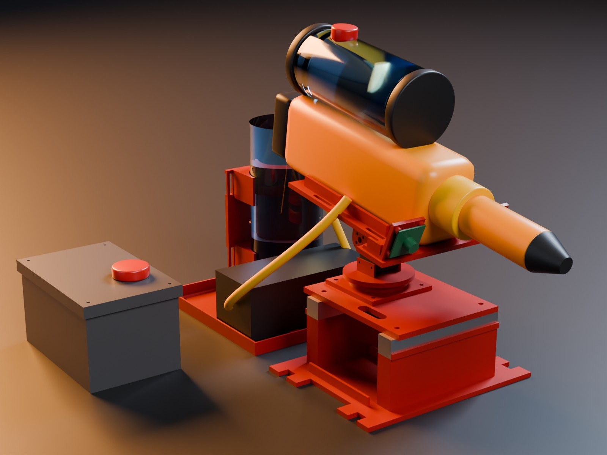
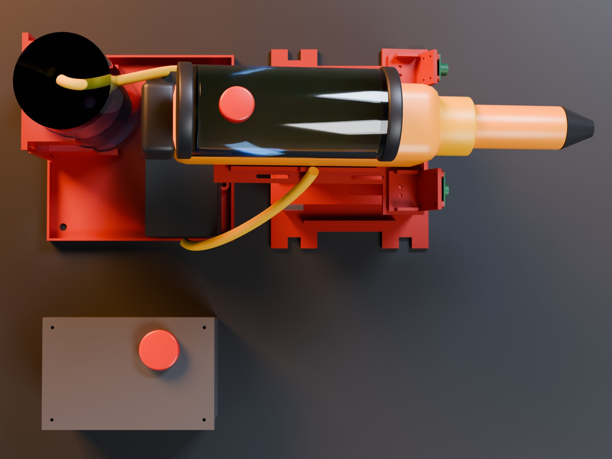

# Bench rig for the pan-tilt module

This folder holds a table-top test rig. It carries the STS3215 pan-tilt module, the cameras, the water system and the electronics.
With it, the team can test detection, aiming and spraying before the robot walks.

Status: all parts are planned. The CAD is done. No part is printed, and nothing is measured on the rig.





## Files

| File | What it does |
|---|---|
| `bench.py` | Builds the bench parts (build123d), exports STEP and STL to `out/`, runs the checks. Parameters are at the top. |
| `render.py` | Blender script for the two renders. It uses `cad/bhl.py` and `cad/parts/render_module.py`. |
| `out/*.step`, `out/*.stl` | One STEP and one STL per printed part. |
| `out/ref/*.stl` | Simple shapes of the rails, the bottle and the pump, for the checks and renders. |
| `out/bench.json` | Masses, clearances and the stability result. |
| `renders/` | `bench_front.jpg` (front 3/4) and `bench_top.jpg` (top view). |

`bench.py` imports from other folders instead of copying:

- `cad/parts/top_module_sts3215.py`: the STS3215 module (deck, pan base, yoke, tilt U, payload plate, camera brackets).
- `cad/parts/top_module.py`: helpers, the mass estimate and the wall scan.
- `cad/backpack/body.py`: the bottle cradle (unchanged), and the bottle and pump sizes.

I changed one file outside this folder: `cad/parts/render_module.py`.
Its main loop now runs only when Blender runs the file directly, so `render.py` can import it. Its output does not change.

## How to run

Run all commands from the repository root. It uses the CAD environment: run `uv sync --project cad` once.

1. Build the parts and run the checks (about 15 s):

```
uv run --project cad python cad/bench/bench.py
```

2. Make the renders (about 1 min on the RTX 3090):

```
blender -b --factory-startup -P cad/bench/render.py -- third_party/berkeley-humanoid-lite-assets/data/robots/berkeley_humanoid/berkeley_humanoid_lite cad/bench/renders
```

The module STLs must exist first. Run `uv run --project cad python cad/parts/top_module_sts3215.py` once.

## Frame

The bench frame is the module frame of `cad/parts`: x forward, y left, z up, in mm.
The origin is on the top face of the two rails, at their centre. The table top is at z = -80 mm.
So the module STLs from `cad/parts/out_sts3215/` sit on the bench without a transform.

## Layout

1. **Base** (`base_clamp` or `base_tripod`): a printed plate with two hollow saddles. Two 2020 rails lie on the saddles along y, at x = -60 and x = +60 mm. This is the spacing of the torso-top rails, so the same deck plate bolts on unchanged.
2. **Module**: the STS3215 module from `cad/parts`, with the deck on the rails. The pan servo hangs between the rails, 1.9 mm from the rear rail.
3. **Tray**: a free-standing tray, 40 mm behind the base. It carries the Seaflo pump (lying on its feet) and the 1 L bottle in the backpack cradle. A 12 mm rim keeps leaks in the tray. A drain hole sits in one corner.
4. **Electronics box** (`ebox` and `ebox_lid`): a free-standing box beside the tray. It holds the Pico 2, the relay module and the 12 V converter. The lid carries the e-stop.

Rail cut length: **2 x 140 mm** of 2020 profile. The deck screws use the top slot at y = +-55 mm. The base screws use the bottom slot at y = +-48 mm.

The table rail top is 80 mm above the table (`H_BASE`). This height keeps the gun stand-in above the pump when the gun points 30 degrees up.

**Table clamp version** (`base_clamp`): four tabs with a 14 mm open slot. Put a C-clamp or a bar clamp on each front tab, or on all four.
**Tripod version** (`base_tripod`): a 1/4"-20 hex nut sits in a pocket inside the base, at x = -30, y = +32 mm.
The nut is beside the hanging pan servo. On a tripod, the tray and the box stand on the ground.

## Checks

`bench.py` stops with an error when a check fails. The last run passed all of them.

| Check | Result |
|---|---|
| Every part fits a 220 x 220 x 250 mm bed | yes. Largest: base_clamp, 170 x 216 x 66 mm |
| Thinnest wall (ray scan of each STL) | 2.0 mm or more on the bench parts. The backpack cradle has knife-edge tips (see below). |
| Base against the deck, the pan base and the pan servo | no overlap |
| Gun stand-in at 30 degrees nose-up against the pump | lowest gun point z = 5.5 mm, pump top z = -7 mm |
| Bottle against the gun sweep (any pan angle) | gun sweep radius 175.6 mm, bottle edge at 189.4 mm from the pan axis |
| Electronics box against the gun sweep | outside |
| Tipping margin, gun panned 90 degrees | **58.8 mm** |
| Tipping margin, worst pan angle (0 degrees) | **50.3 mm** |

**Stability.** The check takes the base, the two rails and the STS3215 module with the gun stand-in (0.9 kg, a guess).
The total is 1.89 kg. It turns the module part that pans (1.19 kg) in 5 degree steps from -180 to +180 degrees.
The tipping margin is the distance from the centre of mass to the nearest edge of the base footprint.
The full bottle and the pump are on the separate tray, so they do not load the base.
The jet pushes back with about 0.6 N (2.5 L/min at 13.6 m/s, from `docs/hardware/README.md`). At 0.1 m height, this is 0.06 Nm. It does not change the result.
A clamp makes the base safe in any case. Use a clamp outdoors.

**Gun sweep.** The gun stand-in of `cad/concepts.py` ends 145 mm behind its body centre. Its body centre is 22 mm behind the tilt axis.
So the gun sweeps a circle of 175.6 mm radius around the pan axis, with 5 mm margin.
A real water gun is shorter. Check the real gun before you move the tray closer.

**Cradle walls.** The ray scan finds knife-edge tips of 0.2 to 1.1 mm on the backpack cradle, where its cup wall ends.
The tips come from `cad/backpack/body.py`. I did not change that file. The check skips the cradle for this reason.

## Parts, volume and mass

Mass estimate as in `cad/parts`: PLA 1.24 g/cm3, 1.2 mm shell, 40 % gyroid infill.

| Part | Qty | Volume (cm3) | Mass est. (g) | Size (mm) |
|---|---|---|---|---|
| base_clamp (or base_tripod) | 1 | 324.0 (316.8) | 316 (308) | 170 x 216 x 66 (170 x 180 x 66) |
| tray | 1 | 199.6 | 210 | 200 x 200 x 128 |
| cradle (from cad/backpack) | 1 | 202.1 | 162 | 72 x 113 x 150 |
| ebox | 1 | 188.2 | 220 | 165 x 105 x 93 |
| ebox_lid | 1 | 70.5 | 80 | 172 x 112 x 13 |
| **Total bench parts** | | | **988** | |
| STS3215 module (from cad/parts) | 1 | | 312 | see `cad/parts/README.md` |

## Sources of external dimensions

| Part | Values used (mm) | Source |
|---|---|---|
| 2020 rail spacing and slot | rails at x = +-60, 6 mm slot | measured on the BHL mesh, `cad/parts/README.md` |
| 2020 profile mass | 0.5 kg/m | **guess**, a typical catalogue value |
| Raspberry Pi Pico 2 | 51 x 21 board, 4 holes d 2.1, 11.4 across, about 47 along | https://pip.raspberrypi.com/documents/RP-008299-DS-pico-2-datasheet.pdf (47 read from the drawing scale) |
| 2-channel relay module | 50 x 38 board, holes d 3, about 44 x 32.5 | https://botland.store/relays/2170-relay-2-channel-module-with-optoisolation--5904422359126.html (spacing from a search summary, **not verified**) |
| DC-DC converter HAM5017 (ICbanq P017177777) | 74 x 74 x 32 free area | **guess**. ICbanq gives no size. Similar 120 W converters are 74 x 74 x 29.5 and 74 x 74 x 32: https://www.dfrobot.com/product-584.html |
| 22 mm e-stop | panel hole 22.3 | Koino KSEP2240-22S: https://www.digikey.gr/en/products/detail/koino/KSEP2240-22S/19199917. Depth behind the panel: **estimate** 46 to 70 mm (IDEC XW 46.4 mm: https://nz.rs-online.com/web/p/emergency-stop-push-buttons/2688447) |
| PG7 cable gland | panel hole 12.5, cable 3 to 6.5 | https://www.digikey.com/en/products/detail/alpha-wire/PPS7-BK080/8552693 |
| 1/4"-20 hex nut | 11.11 across flats, 5.56 thick | https://www.kent-automotive.com/products/hex-nut-grade-2-steel-1-4-20-100 |
| 1/4"-20 heat-set insert (option) | hole d 8.0, insert 12.7 long | https://www.3djake.ch/en-CH/ruthex/threaded-inserts-1-4-20-pieces |
| Inline ATC fuse holder | about 29 x 23 x 13 | **estimate**, Bussmann HHC: https://www.mouser.com/datasheet/2/87/bus_ele_ds_2107_hhc_hhd-2489007.pdf |
| Nalgene 1 L bottle, Seaflo 21 pump | bottle d 89, h 210; pump 169 x 73.5 x 62, feet 79 x 55 | `cad/backpack/README.md` |

The parts inside the box are a layout proposal. The DC-DC converter has no bosses. Fix it with foam tape or a strap until you know its tabs.

## Hardware list

| Item | Qty | In bom_extinction.csv |
|---|---|---|
| 2020 aluminium profile, 6 mm slot, cut to 140 mm | 2 | **no** |
| M5 drop-in T-nut for 2020 | 8 | yes (lot of 100) |
| M5 x 10 button head screw | 4 | **no** (deck to rails, as on the robot) |
| M5 x 25 socket head screw | 4 | **no** (base to rails, from below) |
| STS3215 module hardware | 1 set | see `cad/parts/README.md` |
| M4 brass heat-set insert | 4 | yes |
| M4 x 12 screw + washer | 4 | **no** (pump feet) |
| M4 x 16 countersunk screw + M4 nut | 4 | **no** (cradle to the tray post) |
| 25 mm hook-and-loop strap | 2 | **no** (bottle in the cradle) |
| PG7 cable gland | 4 | **no** |
| M3 x 10 self-tapping screw | 8 | **no** (lid and relay module) |
| M2 x 6 self-tapping screw | 4 | **no** (Pico 2) |
| 1/4"-20 hex nut (tripod version only) | 1 | **no** |
| C-clamp or bar clamp, 50 mm or more | 2 | **no** |
| 24 V bench power: a 24 V 5 A supply or the 6S robot battery | 1 | **no**. The converter needs 20 to 96 V. |
| Plug for the drain hole (8 mm) | 1 | **no** |

I did not check shop links for the new items. Buy them locally.

## Print plan

| Job | Parts | Orientation | Supports | Filament (g) |
|---|---|---|---|---|
| B1 | base_clamp (or base_tripod) | as exported, plate on the bed | no | 316 |
| B2 | tray | as exported, floor on the bed | no | 210 |
| B3 | cradle | backing on the bed, as in `cad/backpack/README.md` | no. The strap channels are 27 mm bridges. | 162 |
| B4 | ebox | floor on the bed | no | 220 |
| B5 | ebox_lid | upside down, lid top on the bed | no | 80 |

The saddle tops bridge 14 mm over the hollow inside. This needs no support.

## Assembly

1. Press four M4 inserts into the pump bosses of the tray with a soldering iron.
2. Put two M5 T-nuts into the bottom slot of each rail, at y = -48 and y = +48 mm.
3. Put each rail on its saddle, with the outer lip against the rail.
4. Screw the rails to the base from below with four M5 x 25 screws. The heads sit in deep holes in the saddles.
5. Put two M5 T-nuts into the top slot of each rail, at y = -55 and y = +55 mm.
6. Assemble the STS3215 module as in `cad/parts/README.md`.
7. Bolt the deck to the rails with four M5 x 10 screws.
8. Bolt the cradle to the tray post with four M4 countersunk screws and nuts.
9. Bolt the pump to the tray bosses with four M4 x 12 screws.
10. Put the bottle in the cradle and close the two straps.
11. Mount the Pico 2, the relay module and the converter in the box. Put the cables through the glands.
12. Mount the e-stop in the lid. Screw the lid to the box with four M3 screws.
13. Clamp the base to the table. Put the tray behind it and the box beside the tray.

## Bench test plan

Do the steps in this order. Steps (a) to (d) use water only. Write each result in the team log.

**(a) Servo calibration**

1. Connect the two STS3215 servos to the bus servo adapter. Give each servo its own ID.
2. Command pan 0 and tilt 0.
3. Check that the gun points straight ahead and level. Use a spirit level on the payload plate.
4. If it does not, change the servo zero offsets in the servo driver.
5. Command pan -90, 0, +90 and tilt -30, 0, +30. Measure each angle with a protractor.
6. Write the error for each angle. An error above 2 degrees needs a correction table.

**(b) Jet speed v0** (method from `aim/README.md`)

1. Set tilt 0. Measure the nozzle height h above the ground.
2. Run the pump and mark where the jet lands. Measure that distance x.
3. Compute v0 = x * sqrt(9.81 / (2 h)).
4. Repeat 3 times and use the mean. Put the value in `ControllerConfig.v0`.
5. Shoot at 30 degrees up. Compare the landing distance with `sim_demo.landing_point()`, and adjust `ControllerConfig.drag`.

**(c) Bore-sight the camera and the nozzle** (method from `aim/README.md`)

1. Calibrate the camera with a checkerboard (OpenCV `calibrateCamera`).
2. Put a wall 1 m in front of the nozzle. Mark the jet spot at pan 0, tilt 0.
3. Put a small target at a known position about 2 m away.
4. Correct the camera yaw and pitch until the predicted and the seen pixel agree within 2 pixels.

**(d) Aim accuracy on paper targets**

1. Put paper targets on the ground at 1, 2 and 3 m, straight ahead and 30 degrees to each side.
2. Let the controller aim and spray a short burst at each target.
3. Measure the miss distance from the target centre to the wet spot centre.
4. Repeat 3 times for each target. Report the mean and the largest miss.

**(e) Detection and spray on a small fire, outdoors only**

1. Do this step outdoors, on a non-flammable surface, with no wind or light wind.
2. Use a small, contained fire: a metal tray with a little paper or a tea light.
3. Keep the ABC powder extinguisher ready in the hand of a second person.
4. Start at 2 m. Let the system detect the fire and spray it.
5. Record the time from the first detection to the fire going out.
6. Repeat at 1 m and 3 m only when the first test is safe.

## Safety notes

- Never test with fire indoors.
- Always have a second person with the extinguisher. Know how to use it before you start.
- Keep the fire small. Use a metal tray. Keep a bucket of water nearby.
- Wear safety glasses. The jet can hit the eyes.
- Keep water away from the electronics box and the 24 V supply. Put the box behind the rig, not in the jet path.
- Push the e-stop before you touch the gun, the nozzle or the wiring.
- Clamp the base to the table before the first pump test.
- Keep people out of the jet path and out of the gun sweep (0.2 m around the pan axis).

## Open questions

- Q1: What size is the HAM5017 converter? Measure it when it arrives, then add bosses.
- Q2: How deep is the KSEP2260-22 e-stop behind the panel? The box allows about 60 mm above the relay module.
- Q3: Does the real water gun fit between the plate walls, and where is its centre of mass?
- Q4: The cradle from `cad/backpack` has knife-edge tips. Should the backpack owner round them?
- Q5: Where does the jet test take place? Step (e) needs an outdoor place where a small fire is allowed.
