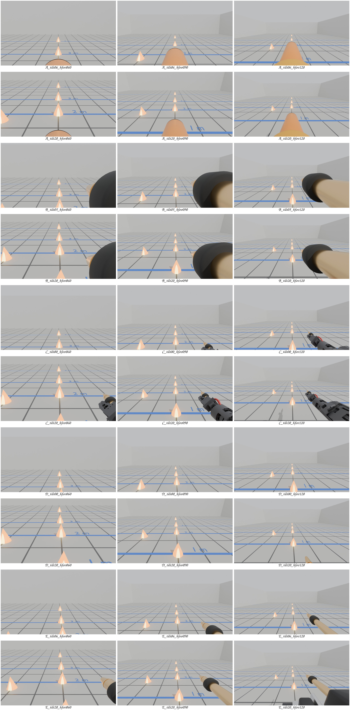
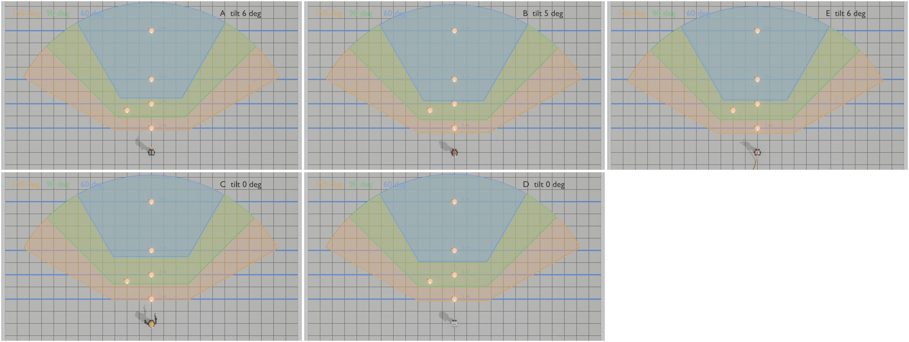
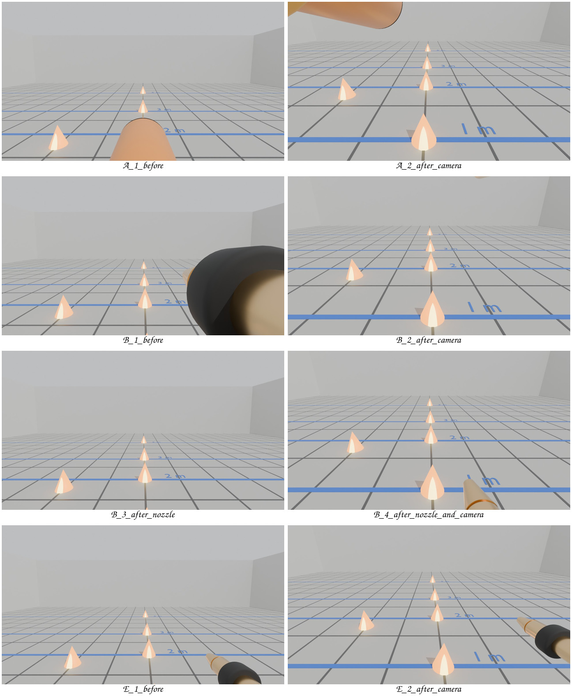

# Camera views and field of view for the firefighter robot

This folder helps Marc choose the fire-detection cameras, lenses and mounting angles.
It does not choose a camera for him. It does not do fire detection.

**Not measured:** No number here comes from a real camera. All numbers come from the CAD model (`cad/concepts.py`) and from datasheets.

**Not verified:** The InfiRay P2 Pro FOV (56.0 x 42.2 deg) is unverified, because its official pages return an error. The tables use the TOPDON TC001 values instead.

## Status

- Built: `views.py`, the camera views, the overview images, the contact sheet and the tables.
- Built: `mounts.py` (round 2), the camera pose search for A, B and E, the nozzle study for B and the before/after views.
- Tested in simulation: the camera pose search and the nozzle study (ray casts in Blender).
- Tested in simulation: the blind-zone formula. A Blender ray cast matches it within 2 cm in 23 cases. The script stops with an error if they differ.
- Measured on laptop, measured on board: nothing.

## Terms

- FOV (field of view): the angle that a camera sees. HFOV is the horizontal angle. VFOV is the vertical angle.
- Tilt: the camera angle below the horizontal, in degrees.
- Blind zone: the floor in front of the robot that the camera cannot see. "Near floor" in the tables is the far end of the blind zone.
- Far floor: the farthest floor point in the image. "horizon" means that the top of the image is above the horizon.
- Frustum: the pyramid of space that a camera sees.
- Ray cast: Blender sends a straight line from the lens and reports the first surface that the line hits.
- Pinhole model: an ideal lens with no distortion. Real wide lenses (above about 100 deg) bend straight lines.
- Robot origin: the floor point between the feet. All distances start there. The toes are at x = 0.14 m.

## How to run

Run these commands from the repository root.

1. To make the tables only (about 10 s), run:

   ```
   blender -b --factory-startup -P cad/camera_views/views.py -- A B E C D
   ```

2. To make the tables and all images (about 2 min on the RTX 3090 PC), run:

   ```
   blender -b --factory-startup -P cad/camera_views/views.py -- render A B E C D
   ```

Without concept letters, the script uses A, B and E.
The script writes everything to `out/`. It does not change `cad/bhl.py` or `cad/concepts.py`.

## Scene

- The robot stands in the default standing pose of `concepts.py`.
- The room has a light grey floor, a back wall at 8 m, side walls at 6 m, a grey sky and one sun.
- A dark grid marks every 0.5 m. Blue lines and labels mark 1, 2, 3 and 5 m.
- Each fire is an orange glowing cone, 20 cm wide and 25 cm tall.
- Fires stand at 1, 2, 3 and 5 m straight ahead. One more fire stands at 2 m, 30 deg to the left.

## Camera positions

The camera is the front of the RGB lens in `concepts.py`. The thermal lens is 3.5 to 5.5 cm beside it on B, C, D and E.
The tables use the RGB lens position for every sensor.

| Concept | Mount | Lens position x, y, z (m), default tilt | Default tilt | Alternative tilt |
|---|---|---|---|---|
| A | on the water gun, tilts with the gun (pivot z = 0.886) | 0.145, 0, 0.927 | 6 deg | 20 deg |
| B | head on a pan servo (pivot z = 0.866) | 0.060, 0.028, 0.873 | 5 deg | 20 deg |
| C | helmet visor, fixed | 0.081, 0.025, 0.863 | 0 deg | 20 deg |
| D | visor in the shell front, fixed | 0.120, 0.055, 0.785 | 0 deg | 20 deg |
| E | pod on a mast (pivot 0.966 m) | -0.015, 0.088, 0.962 | 6 deg | 20 deg |

For A, B and E, the alternative tilt turns the gun, head or pod around its pivot. For C and D, it turns the camera around the lens.

## Images

- `out/views/<concept>_tilt<deg>_hfov<deg>.jpg`: what the RGB camera sees at 1280x720 with a pinhole lens.
  There is one image for each concept (A, B, C, D, E), each tilt and each HFOV (60, 90, 120 deg).
- `out/contact_sheet.jpg`: all 30 views on one sheet. Each row is one concept and tilt. The columns are 60, 90 and 120 deg.
- `out/overview.jpg`: a top view of the floor that each camera sees at its default tilt. The top row is A, B, E. The bottom row is C, D.
  Blue is 60 deg, green is 90 deg and orange is 120 deg HFOV. The coloured area stops 6 m from the lens.
- The overview shows only the lens geometry. It does not show robot parts that block the view. Table 1 and the camera views show them.
- The 120 deg views use a pinhole lens. A real 120 deg lens shows strong barrel distortion, so its image edges look different.





## Tables

The script writes the same tables to `out/tables.md`.

### Table 1. Floor in view, RGB camera at 1280x720 (rendered set)

Distances are along the image centre column, in metres from the robot origin (the floor point between the feet).
Toes: A 0.14 m, B 0.14 m, E 0.14 m, C 0.14 m, D 0.14 m.

| Concept | Tilt down | Lens height (m) | HFOV x VFOV | Near floor, analytic | Near floor, ray cast | Far floor | Robot in image |
|---|---|---|---|---|---|---|---|
| A | 6 deg | 0.93 | 60 x 36 deg | 2.23 | 2.64 (robot in the way) | horizon | 2% |
| A | 6 deg | 0.93 | 90 x 59 deg | 1.45 | 2.66 (robot in the way) | horizon | 4% |
| A | 6 deg | 0.93 | 120 x 89 deg | 0.92 | 2.66 (robot in the way) | horizon | 6% |
| A | 20 deg | 0.89 | 60 x 36 deg | 1.29 | 1.45 (robot in the way) | 25.55 | 2% |
| A | 20 deg | 0.89 | 90 x 59 deg | 0.92 | 1.46 (robot in the way) | horizon | 4% |
| A | 20 deg | 0.89 | 120 x 89 deg | 0.58 | 1.46 (robot in the way) | horizon | 6% |
| B | 5 deg | 0.87 | 60 x 36 deg | 2.12 | 2.12 | horizon | 11% |
| B | 5 deg | 0.87 | 90 x 59 deg | 1.34 | 1.34 | horizon | 18% |
| B | 5 deg | 0.87 | 120 x 89 deg | 0.81 | 0.81 | horizon | 17% |
| B | 20 deg | 0.86 | 60 x 36 deg | 1.16 | 1.16 | 24.50 | 11% |
| B | 20 deg | 0.86 | 90 x 59 deg | 0.80 | 0.80 | horizon | 18% |
| B | 20 deg | 0.86 | 120 x 89 deg | 0.47 | 0.47 | horizon | 17% |
| E | 6 deg | 0.96 | 60 x 36 deg | 2.15 | 2.15 | horizon | 0% |
| E | 6 deg | 0.96 | 90 x 59 deg | 1.34 | 1.34 | horizon | 2% |
| E | 6 deg | 0.96 | 120 x 89 deg | 0.79 | 0.79 | horizon | 3% |
| E | 20 deg | 0.95 | 60 x 36 deg | 1.20 | 1.20 | 27.19 | 3% |
| E | 20 deg | 0.95 | 90 x 59 deg | 0.80 | 0.80 | horizon | 6% |
| E | 20 deg | 0.95 | 120 x 89 deg | 0.44 | 0.49 (robot in the way) | horizon | 11% |
| C | 0 deg | 0.86 | 60 x 36 deg | 2.74 | 2.74 | horizon | 0% |
| C | 0 deg | 0.86 | 90 x 59 deg | 1.62 | 1.62 | horizon | 1% |
| C | 0 deg | 0.86 | 120 x 89 deg | 0.97 | 0.97 | horizon | 4% |
| C | 20 deg | 0.86 | 60 x 36 deg | 1.19 | 1.19 | 24.69 | 4% |
| C | 20 deg | 0.86 | 90 x 59 deg | 0.82 | 0.82 | horizon | 7% |
| C | 20 deg | 0.86 | 120 x 89 deg | 0.50 | 0.50 | horizon | 9% |
| D | 0 deg | 0.79 | 60 x 36 deg | 2.54 | 2.54 | horizon | 0% |
| D | 0 deg | 0.79 | 90 x 59 deg | 1.52 | 1.52 | horizon | 0% |
| D | 0 deg | 0.79 | 120 x 89 deg | 0.93 | 0.93 | horizon | 0% |
| D | 20 deg | 0.79 | 60 x 36 deg | 1.13 | 1.13 | 22.51 | 0% |
| D | 20 deg | 0.79 | 90 x 59 deg | 0.79 | 0.79 | horizon | 0% |
| D | 20 deg | 0.79 | 120 x 89 deg | 0.50 | 0.50 | horizon | 0% |

### Table 2. Blind zone and far floor for every sensor (analytic, no robot parts)

Cell: near floor / far floor, metres from the robot origin. Same lens position as the RGB camera.

| Sensor | HFOV x VFOV | A 6 deg | A 20 deg | B 5 deg | B 20 deg | C 0 deg | C 20 deg | D 0 deg | D 20 deg | E 6 deg | E 20 deg |
|---|---|---|---|---|---|---|---|---|---|---|---|
| MLX90640 BAB (narrow) | 55 x 35 deg | 2.28 / horizon | 1.31 / 20.55 | 2.17 / horizon | 1.18 / 19.69 | 2.82 / horizon | 1.21 / 19.85 | 2.61 / horizon | 1.14 / 18.10 | 2.20 / horizon | 1.23 / 21.83 |
| MLX90640 BAA (wide) | 110 x 75 deg | 1.12 / horizon | 0.72 / horizon | 1.01 / horizon | 0.61 / horizon | 1.21 / horizon | 0.63 / horizon | 1.14 / horizon | 0.62 / horizon | 1.00 / horizon | 0.59 / horizon |
| FLIR Lepton 2.5 | 50 x 39 deg | 2.11 / horizon | 1.24 / > 30 | 2.00 / horizon | 1.11 / > 30 | 2.55 / horizon | 1.14 / > 30 | 2.36 / horizon | 1.08 / > 30 | 2.02 / horizon | 1.15 / > 30 |
| FLIR Lepton 3.5 | 57 x 44 deg | 1.88 / horizon | 1.13 / horizon | 1.76 / horizon | 1.01 / horizon | 2.20 / horizon | 1.03 / horizon | 2.05 / horizon | 0.99 / horizon | 1.78 / horizon | 1.04 / horizon |
| FLIR Lepton 3.1R (wide) | 95 x 79 deg | 1.06 / horizon | 0.68 / horizon | 0.95 / horizon | 0.57 / horizon | 1.14 / horizon | 0.59 / horizon | 1.08 / horizon | 0.59 / horizon | 0.94 / horizon | 0.55 / horizon |
| 256x192 USB (TOPDON TC001) | 56 x 42 deg | 1.96 / horizon | 1.18 / horizon | 1.85 / horizon | 1.05 / horizon | 2.33 / horizon | 1.07 / horizon | 2.16 / horizon | 1.02 / horizon | 1.87 / horizon | 1.08 / horizon |
| RGB 640x480 | 60 x 47 deg | 1.79 / horizon | 1.09 / horizon | 1.67 / horizon | 0.97 / horizon | 2.07 / horizon | 0.99 / horizon | 1.93 / horizon | 0.95 / horizon | 1.69 / horizon | 0.99 / horizon |
| RGB 640x480 | 90 x 74 deg | 1.14 / horizon | 0.73 / horizon | 1.03 / horizon | 0.62 / horizon | 1.23 / horizon | 0.64 / horizon | 1.17 / horizon | 0.63 / horizon | 1.02 / horizon | 0.61 / horizon |
| RGB 640x480 | 120 x 105 deg | 0.72 / horizon | 0.43 / horizon | 0.62 / horizon | 0.33 / horizon | 0.75 / horizon | 0.35 / horizon | 0.72 / horizon | 0.37 / horizon | 0.58 / horizon | 0.29 / horizon |
| RGB 1280x720 | 60 x 36 deg | 2.23 / horizon | 1.29 / 25.55 | 2.12 / horizon | 1.16 / 24.50 | 2.74 / horizon | 1.19 / 24.69 | 2.54 / horizon | 1.13 / 22.51 | 2.15 / horizon | 1.20 / 27.19 |
| RGB 1280x720 | 90 x 59 deg | 1.45 / horizon | 0.92 / horizon | 1.34 / horizon | 0.80 / horizon | 1.62 / horizon | 0.82 / horizon | 1.52 / horizon | 0.79 / horizon | 1.34 / horizon | 0.80 / horizon |
| RGB 1280x720 | 120 x 89 deg | 0.92 / horizon | 0.58 / horizon | 0.81 / horizon | 0.47 / horizon | 0.97 / horizon | 0.50 / horizon | 0.93 / horizon | 0.50 / horizon | 0.79 / horizon | 0.44 / horizon |

### Table 3. Size of a 20 cm wide, 25 cm tall fire in pixels (width x height)

Pinhole model, fire at the image centre. **Bold** = fewer than 3 pixels in width or height.

| Sensor | Pixels | HFOV x VFOV | Source | 1 m | 2 m | 3 m | 5 m | 8 m |
|---|---|---|---|---|---|---|---|---|
| MLX90640 BAB (narrow) | 32x24 | 55 x 35 deg | [1] | 6.1 x 9.5 | 3.1 x 4.8 | **2.0 x 3.2** | **1.2 x 1.9** | **0.8 x 1.2** |
| MLX90640 BAA (wide) | 32x24 | 110 x 75 deg | [1] | **2.2 x 3.9** | **1.1 x 2.0** | **0.7 x 1.3** | **0.4 x 0.8** | **0.3 x 0.5** |
| FLIR Lepton 2.5 | 80x60 | 50 x 39 deg | [2] (VFOV computed) | 17.2 x 21.4 | 8.6 x 10.7 | 5.7 x 7.1 | 3.4 x 4.3 | **2.1 x 2.7** |
| FLIR Lepton 3.5 | 160x120 | 57 x 44 deg | [2] (VFOV computed) | 29.5 x 36.8 | 14.7 x 18.4 | 9.8 x 12.3 | 5.9 x 7.4 | 3.7 x 4.6 |
| FLIR Lepton 3.1R (wide) | 160x120 | 95 x 79 deg | [2] (VFOV computed) | 14.7 x 18.3 | 7.3 x 9.2 | 4.9 x 6.1 | **2.9 x 3.7** | **1.8 x 2.3** |
| 256x192 USB (TOPDON TC001) | 256x192 | 56 x 42 deg | [3] | 48.1 x 62.5 | 24.1 x 31.3 | 16.0 x 20.8 | 9.6 x 12.5 | 6.0 x 7.8 |
| RGB 640x480 | 640x480 | 60 x 47 deg |  (VFOV computed) | 110.9 x 138.6 | 55.4 x 69.3 | 37.0 x 46.2 | 22.2 x 27.7 | 13.9 x 17.3 |
| RGB 640x480 | 640x480 | 90 x 74 deg |  (VFOV computed) | 64.0 x 80.0 | 32.0 x 40.0 | 21.3 x 26.7 | 12.8 x 16.0 | 8.0 x 10.0 |
| RGB 640x480 | 640x480 | 120 x 105 deg |  (VFOV computed) | 37.0 x 46.2 | 18.5 x 23.1 | 12.3 x 15.4 | 7.4 x 9.2 | 4.6 x 5.8 |
| RGB 1280x720 | 1280x720 | 60 x 36 deg |  (VFOV computed) | 221.7 x 277.1 | 110.9 x 138.6 | 73.9 x 92.4 | 44.3 x 55.4 | 27.7 x 34.6 |
| RGB 1280x720 | 1280x720 | 90 x 59 deg |  (VFOV computed) | 128.0 x 160.0 | 64.0 x 80.0 | 42.7 x 53.3 | 25.6 x 32.0 | 16.0 x 20.0 |
| RGB 1280x720 | 1280x720 | 120 x 89 deg |  (VFOV computed) | 73.9 x 92.4 | 37.0 x 46.2 | 24.6 x 30.8 | 14.8 x 18.5 | 9.2 x 11.5 |

Self-check: 23 ray casts matched the analytic blind zone within 2 cm, e.g. B 5 deg 60 deg: 2.117 vs 2.117 m, B 5 deg 90 deg: 1.337 vs 1.337 m, B 5 deg 120 deg: 0.812 vs 0.812 m.

Notes on the tables:

- The 3 x 3 pixel limit is a rule of thumb, which means a rough guide from practice. It is not a measured limit for Marc's detector.
- Table 3 uses the pinhole model at the image centre. A real wide lens with barrel distortion gives more pixels at the centre and fewer at the edges.
- A pixel count says nothing about heat contrast. A hot fire that fills part of one thermal pixel can still raise that pixel's value. Marc can test this.
- "Robot in image" uses a 48 x 48 grid of rays. Very small parts, under about 0.5 % of the image, can show 0 %.
- "(robot in the way)" means that a robot part blocks the lowest rays in the centre column. The ray-cast number is then the first floor point that the camera really sees.

## Findings for Marc

1. On concept A at 6 deg down, the gun barrel and its yellow shroud hide the image centre. The camera sees no floor closer than 2.64 m in the centre column. The 1 m and 2 m fires are hidden. At 20 deg down, the hidden part ends at 1.46 m.
2. The tilt changes the blind zone more than the mount position does. The lens heights are 0.79 to 0.96 m. With a 60 deg RGB camera (16:9) at the default tilt, the near floor is 2.1 to 2.7 m away. At 20 deg down, it is 1.1 to 1.3 m away.
3. Robot parts enter the wide views. On B, the nozzle under the cameras covers 11 to 18 % of the RGB image. On E, the nozzle and its pan-tilt cover up to 11 % at 120 deg and 20 deg down. On C, the hand and the lance enter at 90 and 120 deg. D has a clear view.
4. On a 20 cm fire, the MLX90640 wide version (110 x 75 deg) gives fewer than 3 x 3 pixels already at 1 m. The narrow version (55 x 35 deg) drops below 3 pixels at 3 m. The Lepton 2.5 drops below at 8 m and the Lepton 3.1R at 5 m. The Lepton 3.5 and the 256x192 camera stay above 3 x 3 pixels up to 8 m.
5. A narrow thermal lens also makes a longer blind zone. On B at 5 deg down, the MLX90640 narrow version sees no floor closer than 2.17 m. The 256x192 camera sees floor from 1.85 m. Note: Teledyne lists the Lepton 2.5 as discontinued, with sales ending on 1 September 2027 [2].

## Round 2: camera pose search for A, B and E

`mounts.py` searches for a better lens place and camera tilt on A, B and E. It uses the same ray casts as `views.py`.

**Assumed:** The gun (A), head (B) and pod (E) stay at their default tilt. The camera gets its own pitch on that part.

Goal for each camera:

- No robot part is in the central 60 % of the image (60 % of the width and 60 % of the height).
- The floor is in view from about 0.8 m to at least 5 m from the robot origin. The search accepts a near floor of 0.85 m or less.

Search:

- Lens moves in the gun, head or pod frame: forward 0, 4 or 8 cm, and sideways and up or down from -8 to +8 cm in 4 cm steps. The total move is 9 cm or less.
- Camera tilt: 10 to 40 deg below horizontal, in 2 deg steps.
- The search keeps the image centre free and the far floor at 5 m or more. Then it brings the near floor as close as the goal allows.
- Then it picks the smallest lens move and the smallest tilt change. For this choice, it rounds the near floor up to 5 cm.
- For B, it also tests 12 nozzle places on the head. It measures the RGB image and the thermal image for each place.
- Each reported pose with a clear lowest centre ray passes the same 2 cm ray-cast check as `views.py`.

To run the search and the renders (about 1.5 min), run this command from the repository root:

```
blender -b --factory-startup -P cad/camera_views/mounts.py -- render
```

Without `render`, the script writes only `out/mounts.md` (about 10 s).

Images, all at 90 deg HFOV:

- `out/round2/<concept>_<n>_<label>.jpg`: the camera views before and after.
- `out/round2_contact_sheet.jpg`: all eight views. Each row has "before" on the left and "after" on the right.
- The rows are: A camera, B camera, B nozzle (left: nozzle moved, current camera; right: nozzle moved and camera tilted), E camera.
- In the "after" images, only the camera moves. The old camera model stays behind the new lens. On B, the hose end does not follow the moved nozzle.



### Table 4. Camera pose per concept, current and recommended

Goal: no robot part in the central 60 % of the image, floor seen from 0.85 m or closer (about 0.8 m) to at least 5 m, from the robot origin.
Lens = front of the RGB lens. Part frame = the gun (A), head (B) or pod (E) frame at its default tilt, x forward, z up.
Tilt = camera angle below horizontal. The gun, head or pod keeps its default tilt, so the camera needs its own pitch on it.

| Concept | Pose | HFOV | Lens, part frame (m) | Move (m) | Lens, robot frame (m) | Tilt | Pitch on part | Robot in centre 60 % | Robot in image | Near floor (m) | Far floor (m) | Goal met |
|---|---|---|---|---|---|---|---|---|---|---|---|---|
| A | current | 90 deg | (+0.140, +0.000, +0.056) | (+0.000, +0.000, +0.000) | (+0.145, +0.000, +0.927) | 6 deg | +0 deg | 2% | 4% | 2.66 | horizon | no |
| A | recommended | 90 deg | (+0.140, -0.040, -0.024) | (+0.000, -0.040, -0.080) | (+0.137, -0.040, +0.847) | 22 deg | +16 deg | 0% | 5% | 0.81 | horizon | yes |
| A | current | 60 deg | (+0.140, +0.000, +0.056) | (+0.000, +0.000, +0.000) | (+0.145, +0.000, +0.927) | 6 deg | +0 deg | 0% | 2% | 2.64 | horizon | no |
| A | recommended | 60 deg | (+0.140, -0.080, +0.016) | (+0.000, -0.080, -0.040) | (+0.141, -0.080, +0.887) | 28 deg | +22 deg | 0% | 1% | 1.00 | 5.17 | no |
| B | current | 90 deg | (+0.059, +0.028, +0.012) | (+0.000, +0.000, +0.000) | (+0.060, +0.028, +0.873) | 5 deg | +0 deg | 12% | 18% | 1.34 | horizon | no |
| B | recommended | 90 deg | (+0.059, +0.028, -0.028) | (+0.000, +0.000, -0.040) | (+0.056, +0.028, +0.833) | 18 deg | +13 deg | 0% | 0% | 0.82 | horizon | yes |
| B | current | 60 deg | (+0.059, +0.028, +0.012) | (+0.000, +0.000, +0.000) | (+0.060, +0.028, +0.873) | 5 deg | +0 deg | 2% | 11% | 2.12 | horizon | no |
| B | recommended | 60 deg | (+0.059, +0.028, -0.028) | (+0.000, +0.000, -0.040) | (+0.056, +0.028, +0.833) | 26 deg | +21 deg | 0% | 0% | 0.92 | 5.98 | no |
| B, nozzle at (+0.000, -0.050) | current | 90 deg | (+0.059, +0.028, +0.012) | (+0.000, +0.000, +0.000) | (+0.060, +0.028, +0.873) | 5 deg | +0 deg | 0% | 0% | 1.34 | horizon | no |
| B, nozzle at (+0.000, -0.050) | recommended | 90 deg | (+0.059, +0.028, +0.012) | (+0.000, +0.000, +0.000) | (+0.060, +0.028, +0.873) | 20 deg | +15 deg | 0% | 1% | 0.81 | horizon | yes |
| B, nozzle at (+0.000, -0.050) | recommended | 60 deg | (+0.059, +0.028, +0.012) | (+0.000, +0.000, +0.000) | (+0.060, +0.028, +0.873) | 28 deg | +23 deg | 0% | 2% | 0.90 | 5.01 | no |
| E | current | 90 deg | (+0.035, +0.018, +0.000) | (+0.000, +0.000, +0.000) | (-0.015, +0.088, +0.962) | 6 deg | +0 deg | 0% | 2% | 1.34 | horizon | no |
| E | recommended | 90 deg | (+0.035, +0.058, +0.000) | (+0.000, +0.040, +0.000) | (-0.015, +0.128, +0.962) | 20 deg | +14 deg | 0% | 3% | 0.81 | horizon | yes |
| E | current | 60 deg | (+0.035, +0.018, +0.000) | (+0.000, +0.000, +0.000) | (-0.015, +0.088, +0.962) | 6 deg | +0 deg | 0% | 0% | 2.15 | horizon | no |
| E | recommended | 60 deg | (+0.035, +0.058, -0.040) | (+0.000, +0.040, -0.040) | (-0.019, +0.128, +0.923) | 28 deg | +22 deg | 0% | 0% | 0.87 | 5.21 | no |

### Table 5. Nozzle place on concept B, cameras at the current pose

Nozzle axis (y, z) in the head frame. The current nozzle is at (0, 0), 12 mm under the camera axis.
Values are the share of the image that shows robot parts. Thermal = 56 x 42 deg lens at the thermal camera place.

| Nozzle (y, z) (m) | RGB 90 deg | RGB 60 deg | Thermal 56 x 42 deg |
|---|---|---|---|
| (+0.000, +0.000) | 18% | 11% | 35% |
| (+0.000, -0.020) | 5% | 0% | 1% |
| (+0.000, -0.035) | 0% | 0% | 0% |
| (+0.000, -0.050) | 0% | 0% | 0% |
| (+0.010, +0.000) | 22% | 22% | 21% |
| (+0.010, -0.020) | 4% | 0% | 1% |
| (+0.010, -0.035) | 0% | 0% | 0% |
| (+0.010, -0.050) | 0% | 0% | 0% |
| (-0.050, +0.000) | 1% | 0% | 1% |
| (-0.050, -0.020) | 1% | 0% | 0% |
| (-0.050, -0.035) | 0% | 0% | 0% |
| (-0.050, -0.050) | 0% | 0% | 0% |

### Round 2 findings

1. On A, a 90 deg camera meets the goal when the lens moves 4 cm right and 8 cm down. The lens then sits beside the gun body front, below the barrel.
   It needs a pitch of 16 deg down on the gun. The near floor is then 0.81 m. The barrel stays in the top-left corner (5 % of the image).
2. On A, the camera turns with the gun. When the gun aims up or down to spray, the camera view moves with it.
3. On B, two changes each meet the goal at 90 deg. Change 1 moves the RGB lens 4 cm down, under the nozzle, with a 13 deg pitch on the head.
   Change 2 moves the nozzle 5 cm down, under the head, and pitches the camera 15 deg down. Change 1 does not help the thermal camera, which stays above the nozzle.
4. The B nozzle hides 35 % of the thermal image at its current place. With the nozzle axis 3.5 cm or more lower, robot parts fill less than 0.5 % of the RGB and thermal images (Table 5).
5. On E, the lens meets the goal when it moves 4 cm left on the pod, away from the nozzle, with a 14 deg pitch. The near floor is then 0.81 m.
6. No pose meets the goal with a 60 deg camera. Its 36 deg vertical FOV cannot cover both 0.8 m and 5 m from a lens 0.8 to 1.0 m high.
   With the far floor at 5 m or more, the best near floor is 0.87 to 1.00 m, at a tilt of 26 to 28 deg.

## Limits

- The study uses one standing pose. Walking moves the cameras up and down. The study does not model that.
- The fires are simple glowing cones with no smoke and no flicker.
- Teledyne gives only the HFOV and the diagonal FOV for the Lepton. The script computes the Lepton VFOV from the 4:3 pixel grid with the pinhole model. The datasheet diagonal is a little larger than the pinhole value, so the real VFOV is probably a little larger.

## Sources

A subagent checked these sources on 8 October 2026.

1. [1] Melexis, MLX90640 datasheet, Rev 12, section 12.4, Table 15. BAA version: 110 x 75 deg. BAB version: 55 x 35 deg.
   https://media.melexis.com/-/media/files/documents/datasheets/MLX90640-datasheet-melexis.pdf
2. [2] Teledyne FLIR, Lepton Series datasheet, REV1, December 2025. Lepton 2.5: 50 deg HFOV, 63.5 deg diagonal. Lepton 3.5: 57 deg HFOV, 71 deg diagonal. Lepton 3.1R: 95 deg HFOV, 119 deg diagonal.
   https://www.acalbfi.com/file/12305/Lepton-Series-Datasheet-3.pdf
   Also: Lepton Engineering Datasheet Rev 200, https://cdn.sparkfun.com/assets/f/6/3/4/c/Lepton_Engineering_Datasheet_Rev200.pdf, and https://oem.flir.com/products/lepton/
   The brief gave about 57 deg for the Lepton 2.5. The current Teledyne documents give 50 deg, so the tables use 50 deg. Some older documents may give 51 deg. That value is unverified.
3. [3] TOPDON TC001 product page, specification table: 256x192 pixels, 56 x 42 deg. https://www.topdon.us/products/tc001
   Other 256x192 cameras: the InfiRay P2 Pro is 56.0 x 42.2 deg (unverified, the official page returns an error). The HIKMICRO Mini2 is 50 x 37.5 deg: https://webassets.hikmicrotech.com/global/asset/f4723db2f1014a2c8203018cadb51cac.pdf
