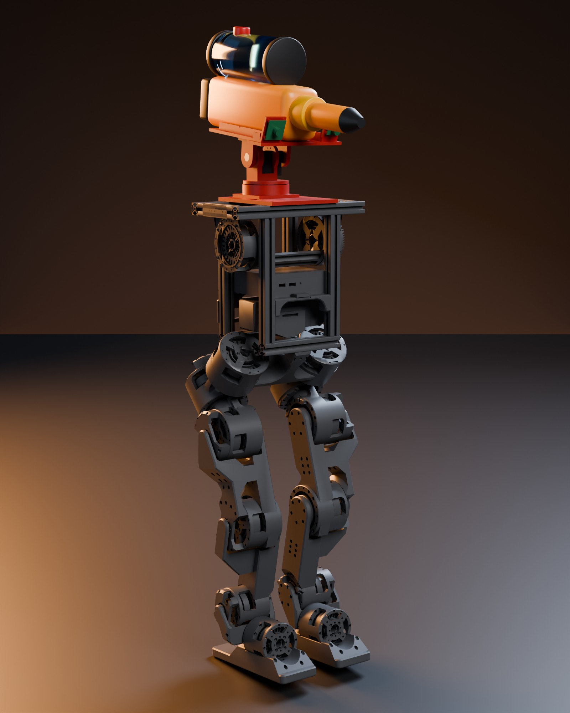
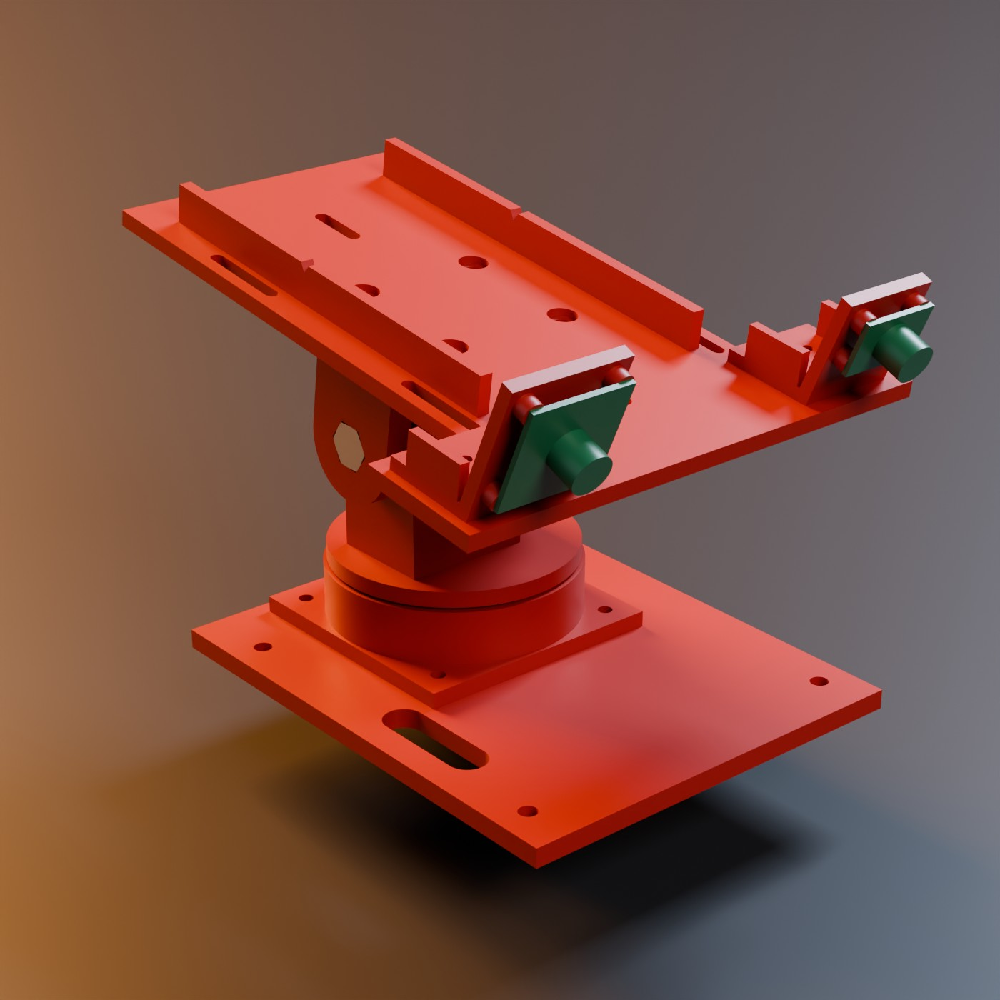
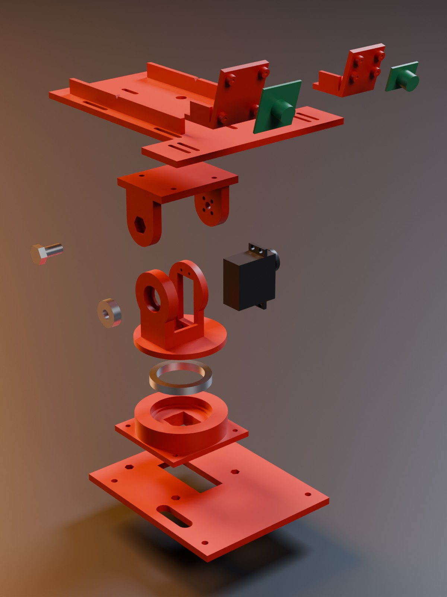
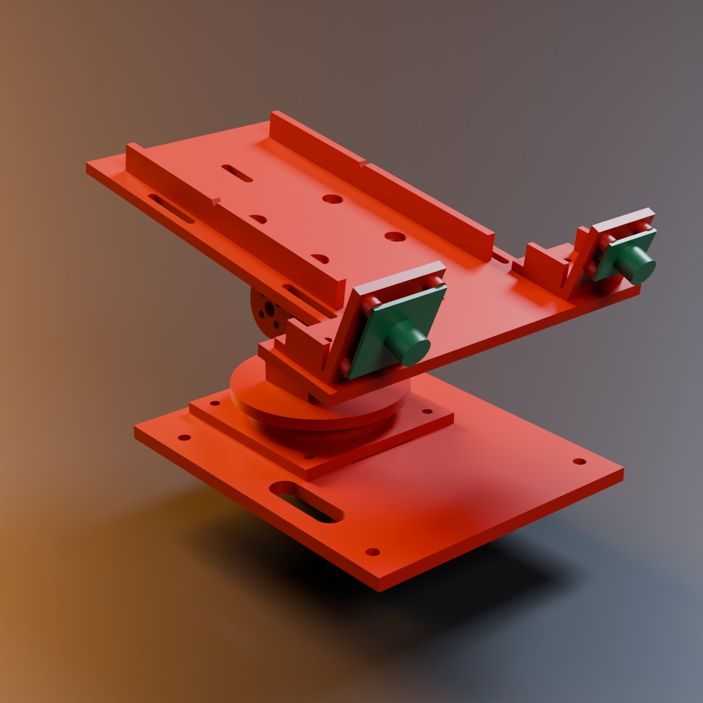

# Concept A top module: printable parts

This folder holds the parametric CAD for the top module of concept A.
The module is a deck plate on the torso, a pan-tilt for two standard servos, a payload plate and camera mounts.
Two adapters use the same payload hole pattern: a head for concept B and a valve clamp for concept E.

Status: all parts are planned. The CAD is done, but no part is printed and no fit is measured.

## Files

| File | What it is |
|---|---|
| `top_module.py` | All parts in one build123d script. Parameters are at the top. |
| `render_module.py` | Blender script for the renders. It uses the helpers in `cad/bhl.py`. |
| `out/*.step`, `out/*.stl` | One STEP and one STL per printed part. |
| `out/ref/*.stl` | Simple shapes of the bought parts (servos, bearings, gun, cameras). For renders only. |
| `out/assembly.json` | Tilt axis, heights, masses, wall checks, centre of mass. |
| `renders/` | Assembled, exploded and on-robot images, and the full concept A robot. |

All parts are exported in the robot frame: x forward, y left, z up, in mm.
The origin is the centre of the top face of the torso frame (robot z = 0.791 m).
So the STLs stack correctly without a transform. Rotate each part to its print orientation in the slicer.

## How to run

1. Install the CAD environment once: `uv sync --project cad`
2. Fetch the Berkeley assets once (for the renders): `scripts/fetch_bhl_assets.sh`
3. Build the parts and run the checks: `uv run --project cad python cad/parts/top_module.py`
4. Make the renders: `blender -b --factory-startup -P cad/parts/render_module.py -- third_party/berkeley-humanoid-lite-assets/data/robots/berkeley_humanoid/berkeley_humanoid_lite cad/parts/renders`

Step 3 takes about 10 s. It stops with an error when a check fails.
Step 4 takes about 3 min on the RTX 3090. Add `concept` at the end of the command to make only the full concept A image.

## 1. Torso-top interface (measured from the BHL mesh)

I measured `meshes/base_visual.stl` with trimesh.
I placed the mesh with the base visual origin of the full URDF `urdf/berkeley_humanoid_lite.urdf`: (-0.0031, 0.0003, 0.6751) m.
Then I moved it down by 0.039 m, like `cad/concepts.py`.
I split the mesh into connected bodies and read their bounding boxes.
Then I cut plane sections through the top rails and read the profile points. The cuts are at y = 0, y = 80 mm and x = 0.
The scad file `aluminum_extrusion_100mm_center.scad` is only a 150 x 140 x 230 mm box. It gives no profile data.

Top of the torso frame (all values in mm, robot frame):

| Item | Value |
|---|---|
| Profile | 20 x 20, slot on all 4 faces |
| Slot opening | 6.3 between the flat faces (6 mm nominal slot) |
| Lip thickness | 1.5 |
| Slot cavity width under the lip | 12.0 |
| Slot depth from the face | 6.2 |
| Centre bore | 4.2 diameter (M5 tap drill size) |
| Front and rear rails | along y, centre lines at x = +60 and x = -60, length 250 (y = -125 to +125) |
| Side rails | along x, centre lines at y = +115 and y = -115, length 100, between the front and rear rails |
| Posts under the front and rear rails | 20 x 20 x 200, at x = +-60, y = +-65 |
| Top face of all four rails | z = 791 (robot frame), flat, nothing above it |
| Free space inside the frame | nothing in the mesh for abs(x) < 48, abs(y) < 50, z > 706 |

The BHL bill of materials agrees with this.
It lists 2020 T-slot extrusion with a 6 mm slot ("European standard").
It lists 2 x 250, 4 x 200, 2 x 150 and 3 x 100 mm pieces.
Source: https://docs.google.com/spreadsheets/d/1AQEHcH_nPkXYfor2-h7bwNIUMmsePtAm53epnsWgZXc and https://arxiv.org/html/2504.17249.
The BOM does not list T-nuts or screws.

Mounting method: M5 screws into M5 drop-in T-nuts in the top slot of the front and rear rails.
A drop-in T-nut (also called a hammer nut) goes into the slot from above, so you do not take the frame apart.
Misumi 5 series 2020 uses M5 for a 6 mm slot: https://my.misumi-ec.com/vona2/detail/110302247910/.
A typical M5 T-nut for this slot is 10.0 x 9.5 x 4.5 mm: https://vxb.com/products/m5-sliding-t-nuts-2020-aluminum-extrusion-6mm.
It fits under the 1.5 mm lip in the 12 mm cavity.

## 2. Design

### Layout

From the bottom to the top:

1. **deck**: a 6 mm plate on the front and rear rails, held by 4 x M5. It has the pan hole pattern (4 x M4 on a 64 mm square) with nut pockets on its top face.
2. **pan_base**: bolts to the deck pattern. The pan servo hangs under it, through the deck, into the free space in the torso frame. A 6808 ball bearing sits in its top. The bearing carries the weight, so the servo only turns the module.
3. **pan_yoke**: the turntable. A hub goes into the bearing bore and screws to the pan servo horn. Two cheeks stand on it. One cheek holds the tilt servo by its flange. The other cheek holds a 608 bearing on the same axis.
4. **tilt_u**: a U-bracket around the tilt servo. One arm screws to the tilt servo horn. The other arm carries an M8 bolt as the pin in the 608 bearing. Its top has the payload pattern (4 x M4 on a 40 mm square).
5. **payload_plate**: bolts to the payload pattern. Two low walls centre a 70 mm wide gun. Four slots take two 25 mm hook-and-loop straps. A front wing carries the camera brackets.
6. **cam_usb32**, **cam_mlx90640**, **cam_purethermal**: L-brackets for the cameras. Print only the thermal bracket that you use.
7. **head_b** (concept B, used instead of the payload plate): a camera box with the RGB board and the thermal board side by side. A column under it holds the nozzle, centred.
8. **valve_e** (concept E, used instead of the payload plate): a cradle for a 12 V solenoid valve. It has zip-tie slots and a nozzle holder in front.

Main heights above the torso top (mm): pan bearing 20.6 to 27.6, turntable top 33.6, tilt axis 72.3, payload plate top 108.3.

### Pan axis position (input from the payload simulation)

The payload simulation (`sim/payload/README.md`) found that mass in front of the torso centre costs the most leg torque.
So the pan axis is a parameter, `PAN_X`. The default is -38 mm, behind the torso centre.
The pan servo body points forward from its shaft. So the body stays clear of the rear rail.
The script stops when `PAN_X` is less than `PAN_X_MIN` = -38.6 mm, because the servo body would then hit the rear rail.
The deck grows to the rear (x = -83 to +75 mm) so that it still carries the pan base.

Payload simulation round 2 asks for the pan axis at x = -60 mm.
At x = -60 mm the pan axis is directly over the rear rail. So the pan servo cannot hang into the frame in any orientation.
A 90 degree turn of the servo gives the same limit, because the servo is 20 mm wide.
The servo would have to sit above the deck, and the module would become 30 mm higher. I did not do this.
Instead, the gun sits 22 mm behind the tilt axis (`GUN_COM_DX` = -22 mm). So the gun centre of mass is at x = -60 mm, as the simulation asks.
The cost is a static torque of about 0.19 Nm on the tilt servo (0.9 kg x 9.81 x 0.022 m).
The pan axis stays at -38 mm. The rest of the module (0.55 kg) has its centre of mass at x = -0.023 m.
Payload simulation round 3 ran this module (A_real) from `out/assembly.json`, tested in simulation.
The worst pitch torque is 5.2 Nm, and 5.5 Nm with the gun panned 90 degrees.

### Centre of mass (estimate)

`top_module.py` writes this into `out/assembly.json`. The values are in the robot frame, at tilt = 0.

| Case | Mass | CoM x, y, z (m) |
|---|---|---|
| Module without gun | 0.55 kg | -0.023, -0.002, 0.843 |
| Module with gun | 1.45 kg | -0.046, -0.001, 0.904 |

Assumptions: the printed parts use the mass estimate below, at their centroid.
The bought parts use guessed masses. Each servo is 60 g. The 6808 is 26 g, the 608 is 12 g and the M8 bolt is 10 g. The cameras are 10 g and 5 g.
The gun with water is a guess: 0.9 kg (`GUN_MASS`), with its centre of mass 22 mm behind the tilt axis.
Screws and nuts (about 30 g) are not included.

How to put the gun centre of mass on the axis:

1. Fill the gun with water.
2. Balance the gun on a pencil across its body. Mark the balance point.
3. Strap the gun so that the mark is over the notches on the two plate walls. The notches are 22 mm behind the tilt axis.

Then the gun centre of mass is at robot x = -0.060 m, and the tilt servo holds about 0.19 Nm.

### Camera position (input from the camera study)

The camera study (`cad/camera_views/README.md`) found a problem with a camera on top of the gun.
The barrel hid the bottom centre of the image, and the camera saw no floor closer than about 2.6 m.
So the cameras sit beside the gun, not on it. They also look down relative to the barrel.
Round 2 of the study asked for the lens 4 cm right of the gun centre line, 8 cm lower, and 16 degrees down.
These parameters are at the top of `top_module.py`:

| Parameter | Value | Reason |
|---|---|---|
| `CAM_Y` | 57 mm | Side offset from the barrel line. The USB camera is on the right (-y), the thermal camera on the left. |
| `CAM_RISE` | 23 mm | Board centre above the payload plate. This is the lowest value for a 32 mm board on the bracket foot. |
| `CAM_PITCH` | 16 deg | The camera looks 16 degrees below the barrel, as the study asks. |
| `CAM_X` | 80 mm | Foot centre in front of the tilt axis. The slots give +-8 mm of adjustment. |

Difference from the study: the lens is 57 mm from the centre line, not 40 mm.
A 32 mm board 40 mm from the centre line would go into the 70 mm wide gun body.
It could only sit in front of the gun body, and then the payload plate would be longer than the 220 mm bed.
The lens height is close to the study: 23 mm above the gun bottom, against about 18 mm in the study.

This is an estimate, not a measurement. With the gun 6 degrees down, the lens is at about x = 0.07 m, z = 0.91 m.
With a 90 degree lens at 16:9 (59 degree vertical field of view), the nearest visible floor is about 0.80 m from the robot origin.
The study found 0.81 m for its position. A check with the camera study script is planned.

### Adapters for concept B and concept E

Both adapters bolt to the tilt U with the payload pattern, in place of the payload plate.
`top_module.py` exports them as `head_b` and `valve_e`, but they are not in the concept A assembly or its checks for overlap.

**head_b** (concept B). The camera study round 2 asked for the nozzle 5 cm lower, centred under the head, and the cameras 15 degrees down.

| Parameter | Value | Meaning |
|---|---|---|
| `HEAD_CAM_DY` | 21 mm | RGB board centre at -y (right), thermal board centre at +y (left) |
| `HEAD_CAM_DZ` | 62 mm | Camera centre above the nozzle axis |
| `HEAD_CAM_PITCH` | 15 deg | The camera box looks down relative to the nozzle |
| `HEAD_THERMAL` | `cam_mlx90640` | Thermal board hole pattern in the head (or `cam_purethermal`) |
| `NOZZLE_D` | 10 mm | Nozzle tube diameter. PLACEHOLDER until the team chooses the nozzle. |
| `NOZZLE_OUT` | 45 mm | Longest nozzle tip in front of the head |
| `RGB_WINDOW`, `THERMAL_WINDOW` | 17 mm, 14 mm | Lens windows. PLACEHOLDER, I found no lens holder size. |

The boards sit inside the box on 2 mm stand-offs, behind the front wall. The lenses look through the windows.
The box has an open back for the hose and cables, and a roof against dripping water.
An M3 set screw holds the nozzle in its bore.
The script checks that the nozzle tip stays out of the camera image.
The check uses a 74 degree vertical field of view (`CAM_VFOV`, a 90 degree lens at 4:3).

**valve_e** (concept E). It fits an Adafruit 997 valve (12 V, 1/2 inch, 85 mm long, 122 g).
The valve lies with its inlet at the back and its coil up. Two short walls centre it, and zip ties hold it in the cradle.
The nozzle holder is in front of the outlet fitting. An M3 set screw holds the nozzle.
The valve sizes are parameters: `VALVE_L`, `VALVE_W`, `VALVE_H`, `VALVE_PORT_Z`, `VALVE_PORT_D` and `VALVE_FITTING`.

The concept E camera pod is not part of this work. Round 2 of the camera study puts its lens 4 cm left on the pod, pitched 14 degrees down.

### External dimensions and sources

| Part | Values used (mm) | Source |
|---|---|---|
| DS3218 servo (main source) | body 40 x 20 x 40.5, flange 54.5 long and 3.1 thick, holes 49.5 x 10, shaft 10 from the body end, bottom to flange underside 27.8, overall height 45.5 | DSSERVO drawing on a reseller page: https://rcdrone.top/cdn/shop/files/Scd9e81bc5aec4620aa84f85292561ef3h.webp (page https://rcdrone.top/products/dsservo-ds3218-digital-servo) |
| MG996R servo (for the envelope) | body 40.7 to 40.9 x 19.7 to 20, case top 36.6 to 37, spline top 42.7 to 42.9, bottom to flange underside 26.6 to 26.8 | https://www.towerpro.com.tw/product/mg996r/ and https://people.ece.cornell.edu/land/courses/ece4760/FinalProjects/f2017/kmv48_rp625/kmv48_rp625/kmv48_rp625/MG996RTowerPro.pdf |
| Servo values used | body 40.9 x 20.1 (largest of both), flange top to body bottom 30.9, flange top to case top 9.6, flange top to spline top 14.6 | DS3218 drawing. 14.6 = 45.5 - 27.8 - 3.1, which I derived. |
| 25T aluminium disc horn (RJX3366) | disc 20, total height 4.5, plate 2.5, hub 9 diameter and 2 high, 4 x M3 on a 14 mm circle, spline bore through | https://rcdrone.top/cdn/shop/files/RJX-Small-Disc-25T-Metal-Servo-Horn-Rudder-Disk-for-MG995_39c8d918-cd17-44ec-bbee-c7d2eaa93049.jpg. A DFRobot drawing also gives 20 and 14: https://dfimg.dfrobot.com/enshop/image/data/FIT0037/FIT0037%20Dimension.jpg |
| 6808-2RS bearing | 40 x 52 x 7 | https://www.qualitybearingsonline.ca/6808-skf-deep-groove-bearings-40x52x7mm/ |
| 608-2RS bearing | 8 x 22 x 7 | https://www.ebay.de/itm/272274115563 |
| USB camera board (Arducam UB0234 class) | 32 x 32 board, 28 x 28 hole pattern, M12 lens | https://welectron.com/Arducam-UB0234-2MP-Wide-Angle-USB20-Camera-Board-with-M12-Lens |
| Adafruit MLX90640 (4407) | 25.4 x 17.78 board, 4 holes 2.5 drill, 20.32 x 12.7 pattern | https://github.com/adafruit/Adafruit-MLX90640-PCB |
| PureThermal 2 (FLIR Lepton) | 22 x 30 board, 4 holes 2.2, 18.00 x 21.51 pattern | https://groupgets-files.s3.amazonaws.com/PT2/PureThermal%202%20-%20Datasheet%20-%201.7.pdf |
| Adafruit 997 solenoid valve, 12 V | length 85, body width 33.5, overall height 59.5, body under the coil about 29 (scaled), G1/2 threads, 4 holes 2.2 to 2.4 on a 25 x 25 square, 122 g | https://cdn-shop.adafruit.com/product-files/997/C1120-001_datasheet.pdf and https://www.adafruit.com/product/997 |

Values that are still guesses or derived. Measure a real part and change the parameter:

- Horn top face height (`HORN_TOP` = 14.6 mm above the flange). I assume the horn top is flush with the spline top, because the horn bore goes through. It sets the pan bearing height.
- The MG996R flange. I use the DS3218 values. The MG996R flange is about 1 mm lower (26.8 against 27.8 mm), and no source gives its thickness or hole spacing.
- Servo mounting hole diameter. No source found. The parts use M3 screws, so it does not change the geometry.
- Hole size on the USB camera board. I use M2.
- Lens holder size of the USB board and the sensor window of the thermal board (`RGB_WINDOW`, `THERMAL_WINDOW`).
- Valve port height (`VALVE_PORT_Z` = 14.5 mm, half the body) and the outlet fitting length (`VALVE_FITTING` = 25 mm).
- Nozzle diameter (`NOZZLE_D` = 10 mm).
- The Adafruit 997 sources do not agree on the thread: the datasheet says G1/2, the product page says 1/2 inch NPS.
- The 25 x 25 mm holes of the valve: the datasheet does not say on which face they are. The cradle does not use them. Zip ties hold the valve.

## 3. Part list, volume and mass

Mass estimate: PLA at 1.24 g/cm3. I assume a solid 1.2 mm shell on every surface (3 walls of 0.4 mm) and 40 % gyroid infill inside.
The "solid" column is the upper limit at 100 % infill.

| Part | Qty | Volume (cm3) | Mass est. (g) | Mass solid (g) | Size (mm) |
|---|---|---|---|---|---|
| deck | 1 | 110.7 | 93 | 137 | 158 x 130 x 6 |
| pan_base | 1 | 80.4 | 58 | 100 | 80 x 80 x 22 |
| pan_yoke | 1 | 58.2 | 49 | 72 | 76 x 76 x 74 |
| tilt_u | 1 | 44.0 | 37 | 55 | 56 x 76 x 48 |
| payload_plate | 1 | 119.4 | 109 | 148 | 200 x 158 x 17 |
| cam_usb32 | 1 | 12.0 | 13 | 15 | 45 x 38 x 42 |
| cam_mlx90640 | 0 or 1 | 9.3 | 10 | 12 | 43 x 31 x 35 |
| cam_purethermal | 0 or 1 | 9.7 | 10 | 12 | 44 x 30 x 41 |
| **Total for concept A** (one thermal bracket) | | | **369** | **539** | |
| head_b (concept B) | 0 or 1 | 145.6 | 120 | 181 | 71 x 84 x 106 |
| valve_e (concept E) | 0 or 1 | 41.5 | 39 | 51 | 123 x 59 x 31 |

## 4. Hardware list

| Item | Qty | Use |
|---|---|---|
| Standard servo, 25T spline (DS3218 or MG996R) | 2 | pan, tilt |
| 25T aluminium disc horn, 20 mm, 4 x M3 on 14 mm (RJX3366 type) | 2 | pan hub, tilt U arm |
| 6808-2RS ball bearing, 40 x 52 x 7 | 1 | pan axis |
| 608-2RS ball bearing, 8 x 22 x 7 | 1 | tilt pin side |
| M8 x 16 hex bolt (fully threaded is acceptable) + M8 washer | 1 + 1 | tilt pin |
| M5 x 10 button head screw + M5 drop-in T-nut for 2020, 6 mm slot | 4 + 4 | deck to rails |
| M4 x 10 socket head screw + M4 hex nut | 4 + 4 | pan base to deck |
| M4 x 10 button head screw + M4 hex nut | 4 + 4 | payload plate to U |
| M3 x 10 self-tapping screw (or the servo's own screws) | 4 | pan servo to pan base |
| M3 x 8 self-tapping screw (or the servo's own screws) | 4 | tilt servo to cheek |
| M3 x 16 socket head screw | 2 | pan hub to pan horn |
| M3 x 10 socket head screw | 4 | U arm to tilt horn |
| M3 x 10 screw + M3 nut | 4 + 4 | camera brackets to plate |
| M2 x 10 screw + M2 nut | 8 | camera boards to brackets |
| 25 mm hook-and-loop strap, about 350 mm | 2 | gun to plate |
| M3 x 6 set screw | 1 | nozzle in head_b or valve_e |
| Zip tie, up to 4.8 mm wide | 2 | valve in valve_e |

The M5 screw must not touch the slot bottom. The slot is 6.2 mm deep, and an M5 x 10 enters it by 4 mm.

## 5. Printability

The script checks these points every time it runs:

- Every part fits a 220 x 220 x 250 mm bed. The largest part is the payload plate, 200 x 158 mm.
- The thinnest wall is at least 2 mm. Two checks do this. Asserts check the wall formulas from the parameters. A ray scan on each STL measures the thinnest wall: 2.0 mm (pan_base, valve_e) and 2.05 mm or more elsewhere.
- No part overlaps another part or a bought part in the assembly at tilt = 0.
- The servo window is the servo body plus 0.4 mm on each side.
- The pan servo body clears the rear rail (`PAN_X >= PAN_X_MIN`).
- The B-head nozzle tip stays out of the camera image.
- Each print job fits the bed.

Clearance holes: M2 2.4 mm, M3 3.4 mm, M4 4.5 mm, M5 5.5 mm, M8 8.4 mm.
Self-tapping M3 pilot holes are 2.5 mm. Bearing seats are 0.15 mm larger than the bearing.
Printed holes often come out small. Print one bearing seat as a test first, and change `FIT` if needed.

Print settings (a suggestion, not tested): PLA, 0.4 mm nozzle, 0.2 mm layers, 3 walls, 5 top and 5 bottom layers, 40 % gyroid infill.

| Part | Orientation | Supports |
|---|---|---|
| deck | as exported, flat | none |
| pan_base | as exported, shelf on the bed | none. The bearing shoulder bridges 22 mm over the servo cavity. |
| pan_yoke | as exported, hub on the bed | yes, under the turntable disc only. The 22 mm bore of the 608 is a horizontal hole. Clean it before you press the bearing in. |
| tilt_u | upside down, U base on the bed | none |
| payload_plate | as exported, flat | none |
| camera brackets | as exported, foot on the bed | none. The upright leans 16 degrees. |
| head_b | as exported, base on the bed | yes, under the roof (84 mm bridge) |
| valve_e | as exported, flat | none |

### Print plan

Each job fits a 220 x 220 mm bed. The script checks that the parts in each job stay on the bed with 3 mm between them.
The filament estimate is the part mass estimate above plus the supports. The support masses are guesses.

| Job | Parts (corner position on the bed, mm) | Orientation | Supports | Filament (g) |
|---|---|---|---|---|
| J1 | payload_plate (5, 5), cam_usb32 (5, 170), cam_mlx90640 (60, 170) | all as exported, flat side down | no | 132 |
| J2 | deck (5, 5), tilt_u (5, 140) | deck as exported. tilt_u upside down, U base on the bed. | no | 131 |
| J3 | pan_base (5, 5), pan_yoke (92, 5) | both as exported | yes, under the pan_yoke disc only | 111 |
| J4 (only for B or E) | head_b (5, 5), valve_e (5, 100) | both as exported, base on the bed | yes, under the head_b roof (84 mm bridge) | 167 |

Concept A needs J1, J2 and J3: about 375 g of PLA. Use cam_purethermal in J1 in place of cam_mlx90640 if you use a PureThermal board.

## 6. Assembly

1. Press 4 M4 nuts into the pockets on the top face of the deck.
2. Put 4 M5 T-nuts into the top slots of the front and rear rails, near y = +-55 mm.
3. Bolt the deck to the rails with 4 M5 x 10 screws.
4. Set the pan servo to its centre position.
5. Screw the pan servo under the pan_base shelf with 4 M3 self-tapping screws. The body points forward (+x).
6. Put the 25T horn on the pan servo spline from above, through the bearing seat. Tighten the horn centre screw.
7. Press the 6808 bearing into the pan_base seat.
8. Bolt the pan_base to the deck with 4 M4 x 10 screws. The servo body goes through the deck opening.
9. Push the pan_yoke hub into the 6808 inner ring. Turn it to align the two holes with the horn.
10. Tighten 2 M3 x 16 screws from the top of the turntable into the horn.
11. Press the 608 bearing into the bearing cheek from the outside.
12. Set the tilt servo to its centre position.
13. Slide the tilt servo through the servo cheek window from the +y side. Screw the flange with 4 M3 self-tapping screws.
14. Put the second horn on the tilt servo spline. Tighten the horn centre screw.
15. Lower the tilt_u over the yoke. Its arms go outside the two cheeks.
16. Screw the +y arm to the tilt horn with 4 M3 x 10 screws.
17. Hold the M8 washer between the -y arm and the 608. Push the M8 bolt through the arm, the washer and the bearing.
18. Glue the bolt head into its hex pocket with a drop of cyanoacrylate glue. Nothing else holds the bolt.
19. Press 4 M4 nuts into the pockets under the U base.
20. Bolt the payload plate to the U with 4 M4 x 10 button head screws.
21. Bolt the camera boards to the brackets with M2 screws and nuts.
22. Bolt the brackets to the front wing slots with M3 screws and nuts.
23. Strap the gun to the plate as described in "Centre of mass" above.

Route the tilt servo cable and the camera cables down beside the pan base. Leave a loop so that the pan can turn.
The deck has a 40 x 12 mm slot for the cables at y = -50 mm.

## STS3215 serial bus servo: why it needs its own parts

The hardware research (`docs/hardware/README.md`) recommends two Feetech STS3215 (Waveshare ST3215) 12 V servos.
I checked the Waveshare drawing and STEP model: https://www.waveshare.com/wiki/ST3215_Servo
(files https://files.waveshare.com/upload/0/08/ST3215-2D.zip and https://files.waveshare.com/upload/5/59/ST3215-3D.zip).
The DS3218 parts do not take this servo. So the STS3215 has its own file (next section), not a `SERVO` parameter.

| Item | DS3218 (current parts) | STS3215 / ST3215 |
|---|---|---|
| Body (mm) | 40 x 20 x 40.5 | 45.22 x 24.72 x 32 (35 with bosses, 37.8 with both horns; STEP model) |
| Mounting | flange ears, 4 holes on 49.5 x 10 mm | no ears. 4 threaded holes in each horn face (top face: 18.41 and 42.86 mm from the shaft end, 20.5 mm apart). Thread size not given. |
| Output | 25T spline, separate disc horn | horn on the servo: 19.2 mm disc, 4 holes on a 14 mm pattern, about 2.6 mm above the case |
| Back side | none | idler horn on the same axis (19.2 mm disc) |
| Shaft from body end | 10 mm | 10.11 mm |
| Mass | 60 g (guess) | 89 g (Waveshare product page) |
| Torque | 21.5 kg·cm at 6.8 V (hardware README) | 30 kg·cm at 12 V (hardware README) |

Why the current parts do not fit:

- The pan base and the servo cheek hold the servo by its flange ears. The STS3215 has no ears.
- The body is 4.3 mm longer and 4.6 mm wider than the servo size used in the parts (40.9 x 20.1 mm).
- The horn is only about 2.6 mm above the case. The pan hub and the U arm cannot reach it through a 5 to 6 mm thick shelf or cheek.

The next section describes the redesign.

The two servos add 58 g against the DS3218 guess. The module centre of mass moves very little.

## STS3215 variant (separate file)

`top_module_sts3215.py` builds the module for two STS3215 servos. It writes `out_sts3215/`.
It imports the deck, the payload plate and the camera brackets from `top_module.py`. The DS3218 version is unchanged.
Run it with `uv run --project cad python cad/parts/top_module_sts3215.py`. It runs the same checks: bed fit, walls of at least 2 mm (ray scan), no overlaps, rear-rail clearance.
Render it with `PARTS_DIR=out_sts3215 RENDER_NAME=module_sts3215` in front of the render command and the view `assembled`.

What changes:

- **pan_base**: the servo hangs under the shelf, body forward. Two M2 screws go from above into the far holes of its output face. A foot takes two M2 screws from below into its idler face. An end wall joins the shelf and the foot and has a cable window. The 6808 sits directly on the shelf.
- **pan_yoke**: a 22 mm boss on the hub reaches through the shelf to the servo horn (4 x M3 on the 14 mm circle). Two 2 mm tabs on the turntable hold the tilt servo by the far holes of its two faces.
- **tilt_u**: both arms bolt to a servo horn: the output horn on +y and the idler horn on -y. The idler horn is the bearing on that side, so the 608 and the M8 pin are gone.
- **deck**: the same deck with a larger opening for the STS3215 body.

| Item | DS3218 version | STS3215 version |
|---|---|---|
| Tilt axis above the torso top | 72.3 mm | 63.0 mm |
| Payload plate top | 108.3 mm | 93.0 mm |
| Printed mass (concept A parts) | 369 g | 312 g |
| Servo mass | 2 x 60 g (guess) | 2 x 89 g |
| Bought parts not needed | – | 608 bearing, M8 bolt, 2 disc horns |
| Module CoM with gun (robot frame, m) | -0.046, -0.001, 0.904 (1.45 kg) | -0.046, 0.000, 0.891 (1.43 kg) |

Guesses in this variant: the case screw thread (M2, clearance 2.4 mm), the horn screw thread (M3), and the hole spacing on the idler face (same 20.5 mm as the output face).
I use only the far case holes. The near holes are 2.7 mm from the horn edge, which leaves no 2 mm wall around the horn opening.
The 2 mm yoke tabs carry the tilt torque. A load test is planned.
Print the STS3215 pan_base upside down on the top face of its bearing ring, with supports under the shelf. Print the pan_yoke with supports under the hub and the disc.

## 7. Open questions

- Q1: Which servo does the team buy? The parts follow the DS3218 drawing. For an MG996R, check the flange height and the hole spacing.
- Q2: Which horn does the team buy? The parts follow the RJX3366 drawing. Check that its top is flush with the spline top (`HORN_TOP`).
- Q3: The pan bearing is one 7 mm wide deep-groove bearing. It carries the tilting moment of a 1.5 kg payload. A test is planned. A second bearing or a lazy-susan bearing can take more moment.
- Q4: The horn screws on the pan hub can pull the servo shaft up if the heights do not match. Add washers under the horn if a gap remains before you tighten.
- Q5: Which water gun does the team use? The walls fit a 70 mm wide body (`GUN_W`). The gun mass of 0.9 kg is a guess.
- Q6: Which cameras does Marc choose? The brackets take a 32 x 32 USB board, an Adafruit MLX90640 or a PureThermal 2. Other boards need a new entry in `CAMS`.
- Q7: Can the pan servo hang into the torso frame? The BHL mesh shows free space there. The team may put electronics there later.
- Q8: Does the real gun body hide part of the camera image at `CAM_Y` = 57 mm? A check with the camera study script is planned.
- Q9: Which nozzle and which valve does the team buy? `NOZZLE_D` and the valve sizes are placeholders.
- Q10: Can the pan axis move to x = -60 mm? Only with the pan servo above the deck, which makes the module 30 mm higher.

## Renders

| View | File |
|---|---|
| Assembled, front | `renders/module_assembled.jpg` |
| Assembled, rear | `renders/module_assembled_rear.jpg` |
| Exploded | `renders/module_exploded.jpg` |
| On the robot, close | `renders/module_on_robot.jpg` |
| On the robot, full | `renders/module_on_robot_full.jpg` |
| Full concept A robot with this module and the placeholder gun shape | `renders/concept_A_real_module.jpg` |
| Concept B head and concept E valve clamp | `renders/adapters_B_E.jpg` |

The renders show the bought parts as simple boxes and cylinders. The gun is a 240 x 70 x 85 mm box.
In `concept_A_real_module.jpg` the gun has the same shapes as the placeholder gun in `cad/concepts.py` (body, clear tank, barrel).
Its body centre is 22 mm behind the tilt axis, and it tilts 6 degrees down.
