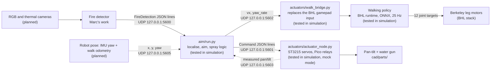

# System overview

This page shows how the software parts of the robot connect.
Each box has a status: built, tested in simulation, measured on laptop, measured on board, or planned.

## Data between the parts

| From | To | What | Where it is defined |
| --- | --- | --- | --- |
| Fire detector | `aim/run.py` | One `FireDetection` per fire and frame, or (interface v2, proposal) one frame message per image with a list of detections, empty when there is no fire | `aim/detection.py`, `aim/README.md` |
| `aim/run.py` | Actuator driver | `pan`, `tilt` (rad), `pump_on`, plus the state name. UDP 5601 | `aim/controller.py` (`Command`) |
| `aim/run.py` | Command bridge → walking policy | `vx` (m/s), `yaw_rate` (rad/s), to turn toward the fire and walk closer. Same JSON line, sent to UDP 5602 | `aim/controller.py` (`Command`), `docs/locomotion/README.md` |
| Robot state estimate | `aim/run.py` | Pose {timestamp, x, y, yaw} on UDP 5605. Without it for 0.5 s, run.py integrates its own walk command and warns | `aim/README.md` |
| Actuator node | `aim/run.py` (with `--feedback`) | Measured pan and tilt angles with a timestamp, UDP 5603 | `actuators/README.md` |

## Rules that all parts follow

- Robot frame: x forward, y left, z up, metres. The origin is the floor point under the BHL base link origin (pelvis centre). The pan axis of concept A is at x = −0.038 m.
- Timestamps use `time.monotonic()` on the robot computer.
- Angles are in radians. Pan is positive to the left. Tilt is positive up.

## Open questions

- Q1. Which computer runs the detector and `aim/run.py`: the robot computer or a laptop over Wi-Fi?
- Q2 (answered in `docs/locomotion/README.md`). The Berkeley Python runtime reads the walk command from a USB gamepad (`Se2Gamepad`). Our bridge replaces that class: it reads `vx` and `yaw_rate` from UDP 5602, clips them, and sends zero after 0.5 s without a message.
- Q3 (answered). Two ST3215 bus servos on the Waveshare adapter, and a Pico 2 with a relay module. See `actuators/README.md` and `docs/hardware/bom_extinction.csv`.
