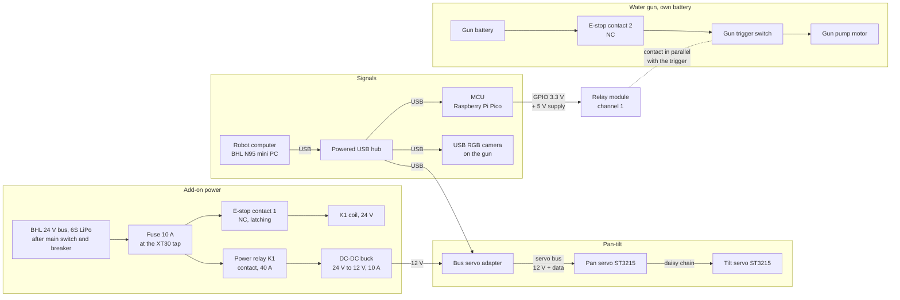

# Hardware plan: concepts A, B and E

Status of everything on this page: **planned**. Nobody has built, tested or measured these parts yet.

**Not verified:** All values come from shop pages, datasheets or the BHL sources, not from our own measurement. "(unverified)" marks a value from a listing with no datasheet, from a search snippet, or from my own estimate. Subagents read most shop pages. I checked the key pages myself (listed in section 3). Most Devicemart small-part prices were read only once.

**Not done:** I found no prices on Coupang, Gmarket, Auction or NAVER, because those sites refused automatic access (HTTP 403). I found no Korean shop for the DS3218, the 12 V STS3215, the InfiRay P2 Pro or the Topdon TC001. Some parts have no price: USB hub, enclosure, brackets, adapters, diodes, filter, swivel, the B bottle and the B backpack hardware.

**Assumed:** I assume that we can tap the BHL 24 V bus after its main switch and circuit breaker. I assume Devicemart prices include VAT.

**Prices:** Prices change often. All prices and pages were read on 2026-10-08. Check them again before you order.

## 1. Summary

This page plans the add-on hardware for concept A (first build), then the changes for concepts B and E.
The add-ons are the water parts, the pan-tilt, the cameras and their power.

- **BHL power:** the BHL runs on a 6S 4000 mAh LiPo battery (about 88.8 Wh) and a 24 V bus, for about 30 minutes. 22 actuators sit on four 1 Mbps CAN buses, which connect to an Intel N95 mini PC through USB-CAN adapters.
- **Our power plan:** we tap the 24 V bus once, with an XT30 connector and a 10 A fuse. A power relay, controlled by the e-stop, feeds one 24 V to 12 V, 10 A converter.
- **Pan-tilt:** two 12 V serial bus servos (ST3215 = Feetech STS3215, 30 kg·cm, with position feedback) on a USB bus servo adapter.
- **Switching:** a Raspberry Pi Pico switches a 2-channel relay module. The relay fires the gun (A), the pump (B) or the valve (E).
- **Cost without cameras and shipping:** A = 73,310 KRW + 48.97 USD. B = 129,308 KRW + 48.97 USD. E = 121,424 KRW + 48.97 USD. Some small parts have no price yet.
- **Water jet (concept B):** the Seaflo 3.8 L/min pump with a 2 mm nozzle gives about 2.5 L/min at about 13.6 m/s (ideal). The drag-free range is 16–19 m. The real range will be much shorter. We must measure it.
- **Recoil:** the jet pushes back with 0.3–1.3 N. This is small for the robot and the servos.
- **Cameras:** section 4 compares 8 thermal and 8 RGB/depth cameras for Marc. Thermal prices go from 88,000 KRW (MLX90640, 32 × 24) to 572,660 KRW (FLIR Lepton 3.5 + PureThermal 3, 160 × 120).

## 2. Berkeley Humanoid Lite (BHL) power and electronics

Sources (accessed 2026-10-08):

- [P] Paper, HTML version: https://arxiv.org/html/2504.17249
- [BOM] Official BOM sheet: https://docs.google.com/spreadsheets/d/1AQEHcH_nPkXYfor2-h7bwNIUMmsePtAm53epnsWgZXc (linked from https://berkeley-humanoid-lite.gitbook.io/docs/getting-started-with-hardware/materials-and-parts-bom)
- [W] Build guide with the wiring diagram: https://berkeley-humanoid-lite.gitbook.io/docs/getting-started-with-hardware/building-the-robot
- [G] Docs: https://berkeley-humanoid-lite.gitbook.io/docs/
- [LL] Low-level code: https://github.com/HybridRobotics/Berkeley-Humanoid-Lite-Lowlevel

I checked the [P] quotes myself. A subagent read [BOM], [W], [G] and [LL]. I did not open those four pages myself.

### 2.1 Facts

| Item | Value | Source |
|---|---|---|
| Actuator type | BLDC drone motor + 3D-printed cycloidal gearbox. A cycloidal gearbox is a compact, high-ratio reducer. | [P] |
| Actuator sizes | "6512": MAD M6C12 150KV motor. "5010": MAD 5010 110KV motor. | [P], [BOM] |
| Gear ratio | 15:1 | [G] motor-characterization page; [LL] config `gear_ratio -15.0` |
| Actuator torque | No rating found. [P] tested a 6512 up to 20 N·m. [LL] firmware limits: 6 N·m on legs, 1–2 N·m on arms, 20 A current limit. | [P], [LL] |
| Torque limit we plan | The BHL Python runtime on the robot uses a fixed 4 N·m limit. In sim2sim (tested in simulation), B with a full tank falls at 4 N·m, so we plan 6 N·m. | docs/locomotion/README.md |
| Actuator count | 22 in total: 10 × 6512 and 12 × 5010. Each leg has 6, each arm has 5. Our legs-only robot keeps 12. | [P] Table III, [W] |
| Motor driver | One ST B-G431B-ESC1 per actuator, with the team's "Recoil" firmware | [P], [G] |
| Bus voltage | 24 V ("a 24 V power supply ... identical to those on the robot") | [P] |
| Communication | CAN 2.0 at 1 Mbps, one bus per limb. Four USB-CAN adapters on two USB hubs. Linux `gs_usb` driver. CAN is a two-wire bus for motor controllers. | [P], [G] can-communication page |
| Control rates | 250 Hz low-level loop, 25 Hz policy | [P] |
| Main computer | Intel N95 mini PC at the torso centre ("BeeLink N95 NUC", USD 129) | [P], [G], [BOM] |
| Battery | 6S 4000 mAh LiPo, "approximately 30 minutes of operation". Tethered power is also supported. | [P] |
| Battery energy | ≈ 88.8 Wh (my calculation: 22.2 V nominal × 4 Ah) | inferred |
| Battery part | Zeee 6S LiPo, USD 70.20 | [BOM] |
| Connectors | XT60 on the main cable, XT30 from the main bus to each actuator, WAGO connectors | [W] |
| Power path | Battery → "Main Switch & Circuit Breaker" → current and voltage meters → power bus | [W] |
| Regulators in the BOM | "24V to 12V regulator" (DROK, USD 16.99) and "12V to 5V regulator" (USD 4.49). Loads not stated. The 12 V one probably feeds the mini PC (unverified). | [BOM] |
| Mass, height | 16 kg, 0.8 m | [P] |
| Cost | USD 4,312 (US parts), USD 3,236 (China parts) | [P] Table III |
| Mounting space | "The torso is built with aluminum extrusions to support mounting additional components" | [P] |
| Stop functions | Gamepad button `B` puts the joints into passive damping. The firmware has a watchdog timeout. No dedicated e-stop found. | [LL] |

**Not found:** torque ratings, walking power, idle current, mini PC ports, how the mini PC gets power, a fuse, an e-stop.

### 2.2 Power budget

- Average robot power while walking is not published. If 88.8 Wh lasts 30 min, the average is about 180 W (inferred, upper estimate).
- Our add-ons draw much less while idle. The Seaflo pump of concept B draws about 48 W (12 V × 4 A) while it sprays.
- Worst case on our 12 V rail: 2 servos at stall (5.4 A) + pump (4 A) = 9.4 A, about 113 W. This is about 5 A from the 24 V bus (my calculation). The 10 A fuse covers it.
- Add-on loads take some minutes from the 30-minute runtime. The pump runs only in short bursts, so the loss is small (unverified).

### 2.3 What is free for our add-ons

- **24 V bus:** the main bus uses XT30 taps for each actuator [W]. We can add one more XT30 tap for the add-ons, after the main switch and circuit breaker. Our own fuse goes directly at this tap.
- **Do not use the BHL 24 V → 12 V regulator for our loads.** We do not know its spare current, and it probably feeds the computer. A pump or servo current peak could reset the computer.
- **USB:** the four USB-CAN adapters already use two USB hubs [P]. I did not find how many ports are free. Plan one powered USB hub for the cameras and the MCU.
- **Mounting:** the aluminium extrusion torso has room for an add-on box and a pan-tilt [P].
- **Legs-only robot:** our concepts remove the arms. This removes 10 of the 22 actuators and their weight (inferred from [P] Table III and [W]).

## 3. Bill of materials (BOM)

The CSV files hold the same rows: bom_A.csv, bom_B.csv, bom_E.csv.
A subagent found most prices. I checked these pages myself: the ST3215 servo, the 12 V DC-DC converter, the Seaflo pump, the Adafruit 997 valve and the SEENGREAT MLX90640.
A second subagent checked the Daiso, 11st, Amazon, Waveshare and aifitlab prices in the totals again. All matched.
**Not verified:** the other Devicemart prices in the totals (Pico, relays, e-stop, fuses, connectors, wire, hose parts) were read only once. Devicemart then refused more connections.
Devicemart prices include VAT. Devicemart shipping is 2,700 KRW, free above 66,000 KRW (subagent finding).
Amazon prices are in KRW for a Korean visitor and exclude international shipping and import charges.
I did not convert USD to KRW, because I could not verify the exchange rate for today.

### 3.1 Totals

| Concept | KRW parts | USD parts | Rows with no price found | Not included |
|---|---|---|---|---|
| A | 73,310 KRW | 48.97 USD | 4 | cameras, shipping |
| B | 129,308 KRW | 48.97 USD | 10 | cameras, shipping, PLA filament |
| E | 121,424 KRW | 48.97 USD | 9 | cameras, shipping, external pump |

The cameras are not in the totals, because Marc chooses them (section 4).
Camera cost: an RGB USB camera is about 42–56 USD. A thermal camera is 88,000 KRW (MLX90640) to 572,660 KRW (Lepton 3.5 + PureThermal 3).
The rows with no price are small parts (brackets, USB hub, box, adapters, diodes, the B bottle and backpack hardware). They are real costs. Add a margin for them.

### 3.2 Main choices in this plan

I made these choices. Change them if the team prefers another option.

- **Servos: serial bus servos (Waveshare ST3215 = Feetech STS3215, 12 V version).** They report position and load, so the robot knows where the nozzle points. They run from the same 12 V rail as the pump or valve. A serial bus servo gets commands over one shared data wire, not a PWM signal.
- **One 12 V rail for everything.** A 24 V to 12 V, 10 A converter feeds the servos and the pump or valve. Worst case: 2 servos × 2.7 A stall + 4 A pump = 9.4 A. This is near the 10 A limit. Measure the real current.
- **One 2-channel relay module for the switching.** Channel 1 fires the gun (A). Channel 2 switches the pump (B) or the valve (E). A logic-level MOSFET module is an alternative (see 3.7).
- **E-stop through a power relay.** I did not find the contact rating of the e-stop button. So the e-stop opens the coil circuit of a 40 A power relay, and that relay cuts the add-on power.
- **Water gun for A: the 5,000 KRW Daiso gun.** It is the cheapest first test. Its tank is only about 100 mL. A larger gun (section 3.8) is better for a demonstration.

### 3.3 BOM, concept A (also the common part of B and E)

| Item | Qty | Unit price | Link | Notes |
|---|---|---|---|---|
| Serial bus servo Waveshare ST3215 (Feetech STS3215) 12 V version, pan and tilt | 2 | 21.99 USD | https://www.waveshare.com/st3215-servo.htm?sku=22414 | 6-12.6 V; 30 kg.cm at 12 V; stall 2.7 A; position/load/speed/voltage feedback; 12 V version is SKU 22414 at USD 21.99 (7.4 V version is USD 16.99); Korean shop for 12 V version not found |
| Waveshare Bus Servo Adapter (A), USB to servo bus | 1 | 4.99 USD | https://www.waveshare.com/bus-servo-adapter-a.htm | input 9-12.6 V; 5.5x2.1 mm DC jack |
| Pan-tilt brackets | 1 | not found | – | not found; plan to 3D-print in PLA like the BHL parts |
| DC-DC buck 12 V 10 A SZH-PWSD-064 | 1 | 14300 KRW | https://www.devicemart.co.kr/goods/view?no=16084804 | input 15-90 V covers 6S LiPo 18-25.2 V; IP68; feeds servos (and pump or valve in B/E) |
| Raspberry Pi Pico (MCU for relay switching) | 1 | 5940 KRW | https://www.devicemart.co.kr/goods/view?no=13921792 | USB to robot computer |
| 2-channel 5 V relay module with optocoupler | 1 | 2310 KRW | https://www.devicemart.co.kr/goods/view?no=1327557 | 10 A at 30 VDC; 3.3 V trigger from Pico unverified |
| E-stop button KGE-N4R2R 22 mm, push-lock turn-reset, 2 NO + 2 NC | 1 | 12100 KRW | https://www.devicemart.co.kr/goods/view?no=10895014 | contact rating not found; switches the coil of the power relay |
| Power relay KKA-K4, 24 V coil, 40 A (switched by the e-stop) | 1 | 7150 KRW | https://www.devicemart.co.kr/goods/view?no=14822397 | carries the add-on 24 V current |
| ATO blade fuse holder 287 | 1 | 2420 KRW | https://www.devicemart.co.kr/goods/view?no=12170195 | inline type unverified |
| Blade fuse set 10 pcs (10/15/20/25/30 A) | 1 | 2200 KRW | https://www.devicemart.co.kr/goods/view?no=1321122 | use 10 A at the 24 V tap; 5 A fuse URL not found |
| XT30 connector pair for the BHL 24 V bus tap | 1 | not found | – | not found; BHL uses XT30 taps on its main bus |
| XT60 connector pair | 1 | 1760 KRW | https://www.devicemart.co.kr/goods/view?no=1078005 | for the add-on box input |
| Silicone wire 16 AWG, 1 m red + 1 m black (DFRobot FIT0584) | 2 | 6930 KRW | https://www.devicemart.co.kr/goods/view?no=16057418 | 35 A rating per listing |
| Dupont F/F jumper set | 1 | 6270 KRW | https://www.devicemart.co.kr/goods/view?no=1386062 | signal wiring |
| Powered USB hub | 1 | not found | – | not found; BHL USB ports are used by 4 USB-CAN adapters |
| Plastic enclosure IP65 for the add-on electronics | 1 | not found | – | not found |
| Electric water gun Daiso 전동 기관단총 워터건 | 1 | 5000 KRW | https://www.daisomall.co.kr/pd/pdr/SCR_PDR_0001?pdNo=1075502 | about 100 mL tank; 3 x AA; range not listed; cheapest first test gun |
| USB RGB camera (Marc chooses) | 1 | see section 4 | – | excluded from total; example ELP-USBFHD01M-L180 USD 42.00 |

### 3.4 BOM, concept B: rows added to the common part

Concept B uses all rows of 3.3 except the water gun and the camera row. Then it adds these rows.

| Item | Qty | Unit price | Link | Notes |
|---|---|---|---|---|
| 12 V diaphragm pump Seaflo SFDP1-010-040-21 | 1 | 36300 KRW | https://www.devicemart.co.kr/goods/view?no=14900780 | 3.8 L/min; 40 PSI (0.28 MPa); 4 A; price with VAT; about 1 week lead time; Seaflo 21 series, fits the printed pump bracket in cad/backpack |
| Flyback diode for the pump | 1 | not found | – | not found |
| Tank: Nalgene 32 oz (946 mL) wide-mouth bottle | 1 | not found | https://well.ca/products/nalgene-32-ounce-wide-mouth-water_85490.html | price not found; size 89 mm diameter x 210 mm from this listing per cad/backpack/README.md; the printed cradle fits this bottle |
| Inlet filter | 1 | not found | – | not found |
| PVC braided hose ID 8 mm OD 12 mm, per 1 m | 2 | 1100 KRW | https://www.devicemart.co.kr/goods/view?no=14977698 | 10 kgf/cm2 working pressure |
| Push-fit fitting 8 mm tube to PT 3/8 | 2 | 770 KRW | https://www.devicemart.co.kr/goods/view?no=15357016 |  |
| Mini hose clamp SZH-CO004 for 8-12 mm hose | 4 | 440 KRW | https://www.devicemart.co.kr/goods/view?no=10897015 |  |
| Nozzle uxcell 304 stainless mist nozzle 1/4 inch BSPT, 2 mm orifice | 1 | 19198 KRW | https://www.amazon.com/dp/B07W71Z27Z | 1 piece per pack; Amazon price in KRW, without international shipping |
| Adapter 8 mm tube to 1/4 inch BSPT | 1 | not found | – | not found |
| Printed PLA backpack: 2 brackets, plate, strapped bottle cradle, Seaflo 21-series pump bracket (cad/backpack) | 1 | not found | – | filament price not found; about 502 g PLA estimated in cad/backpack/README.md |
| Backpack hardware: M5 drop-in T-nuts, M4 heat-set inserts, M4/M5 screws, nuts, 2 hook-and-loop straps (list in cad/backpack/README.md) | 1 | not found | – | not found |
| USB RGB camera (Marc chooses) | 1 | see section 4 | – | excluded from total; example ELP-USBFHD01M-L180 USD 42.00 |
| Thermal camera (Marc chooses) | 1 | see section 4 | – | excluded from total; options from 88,000 KRW (MLX90640) to 572,660 KRW (Lepton 3.5 + PureThermal 3) |

### 3.5 BOM, concept E: rows added to the common part

Concept E uses all rows of 3.3 except the water gun and the camera row. Then it adds these rows.

| Item | Qty | Unit price | Link | Notes |
|---|---|---|---|---|
| 12 V NC solenoid valve Adafruit 997, plastic, 1/2 inch | 1 | 11880 KRW | https://www.icbanq.com/P007406385 | 0.02-0.8 MPa (pilot type, needs 0.02 MPa minimum); 320 mA per Adafruit, unverified |
| Flyback diode for the valve coil | 1 | not found | – | not found |
| 15 m garden hose with spray gun (tether) | 1 | 26500 KRW | https://www.11st.co.kr/products/3911898221 | hose ID not listed |
| Hose connector Daiso 호스 연결구 | 2 | 1000 KRW | https://www.daisomall.co.kr/pd/pdr/SCR_PDR_0001?pdNo=57490 | for hose OD 14-16 mm |
| Stainless hose clamps Daiso 2 pcs | 2 | 1000 KRW | https://www.daisomall.co.kr/pd/pdr/SCR_PDR_0001?pdNo=1037929 | for 16-25 mm hose |
| Brass twist nozzle Morvat, 3/4 inch hose thread | 1 | 10734 KRW | https://www.amazon.com/dp/B01N0ZYBAU | Amazon price in KRW, without international shipping |
| Adapters valve 1/2 inch to hose | 2 | not found | – | not found |
| Hose swivel at the pelvis | 1 | not found | – | not found |
| Camera mast | 1 | not found | – | not found; plan aluminium extrusion |
| Tether power cable and mains power supply (optional) | 1 | not found | – | not found; optional |
| USB RGB camera (Marc chooses) | 1 | see section 4 | – | excluded from total; example ELP-USBFHD01M-L180 USD 42.00 |
| Thermal camera (Marc chooses) | 1 | see section 4 | – | excluded from total; options from 88,000 KRW (MLX90640) to 572,660 KRW (Lepton 3.5 + PureThermal 3) |

### 3.6 Servo options

| Servo | Type | Voltage | Torque | Stall current | Feedback | Price | Link |
|---|---|---|---|---|---|---|---|
| Waveshare ST3215 = Feetech STS3215, 12 V | serial bus, half-duplex UART | 6–12.6 V | 30 kg·cm at 12 V | 2.7 A | position, load, speed, voltage | USD 21.99 (SKU 22414) | https://www.waveshare.com/st3215-servo.htm?sku=22414 |
| Waveshare ST3215, 7.4 V | serial bus | 4–7.4 V | 19.5 kg·cm at 7.4 V | 2.5 A | same | USD 16.99 (SKU 33014) | https://www.waveshare.com/st3215-servo.htm |
| DFRobot ST3215, 7.4 V | serial bus | not checked | 19.5 kg·cm | not checked | same | 28,050 KRW | https://www.icbanq.com/P016771688 |
| DSServo DS3218 MG | standard PWM, 40 × 20 mm | 4.8–6.8 V | 21.5 kg·cm at 6.8 V | 2.6 A at 6.8 V | none | USD 17.00, backordered | https://aifitlab.com/products/dsservo-ds3218-mg-servo-motor |
| TowerPro MG996R (genuine) | standard PWM | 4.8–6.6 V | 11 kg·cm at 6 V | 1.4 A | none | 14,300 KRW | https://www.devicemart.co.kr/goods/view?no=12503489 |
| MG996R compatible | standard PWM | 4.8–6.6 V (unverified) | 11 kg·cm at 6 V | not found | none | 7,150 KRW | https://www.devicemart.co.kr/goods/view?no=1313388 |
| ZX20S bus servo (Korean shop) | serial bus | 5–8.4 V | 20 kg·cm | 3 A max | angle, voltage, temperature | 27,720 KRW + driver board 9,240 KRW | https://www.devicemart.co.kr/goods/view?no=15394194 and https://www.devicemart.co.kr/goods/view?no=15394508 |
| Dynamixel XL430-W250-T (comparison) | serial bus, TTL | 12 V (unverified) | not checked | not checked | encoder | 41,800 KRW | https://www.devicemart.co.kr/goods/view?no=13201618 |

Torque need (my estimate): a 1 kg gun with its centre 5 cm from the tilt axis needs 5 kg·cm. Water recoil adds about 1.3 kg·cm (section 5.5). All servos above have margin, except perhaps the MG996R with a heavy gun.
The DS3218 path needs a second converter (24 V to 6.8 V, for example XL4016, 6,270 KRW, https://www.devicemart.co.kr/goods/view?no=15960963) and PWM signals from the Pico.

### 3.7 Other power and signal options

| Part | Specs | Price | Link | Notes |
|---|---|---|---|---|
| SunFounder PCA9685 16-channel PWM board | I2C, 3.3/5 V logic | 18,700 KRW | https://www.devicemart.co.kr/goods/view?no=1382245 | Needs an MCU. Not needed for 2 servos. |
| ESP32 DevKitC WROOM-32D | Wi-Fi + Bluetooth | 8,690 KRW | https://www.devicemart.co.kr/goods/view?no=15314103 | MCU alternative |
| Arduino Nano compatible | 5 V logic | 7,700 KRW | https://www.devicemart.co.kr/goods/view?no=1265700 | MCU alternative |
| IRF520 MOSFET module | load 0–24 V | 990 KRW | https://www.devicemart.co.kr/goods/view?no=1327605 | IRF520 is not logic-level. It switches poorly from 3.3 V (unverified). |
| D4184 dual MOSFET module | 5–36 V, trigger 3.3–20 V, 15 A | 700–3,300 KRW (unverified, search snippet) | not found | Logic-level. Good for pump and valve if found. |
| 1-channel 5 V relay module | 10 A at 30 VDC | 1,210 KRW | https://www.devicemart.co.kr/goods/view?no=1320897 | No optocoupler mentioned |
| DROK 24 V to 12 V, 20 A | input 17–35 V | USD 13.99 | https://www.droking.com/24v-to-12v-dc-converter-20a-buck-voltage-regulator-car-led-driver-power-supply | More current margin than the 10 A converter |
| DROK adjustable CC/CV buck | input 5.3–32 V, 8 A (12 A with cooling) | USD 11.69 | https://www.droking.com (product URL not recorded) | For a 6.8 V servo rail |
| Pololu D36V50F6 | 6 V, 5.5 A, input 6.5–50 V | 70,400 KRW | https://www.devicemart.co.kr/goods/view?no=12536509 | Good quality, expensive |
| Eaton HHM inline ATC fuse holder | 24 A, 32 V | 17,809 KRW | https://www.devicemart.co.kr/goods/view?no=8994656 | No cart button |
| NR-24SW 2.4 GHz wireless switch | 8 channels, 1 relay output | 99,000 KRW | https://www.devicemart.co.kr/goods/view?no=15267460 | Wireless kill switch option |
| 433 MHz RF relay, 30 A | DC 12/24 V | USD 34.34 (unverified) | https://www.ebay.de/itm/257050134169 | Page not opened (HTTP 403) |

### 3.8 Water part options

A subagent collected these options. I checked the Seaflo pump price and the Adafruit 997 valve price myself.
Coupang, Gmarket, Auction and NAVER pages refused automatic access (HTTP 403). Korean prices come from Devicemart, ICbanq, Daiso Mall and 11st.
Amazon showed prices in KRW for a Korean visitor. Those prices exclude international shipping and import charges.
All pages were accessed on 2026-10-08.

**Electric water guns (concept A)**

| Gun | Tank | Claimed range | Battery | Price | Link | Notes |
|---|---|---|---|---|---|---|
| Daiso 전동 기관단총 워터건 | about 100 mL magazine | not listed | 3 × AA | 5,000 KRW | https://www.daisomall.co.kr/pd/pdr/SCR_PDR_0001?pdNo=1075502 | In stock. 2–3 shots per second while the trigger is held. |
| Daiso 천사 날개 전동 물총 | not listed | not listed | 4 × AA | 5,000 KRW | https://www.daisomall.co.kr/pd/pdr/SCR_PDR_0001?pdNo=1055055 | Out of stock. Stream or spray mode. |
| 11st M4 LED 전동물총 | not found | not found | not found | 28,900 KRW + 3,000 KRW shipping | https://www.11st.co.kr/products/7319617541 | Specs are only in images. |
| SZBZ W-2307 | 610 + 320 mL | 9.8 m (32 ft) | 2 Li-ion packs, USB charged | not found | https://www.amazon.com/dp/B0CZ491324 | Amazon showed no price. |
| OSDUE electric water gun | 500 mL | 8–10 m | 2 USB-rechargeable packs | not found | https://www.amazon.com/dp/B0CWH3W845 | The inlet takes a water bottle. This can feed from a bigger tank. |
| SpyraThree (high-end reference) | about 750 mL (unverified, review) | 10.5 m, 15 m "PowerShot" | built-in, USB-C | USD 199 | https://spyra.com/products/spyrathree | Sold out. 2.2 kg empty. |

**12 V diaphragm pumps (concept B)**

| Pump | Open flow | Max pressure | Current / power | Price | Link | Notes |
|---|---|---|---|---|---|---|
| Seaflo SFDP1-010-040-21 | 3.8 L/min | 40 PSI (0.28 MPa) | 4 A | 33,000 KRW (36,300 with VAT) | https://www.devicemart.co.kr/goods/view?no=14900780 | Korean shop. About 1 week lead time. I checked this page. The shop name says 수동 (manual). This probably means it has no pressure switch (unverified). |
| Seaflo SFDP1-012-035-21 | 4.5 L/min | 35 PSI (0.24 MPa) | 4.0 A | 44,320 KRW | https://www.amazon.com/dp/B00DLKT4OO | 3/8" barb, about 0.6 kg. Self-priming to 1.2 m. |
| IEIK 60 W | 5 L/min | 116 PSI (0.8 MPa) | 60 W. Current not stated. 5 A is a calculation (unverified). | 25,512 KRW | https://www.amazon.com/dp/B07YXTHNRQ | 3/8" barb. Has a pressure switch. |
| Keaiduoa | 3.5 L/min | 0.48 MPa | not listed | 20,138 KRW | https://www.amazon.com/dp/B07XG195TT | |
| CHANCS R385 | 1.5–2 L/min | about 0.1–0.25 MPa (unverified) | 0.5–0.7 A, 6 W | 16,108 KRW | https://www.amazon.com/dp/B09VPJWZ8L | Small and light (0.1 kg). Weak jet. |

**12 V normally-closed solenoid valves (concept E)**

| Valve | Pressure range | Current | Price | Link | Notes |
|---|---|---|---|---|---|
| Adafruit 997, plastic, 1/2" | 0.02–0.8 MPa | 320 mA (Adafruit page, unverified) | 11,880 KRW with VAT | https://www.icbanq.com/P007406385 | Pilot type. A pilot valve needs at least 0.02 MPa to open. Tap pressure is normally higher (unverified). I checked this page. |
| Adafruit 996, brass, 1/2" BSP | 0–1.0 MPa | 3 A | 42,790 KRW | https://www.icbanq.com/P007406392 | Works from zero pressure. Heavy (about 0.8 kg). |
| U.S. Solid USS2-00005, nylon, 1/4" | 0–0.7 MPa | 5 W | USD 13.09 | https://ussolid.com | Direct-acting. Orifice 2.5 mm, which limits flow. |
| U.S. Solid USS2-00051, brass, 1/4" | 0–0.7 MPa | 14 W | USD 15.94 | https://ussolid.com | Direct-acting. Orifice 2.5 mm. |

**Nozzles, tubing and tanks**

| Part | Specs | Price | Link |
|---|---|---|---|
| uxcell mist nozzle, 304 stainless | 1/4" BSPT, 2 mm orifice, max 70 bar | 19,198 KRW | https://www.amazon.com/dp/B07W71Z27Z |
| Aopin brass mist nozzle | G1/4" male, 2 mm orifice | not found | https://www.amazon.com/dp/B093KDHMK7 |
| Morvat brass twist nozzle (garden hose) | 3/4" hose thread | 10,734 KRW | https://www.amazon.com/dp/B01N0ZYBAU |
| PVC braided hose, per 1 m | ID 8 mm, OD 12 mm, 10 kgf/cm² | 1,100 KRW with VAT | https://www.devicemart.co.kr/goods/view?no=14977698 |
| Push-fit fitting | 8 mm tube to PT 3/8 | 770 KRW with VAT | https://www.devicemart.co.kr/goods/view?no=15357016 |
| Mini hose clamp SZH-CO004 | 8–12 mm hose | 440 KRW with VAT | https://www.devicemart.co.kr/goods/view?no=10897015 |
| Daiso hose connector (호스 연결구) | joins hoses OD 14–16 mm | 1,000 KRW | https://www.daisomall.co.kr/pd/pdr/SCR_PDR_0001?pdNo=57490 |
| Daiso stainless hose clamps, 2 pcs | 16–25 mm hose | 1,000 KRW | https://www.daisomall.co.kr/pd/pdr/SCR_PDR_0001?pdNo=1037929 |
| 15 m garden hose with spray gun (11st) | hose ID not listed | 26,500 KRW | https://www.11st.co.kr/products/3911898221 |
| Daiso 2 L water bottle (생수통 물병 2L) | 2 L, with handle | 2,000 KRW | https://www.daisomall.co.kr/pd/pdr/SCR_PDR_0001?pdNo=78935 |
| Unigear hydration bladder | TPU, 2.5 L default size | 20,138 KRW | https://www.amazon.com/dp/B07ZLW2XHQ |

## 4. Camera comparison (for Marc)

This section compares cameras. It does not choose one. Marc chooses.
A subagent collected these values from the pages listed under the tables. I did not open each page myself.
All pages were accessed on 2026-10-08. "(unverified)" means the value came from a search snippet, or two sources disagree.
KRW prices are from Devicemart and include VAT. I did not check stock at Devicemart, except for Adafruit 4407.

Terms:

- **UVC** (USB Video Class): a standard USB camera type. Linux reads it with its normal driver (v4l2), with no extra software.
- **Radiometric**: each pixel gives a temperature value, not only a colour.
- **Export-limited**: US export rules limit thermal cameras faster than 9 Hz. Some shops do not ship them to Korea.

### 4.1 Thermal cameras

| Camera | Resolution | FOV H × V (°) | Frame rate | Temperature range | Interface | Linux support | Price |
|---|---|---|---|---|---|---|---|
| Melexis MLX90640, 55° or 110° | 32 × 24 | 55 × 35 or 110 × 75 | 0.5–64 Hz (datasheet). Adafruit reaches 16 Hz in practice. | −40 to 300 °C | I2C | Needs an I2C host: Pi, MCU or USB-I2C bridge. Adafruit Python and Arduino libraries. | Adafruit 4407/4469: USD 74.95, out of stock [1]. Devicemart, Adafruit board: 158,950 KRW [2]. Devicemart, SEENGREAT board: 88,000 KRW (55°), 91,520 KRW (110°) [3] |
| FLIR Lepton 3.5 + PureThermal 2 or 3 | 160 × 120 | 57 H (71 diagonal). V not found. | 8.7 Hz (export-limited, under 9 Hz) | −10 to 140 °C high gain, −10 to 400 °C low gain (unverified) | Lepton: SPI + I2C. PureThermal board: USB UVC. | UVC through v4l2. 16-bit radiometric data with the GroupGets libuvc tool [4] | Lepton 3.5: USD 172 at GroupGets. GroupGets does not list Korea as a destination [5]. PureThermal 3: USD 129.95 [6]. PureThermal 2: USD 109.99 [7]. Devicemart: Lepton 3.5 297,000 KRW + PureThermal 3 275,660 KRW = 572,660 KRW [8] |
| InfiRay P2 Pro | 256 × 192 | 56 × 42 | 25 Hz | −20 to 600 °C (one review says 550) | USB-C, UVC | Two v4l2 streams. The 256 × 384 stream carries 16-bit raw data in its bottom half. Open-source tool: P2Pro-Viewer [9] | AUD 329 [10]. Amazon US USD 239 (unverified). Korean price not found. |
| Topdon TC001 | 256 × 192 | 56 × 42 | 25 Hz | −20 to 550 °C | USB-C, UVC | Official apps: Android and Windows only. Open-source Linux tool: PyThermalCamera [11] | USD 289, sold out [12]. EUR 269 without VAT [13]. Korean price not found. |
| Waveshare Thermal-45 / Thermal-90 (B) | 80 × 62 | 45 × 34 or 90 × 67 | 25 Hz | −40 to 400 °C | HAT: I2C + SPI. A USB-C version exists. UVC: not found. | Python demo for Raspberry Pi | HAT (B): USD 89.99 [14] |
| Melexis MLX90641 | 16 × 12 | 55 × 35 or 110 × 75 | 0.5–64 Hz | −40 to 300 °C | I2C | Same as MLX90640 | GBP 42.46 (unverified). Marked end-of-life [15] |
| Seek Thermal Compact | 206 × 156 | 36 (unverified) | under 9 Hz | −40 to 330 °C (unverified) | USB, not UVC | libseek-thermal (user-space driver) [16] | not found |
| InfiRay Tiny1-C module | 256 × 192 | not found | 25 Hz | −15 to 150 / 50 to 550 °C (unverified) | Bare module, SPI (unverified) | Python bindings exist [17] | about USD 289 (unverified) |

### 4.2 RGB and depth cameras

| Camera | Resolution and frame rate | FOV H × V (°) | Interface | Linux support | Price |
|---|---|---|---|---|---|
| ELP-USBFHD01M-L180 (OV2710 sensor) | 1080p 30 fps, 720p 60 fps, 480p 120 fps | 187 diagonal. H and V not given. | USB 2.0, UVC | UVC driver | USD 42.00 [18] |
| Arducam B0201 (IMX291, "120°") | MJPEG 1080p 30 fps. Uncompressed 1080p only 5 fps. | The page table and the title disagree (unverified) | USB 2.0, UVC | UVC driver | USD 55.99 [19] |
| Raspberry Pi Camera Module 3 | 12 MP. 1080p 50 fps, 720p 100 fps | 66 × 41 | CSI-2 ribbon. **Not usable on the x86 mini PC.** Needs a Pi. Jetson support not verified. | libcamera | 43,780 KRW [20] |
| Raspberry Pi Camera Module 3 Wide | Same | 102 × 67 | CSI-2 ribbon | libcamera | 56,100 KRW [20] |
| Intel RealSense D435i (depth + RGB + IMU) | RGB 1080p 30 fps, rolling shutter. Depth up to 1280 × 720, 0.3–3 m | RGB 69 × 42. Depth 87 × 58 | USB-C 3.1 | librealsense SDK 2.0 | USD 399, out of stock (unverified) [21]. 610,500 KRW [2] |
| RealSense D455 | RGB 1280 × 800, global shutter, 30 fps. Depth 0.6–6 m | RGB 90 × 65. Depth 87 × 58 | USB-C 3.1 | librealsense | USD 499 [21]. 763,400 KRW [2] |
| Luxonis OAK-D Lite (runs a neural network on the camera) | RGB 13 MP, 35 fps max. Stereo 640 × 480 | RGB 69 × 54. Stereo 73 × 58 | USB-C (USB 3) | DepthAI SDK. 4 TOPS on-device | USD 269 [22]. 539,000 KRW [2] |
| Luxonis OAK-D Pro (autofocus) | RGB 12 MP, 4K 30 fps or 1080p 60 fps. IR dot projector + IR LED | RGB 66 × 54. Stereo 80 × 55 | USB 2 / 3 | DepthAI SDK | USD 429 [23]. 852,500 KRW [2] |

RealSense became a company separate from Intel in July 2025 (subagent finding, unverified).

### 4.3 Points for Marc to consider

- Only the 256 × 192 USB cameras (P2 Pro, TC001) give a thermal image over UVC at 25 Hz with no extra board.
- The MLX90640 is the cheapest. With 32 × 24 pixels, a small fire far away covers less than one pixel (my inference).
- The Lepton 3.5 with a PureThermal board has a documented radiometric output over UVC. Its export limit can delay delivery to Korea.
- The Pi cameras need a Raspberry Pi. The BHL computer is an x86 mini PC.
- All cameras above use USB, except the Pi cameras, the MLX boards and the Waveshare HAT. Plan the USB ports (section 2.3).

### 4.4 Camera sources (accessed 2026-10-08)

1. https://www.adafruit.com/product/4407 and https://www.adafruit.com/product/4469
2. Devicemart: https://www.devicemart.co.kr/goods/view?no=12518723 (Adafruit 4407), no=12518722 (4469), no=13017225 (D435i), no=13004394 (D455), no=15073616 (OAK-D Lite), no=15073611 (OAK-D Pro)
3. https://www.devicemart.co.kr/goods/view?no=15356287 and https://www.devicemart.co.kr/goods/view?no=15356286
4. https://github.com/groupgets/purethermal1-uvc-capture
5. https://groupgets.com/products/flir-lepton-3-5
6. https://www.sparkfun.com/purethermal-3-flir-lepton-smart-i-o-board.html
7. https://groupgets.com/products/purethermal-2-flir-lepton-smart-i-o-module
8. https://www.devicemart.co.kr/goods/view?no=6500199 (Lepton), no=14830275 (PureThermal 3)
9. https://github.com/LeoDJ/P2Pro-Viewer
10. https://www.reductionrevolution.com.au/products/infiray-p2-pro
11. https://github.com/leswright1977/PyThermalCamera
12. https://www.topdon.us/products/tc001
13. https://eu.topdon.com/products/tc001
14. https://www.waveshare.com/thermal-45-camera-hat-b.htm
15. https://www.openelab.io/products/seeed-studio-thermal-imaging-camera
16. https://github.com/OpenThermal/libseek-thermal
17. https://github.com/matbeedotcom/Tiny-1C-Python-Bindings
18. https://www.webcamerausb.com (product page p-85)
19. https://www.uctronics.com (Arducam B0201 page)
20. https://www.devicemart.co.kr/goods/view?no=14917048 and https://www.devicemart.co.kr/goods/view?no=14933041
21. https://store.realsenseai.com and https://www.realsenseai.com/products/depth-camera-d435i/
22. https://shop.luxonis.com/products/oak-d-lite-1
23. https://shop.luxonis.com/products/oak-d-pro

## 5. Water-jet estimate

This section estimates the jet of a 12 V diaphragm pump through a small nozzle.
A diaphragm pump moves water with a flexible membrane. It can lift water from a tank below it (self-priming).

### 5.1 Formulas

| Quantity | Formula | Symbols |
|---|---|---|
| Nozzle exit area | A = π d² / 4 | d = nozzle diameter (m) |
| Exit velocity from flow | v = Q / A | Q = flow (m³/s); 1 L/min = 1.667 × 10⁻⁵ m³/s |
| Exit velocity from pressure (Bernoulli) | v ≈ sqrt(2 Δp / ρ) | Δp = pressure at the nozzle (Pa), ρ = 1000 kg/m³ |
| Range with no air drag | R = v² sin(2θ) / g | θ = jet angle above horizontal, g = 9.81 m/s² |
| Reaction (recoil) force | F = ρ Q v | force that pushes the nozzle back (N) |

Bernoulli check: 0.5 MPa gives v ≈ 31.6 m/s. 0.8 MPa gives v ≈ 40.0 m/s.

### 5.2 The pump cannot give full flow and full pressure at the same time

A pump listing gives two numbers: the open flow Q₀ (at zero pressure) and the maximum pressure p_max (at zero flow).
A small nozzle raises the pressure, so the flow falls.
I assume a straight-line pump curve, Q = Q₀ (1 − p / p_max) (unverified, typical shape).
The nozzle curve is Q = A sqrt(2p / ρ), with a perfect nozzle. A real nozzle gives about 60–95 % of this flow (discharge coefficient, unverified textbook range).
The working point is where the two curves meet.
The script I used is not in the repo. The formulas above are enough to repeat it.

### 5.3 Results (ideal, upper bound)

Pump "small" = 3 L/min, 0.5 MPa. Pump "large" = 5 L/min, 0.8 MPa. These two are typical listing values, not one specific part.
Pump "Seaflo" = Seaflo SFDP1-010-040-21, 3.8 L/min, 40 PSI (0.28 MPa), 12 V 4 A, the pump in BOM B (https://www.devicemart.co.kr/goods/view?no=14900780, accessed 2026-10-08).
The "large" values match a listed 60 W pump (IEIK, 5 L/min, 116 PSI = 0.8 MPa, https://www.amazon.com/dp/B07YXTHNRQ, accessed 2026-10-08, subagent finding).

| Pump | Nozzle d (mm) | v = Q₀/A (m/s) | Δp needed for Q₀ (MPa) | Working pressure (MPa) | Working flow (L/min) | Working v (m/s) | Range 30°, no drag (m) | Range 45°, no drag (m) | Recoil F (N) |
|---|---|---|---|---|---|---|---|---|---|
| small | 1.5 | 28.3 | 0.40 | 0.17 | 1.97 | 18.6 | 30 | 35 | 0.61 |
| small | 2.0 | 15.9 | 0.13 | 0.09 | 2.48 | 13.2 | 15 | 18 | 0.54 |
| small | 2.5 | 10.2 | 0.05 | 0.04 | 2.74 | 9.3 | 8 | 9 | 0.42 |
| small | 3.0 | 7.1 | 0.03 | 0.02 | 2.86 | 6.8 | 4 | 5 | 0.32 |
| large | 1.5 | 47.2 | 1.11 (too high) | 0.35 | 2.81 | 26.5 | 62 | 71 | 1.24 |
| large | 2.0 | 26.5 | 0.35 | 0.20 | 3.76 | 19.9 | 35 | 41 | 1.25 |
| large | 2.5 | 17.0 | 0.14 | 0.11 | 4.33 | 14.7 | 19 | 22 | 1.06 |
| large | 3.0 | 11.8 | 0.07 | 0.06 | 4.63 | 10.9 | 11 | 12 | 0.84 |
| Seaflo | 1.5 | 35.8 | 0.64 (too high) | 0.15 | 1.81 | 17.1 | 26 | 30 | 0.52 |
| Seaflo | 2.0 | 20.2 | 0.20 | 0.09 | 2.55 | 13.6 | 16 | 19 | 0.58 |
| Seaflo | 2.5 | 12.9 | 0.08 | 0.05 | 3.07 | 10.4 | 10 | 11 | 0.53 |
| Seaflo | 3.0 | 9.0 | 0.04 | 0.03 | 3.37 | 7.9 | 6 | 6 | 0.45 |

How to read the table:

- The column "v = Q₀/A" assumes the full rated flow. The Bernoulli check gives the pressure that this needs ("Δp needed").
- The pump gives less than Q₀ at any pressure above zero. So "v = Q₀/A" is never reached. It is far off when "Δp needed" is near or above p_max.
- The "working" columns are the better estimate. They include the pump curve.
- A 1.5–2.0 mm nozzle gives the fastest jet. A 3 mm nozzle gives more water but a slow jet.

### 5.4 Realistic note

- **The drag-free range is far too high.** Air drag slows a thin jet. The jet also breaks into drops after some metres, and the drops slow down fast.
- I did not find a reliable formula for the real range of a 1.5–3 mm jet. Expect a few metres to roughly 10 m (unverified). Electric toy water guns claim 8–10.5 m (section 3.8).
- Tubing, bends, fittings and the solenoid valve remove pressure. The real working pressure is lower than in the table.
- Many diaphragm pumps have a pressure switch. The switch stops the pump near p_max. A very small nozzle can make the pump switch on and off.
- The nozzle is about 0.8–1 m above the floor. This height adds a little range. The table ignores it.
- **Action:** measure the real range and flow on the first test day. Use a bucket, a timer and a tape measure.

### 5.5 Recoil force on the robot

The recoil force is 0.3–1.3 N in the table. The robot weighs 16 kg with arms, or about 157 N [P]. The jet alone will not push the robot over (my estimate).
The force acts on the pan-tilt. With the nozzle 0.10 m from the tilt axis, the torque is up to 0.13 N·m (1.3 kg·cm).
This torque is small compared with the 30 kg·cm ST3215 servo. A sudden valve opening gives a short pressure peak (water hammer), which is larger (not estimated).

## 6. Wiring

### 6.1 Concept A: water gun on a pan-tilt

- The add-on power comes from the BHL 24 V bus through our own fuse, a power relay and a DC-DC converter.
- A DC-DC converter changes one DC voltage into another. Here it changes the 24 V bus to a 12 V rail.
- The e-stop button opens the coil circuit of the power relay. The relay then cuts all add-on power.
- The bus servo adapter takes servo commands from the robot computer over USB. The two servos share one data cable (daisy chain).
- The gun keeps its own battery and pump. A relay contact closes in parallel with the gun trigger switch.
- A small microcontroller (MCU) on USB switches that relay.

Notes:

- The relay contact must carry the gun motor current. The module is rated 10 A at 30 VDC. Measure the gun motor current before the first test.
- The relay module takes its 5 V supply from the Pico USB pin (VBUS). A 3.3 V input from the Pico may not trigger every 5 V relay module (unverified). Test it on the bench.
- If you open the gun and find the motor wires, a logic-level MOSFET can replace the relay. A MOSFET is a transistor switch with no moving parts.
- Option with standard PWM servos (DS3218): add a 24 V to 6.8 V converter and connect the servo signals to two Pico pins. PWM (pulse-width modulation) is the signal type of a standard hobby servo. Connect the servo ground to the Pico ground.
- The e-stop does not stop the BHL leg motors. The BHL main switch and circuit breaker do that [W].

### 6.2 Concept B: changes from A

- Remove: the gun, its battery and e-stop contact 2.
- Add: the pump on the 12 V rail through relay channel 2. The Pico switches channel 2.
- Add: a flyback diode across the pump motor. A flyback diode stops the voltage spike when the motor turns off.
- Check the 12 V current: 2 servos at stall (5.4 A) and the pump (4 A) give 9.4 A. The converter gives 10 A. Choose the 20 A DROK converter (section 3.7) if the measured current is near 10 A.
- Add: the thermal camera on USB, next to the RGB camera on the head pan-tilt.
- Water path: 1 L bottle in the printed cradle → inlet filter → pump → 8 mm hose → nozzle on the head.

### 6.3 Concept E: changes from A

- Remove: the gun, its battery and e-stop contact 2.
- Add: a 12 V normally-closed (NC) solenoid valve on relay channel 2. Add a flyback diode across the valve coil.
- An NC valve stays closed with no power. So the e-stop also stops the water. This is the safe direction.
- The Adafruit 997 valve is a pilot type. It needs at least 0.02 MPa to open. Tap water normally gives more (unverified). Measure the tap pressure with a gauge. I did not find the normal tap pressure in Seoul.
- Water path: tap or external pump → 15 m hose (tether) → swivel → NC valve → nozzle on the pan-tilt.
- Cameras: RGB and thermal on the mast, both USB to the robot computer.
- Optional power through the tether: a cable from a mains power supply to the robot. Copper wire of 1.5 mm² has about 0.011 Ω per metre (my calculation from ρ_Cu ≈ 1.7 × 10⁻⁸ Ω·m). A 10 m tether (20 m of wire) at 3 A then loses about 0.7 V.

## 7. Safety

### 7.1 Water and electronics

- **IP rating** (Ingress Protection, standard IEC 60529) tells how well a box keeps out dust and water. The second digit is for water.
  - IPX4: splashing water from any direction has no harmful effect.
  - IPX5: a 6.3 mm water jet from any direction has no harmful effect.
  - IPX6: a powerful 12.5 mm water jet has no harmful effect.
  - Source: https://en.wikipedia.org/wiki/IP_code (accessed 2026-10-08).
- Our own jet, drips from the nozzle and spray back from the fire target can reach the robot. Aim for IPX4 for all add-on electronics.
- Put the relays, fuse, Pico and bus servo adapter in one closed plastic box with cable glands. A cable gland is a sealed hole for a cable.
- Mount the box above the water parts, never below the tank, pump or valve.
- Put the pump and tank below the electronics in concept B. A leak then drips away from the electronics.
- Add a drip loop to every cable. A drip loop is a low bend, so water drips off before it reaches the connector.
- I found no water protection for the BHL electronics in its sources. Add a splash cover over its computer, drivers and battery.
- Cameras need a clear front window. Keep the nozzle in front of and below the camera lenses.

### 7.2 Battery

- Lithium batteries can burn when they are crushed, shorted or overcharged.
- Put a fuse as near to the battery positive terminal as you can. The fuse protects the wire, so size it to the wire.
- Charge only with a balance charger, in a fire-safe bag, with a person present.
- Never let the battery get wet. Never charge a battery that is swollen or wet.
- Disconnect the battery for transport and storage.

### 7.3 Emergency stop (e-stop)

- An e-stop is a red latching button. Pressing it cuts power, and it stays cut until someone turns the button to release it.
- Use a normally-closed (NC) contact. A broken wire then also stops the system, which is the safe direction.
- The e-stop must cut the pump, the valve, the gun trigger and the servos. A software command is not enough.
- In concept A the gun has its own battery. Put a second NC e-stop contact in series with the gun battery lead.
- A wireless kill switch lets a person stop the robot from a distance. Use one for walking tests (section 3.7).
- Our e-stop cuts only the add-ons. The BHL main switch cuts the leg motors [W]. The gamepad `B` button puts the joints into damping [LL].
- If the e-stop cannot switch the full current, let it switch the coil of a relay (contactor) that carries the current.

### 7.4 Testing

- Test the water parts outdoors or in a place with a floor drain. Keep the robot on a stand for the first tests.
- Test the water parts first without the robot. Then mount them on the stand robot. Walk only after both tests pass.
- Keep people out of the jet line. A thin, fast jet can hurt eyes. Wear safety glasses.
- Use a small, controlled fire only with university approval, a fire extinguisher and a trained person present.
- Start every test with the e-stop in reach of one person whose only job is the e-stop.

## 8. Sources

- BHL sources: section 2 lists them as [P], [BOM], [W], [G] and [LL].
- Parts: each BOM row and each option row has its own link. The CSV files hold the same links.
- Cameras: section 4.4.
- IP ratings: https://en.wikipedia.org/wiki/IP_code
- All pages were accessed on 2026-10-08.
