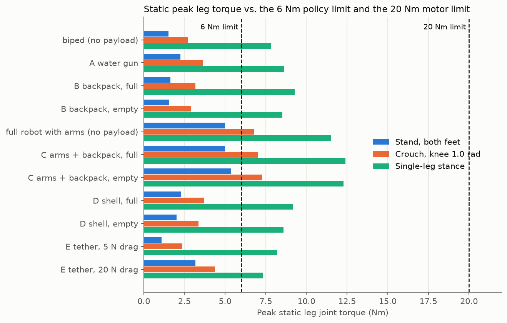
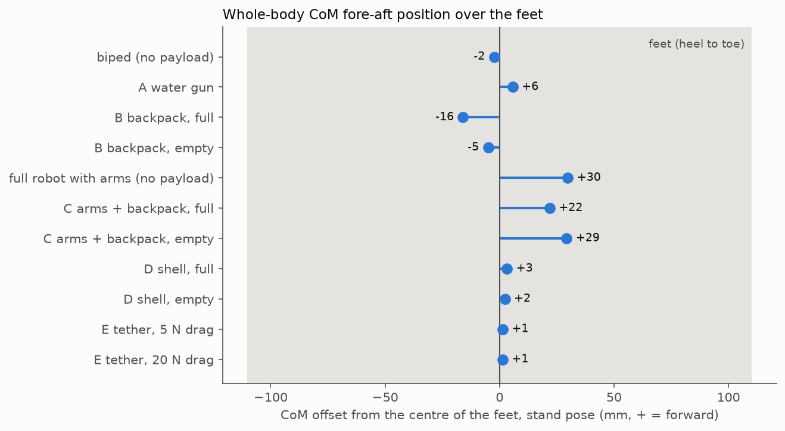
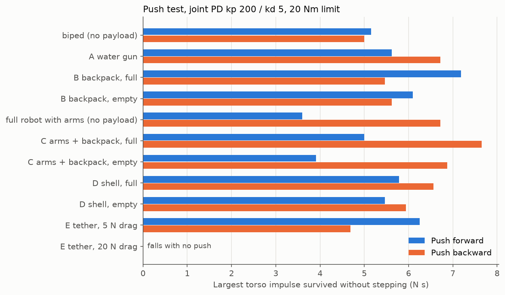
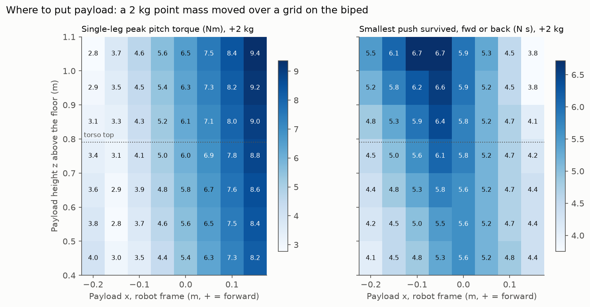
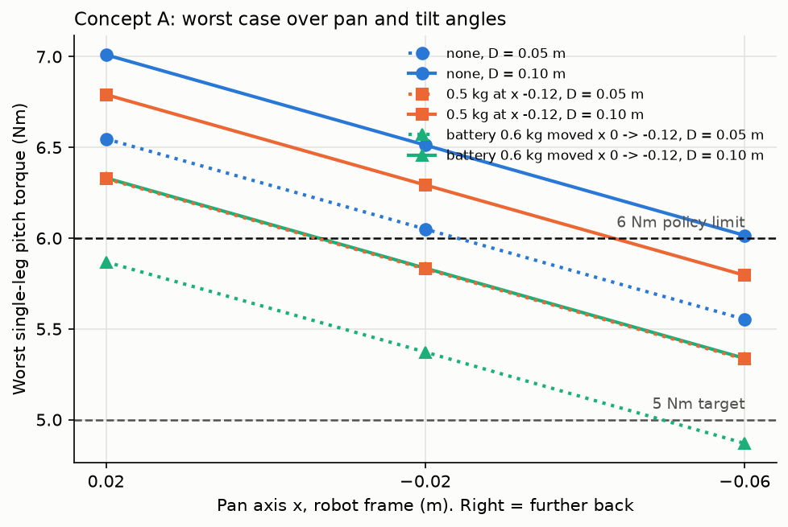

# Payload check: can the BHL legs carry each body concept?

This folder answers one question with MuJoCo simulation numbers.
Can the Berkeley Humanoid Lite (BHL) legs carry the payload of body concepts A to E, and where should the mass go?

Status: **tested in simulation** (MuJoCo 3.15, Python 3.12).
Nothing here is measured on board.
All payload masses are **estimates**. The BHL masses come from the BHL URDF files.

## Short answer

1. In the normal stand pose, all concepts stay well below 6 Nm, except C (5.0 to 5.4 Nm).
2. In a crouch (knee 1.0 rad), C goes above 6 Nm (7.0 to 7.3 Nm). A, B, D and E stay below 4.4 Nm.
3. In slow single-leg stance, every model goes above 6 Nm. This includes the bare biped (7.8 Nm at the hip roll joint).
4. No model reaches the 20 Nm motor limit in any static pose. The smallest margin is 7.6 Nm (C, single-leg stance).
5. C (full robot with arms) is the worst concept by a large margin. The arms add 5 kg and move the centre of mass (CoM) 30 mm forward.
6. B (backpack) is the best tank concept. The water behind the torso partly balances the forward lean of the BHL stand pose.
7. Put mass slightly behind the torso centre (x = -0.10 to -0.15 m). Height has almost no static effect.
8. When the tank empties, the CoM of B moves 11 mm forward and the CoM of C moves 7 mm forward. D changes little.
9. A plain joint PD controller with the policy gains (kp 20, kd 2) cannot stand any model, not even the bare biped.
10. A 20 N hose drag on E makes every plain PD stance fall backward. 5 N is not a problem.

The details, the limits of these numbers, and the method follow below.
Round 2 (concept A variants) is near the end of this page. It recommends the pan axis at x = -0.06 m.
Round 3 uses the CAD parts. The worst single-leg pitch torque is 5.2 Nm for A_real and 3.9 Nm for B_real (full).
Round 4 checks motor heat at 6 Nm. The result is unknown but probably acceptable for the motor copper. 4 Nm makes A_real and B_real fall in simulation.

## How to run

1. Install the environment once, from the repository root (see the root README).

```bash
uv sync
```

2. Fetch the Berkeley assets once, from the repository root.

```bash
scripts/fetch_bhl_assets.sh
```

3. Build the model files and run the model self-check (2 s).

```bash
cd sim/payload && uv run python models.py
```

4. Run the static and dynamic analysis (about 1 min). It writes `results/results.json`.

```bash
uv run python analyze.py
```

5. Run the payload placement sweep (2 to 5 min). It writes `results/placement.json`.

```bash
uv run python placement.py
```

6. Make the tables and plots. It writes `results/results.md` and `results/*.png`.

```bash
uv run python report.py
```

7. When you change code, run the fast self-check (mass and left/right symmetry asserts).

```bash
uv run python analyze.py check
```

8. Run the concept A variant study (about 1 min). It writes `results/a_variants.md`, `a_variants.json` and `a_variants.png`.

```bash
uv run python variants_a.py
```

9. Run the round 3 comparison of the CAD-based models (about 30 s). It writes `results/real_parts.md`.

```bash
uv run python real_parts.py
```

10. Run the round 4 walking torque logs (about 10 s). Run it from the repository root. It writes `results/heat.md`.

```bash
uv run python sim/payload/heat.py
```

## Files

| File | What it does |
|---|---|
| `models.py` | Builds the MuJoCo models, holds the payload table `PARTS`, self-check of the masses. |
| `poses.py` | Leg poses and placement on the floor with flat feet. |
| `analyze.py` | Static torques, CoM offsets, PD standing test, push test, self-check. |
| `placement.py` | Moves a 2 kg point mass over a grid of positions. Finds the mass budget. |
| `report.py` | Writes `results/results.md` and the PNG plots. |
| `variants_a.py` | Round 2: concept A variants (pan axis, pan and tilt angle, counterweight). |
| `real_parts.py` | Round 3: compares A_real and B_real (from the CAD outputs) with the older A and B models. |
| `heat.py` | Round 4: walks the BHL policy for 60 s, logs joint torques, RMS, time above 4 Nm, copper loss estimate. |
| `models/bhl_<variant>.xml` | Model files for reuse (for example by `sim/rl/`). |
| `results/` | `results.json`, `placement.json`, `results.md`, PNG plots. |

## Model files for reuse

The model files are in `models/`. Each file is a full scene: robot, payload, floor and light.
Variants: `biped`, `full`, `A`, `A_v0`, `B`, `B_empty`, `C`, `C_empty`, `D`, `D_empty`, `E`.
`A` is A v1 from round 2 (pan axis moved back). `A_v0` is the first version of A.
Round 3 adds `A_real`, `B_real` and `B_real_empty`, built from the CAD outputs.

- Each file has a keyframe `stand`. It holds the BHL stand pose with both feet flat, 1 mm above the floor.
- The actuators are the original BHL `motor` actuators with forcerange ±20 Nm. The sensors are the original BHL sensors.
- Each payload part is a body `payload_<name>` with mass and box inertia. It has no joint, so it is welded to its parent.
- The parent is the base, except the lance of C. The lance is welded to `arm_right_hand_link`.
- Payload boxes are visual only (`contype 0`, `conaffinity 0`). They do not collide.
- The full robot (`full`, `C`, `C_empty`) has 22 actuators. The arm targets for C are `ARM_POSE` in `models.py` (right arm forward). The keyframe holds this arm pose.
- E has a site `hose_connector` at the back of the pelvis. Apply the hose drag force there, 5 to 20 N, backward.
- The mesh path in each file is relative to `models/`. The files work from any working directory.
- Load a model with `mujoco.MjModel.from_xml_path("sim/payload/models/bhl_B.xml")`.

## Fixes to the BHL assets

I did not edit `third_party/`. `models.py` reads the original MJCF files and makes these changes in memory:

1. The MJCF files say `meshdir="assets"` and `file="merged/..."`. The meshes are in `../meshes` without `merged/`. `models.py` sets the correct path.
2. The biped MJCF has the same visual error as the biped URDF. It places `base_visual.stl` at the biped base CoM (z = 0.638 m). The full MJCF places the same mesh at z = 0.675 m. The torso mesh is 3.7 cm too low in the biped MJCF. `models.py` uses the full MJCF placement. This changes the visual only, not the inertia.

## Important finding: the stand pose leans the torso forward

The BHL stand pose is hip pitch -0.2, knee 0.4, ankle pitch -0.3 rad.
The sum of these angles is -0.1 rad, not 0. With an upright torso, the feet point 0.1 rad toes-up.
The Blender renders in `cad/` show this: upright torso, tilted feet.
On a real floor the feet are flat. Then the whole torso leans **0.1 rad (5.7°) forward**.
All simulations here use flat feet and this forward lean.
A part at 0.9 m height moves about 8 cm forward compared with the Blender renders.
This is why mass behind the torso helps.

## Method

### Terms

- **CoM**: centre of mass of the whole robot.
- **CoP**: centre of pressure, the point under a foot where the total floor force acts. It must stay inside the sole.
- **Support polygon**: the area under and between the two feet. Here, "CoM offset" is the fore-aft distance from the CoM to the centre of the two soles.
- **PD control**: each joint motor pushes toward a target angle. Torque = kp × angle error - kd × joint speed.
- **Impulse**: force × time, in N s. A 5 N s push changes the speed of a 12 kg robot by about 0.4 m/s.

### Models

- Biped = BHL legs and torso, 11.34 kg. Full = BHL with arms, 16.33 kg. Both match the URDF masses (asserted in the self-check).
- Concepts A, B, D and E use the biped. Concept C uses the full robot with the right arm forward.
- Payload positions come from `cad/concepts.py`. Robot frame: x forward, y left, z up, feet on the floor, torso upright.
- `models.py` adds 0.039 m to each z value to get the BHL base frame. This is the shift that `cad/concepts.py` uses.

### Payload assumptions (estimates)

All masses are **estimates**. The "Box" column gives the size used for the inertia (solid box) and for the visual box.
Positions are in the robot frame (torso upright, feet on the floor). T = 0.791 m is the top of the torso frame.
The A rows are A v0. Round 2 below gives the parts of A v1.

| Concept | Part | Mass (kg) | Position x, y, z (m) | Box (m) | Basis for the estimate |
|---|---|---|---|---|---|
| A | deck plate + U bracket | 0.20 | 0, 0, T+0.010 | 0.15 × 0.17 × 0.02 | aluminium plate and bracket |
| A | pan servo | 0.07 | 0, 0, T+0.025 | 0.07 × 0.07 × 0.03 | large hobby servo |
| A | tilt servo | 0.07 | 0, 0.067, T+0.09 | 0.04 × 0.02 × 0.04 | large hobby servo |
| A | water gun body (with battery) | 0.60 | 0.03, 0, T+0.095 | 0.30 × 0.07 × 0.085 | toy electric water gun |
| A | water in the gun tank | 0.45 | -0.005, 0, T+0.173 | 0.15 × 0.068 × 0.068 | about 0.45 L tank on the gun |
| A | camera | 0.05 | 0.115, 0, T+0.151 | 0.03 × 0.04 × 0.028 | small USB camera |
| A | **total** | **1.44** | | | |
| B | backpack aluminium frame | 0.30 | -0.11, 0, 0.67 | 0.11 × 0.13 × 0.26 | rails, bars, tray, top plate |
| B | tank shell | 0.15 | -0.145, 0, 0.643 | 0.10 × 0.10 × 0.18 | 1.4 L clear bottle |
| B | water, tank full | 1.40 | -0.145, 0, 0.643 | 0.10 × 0.10 × 0.18 | 1.4 L (r 0.05 m, h 0.18 m) |
| B | 12 V self-priming pump | 0.35 | -0.145, 0, 0.816 | 0.06 × 0.09 × 0.035 | small diaphragm pump |
| B | chest plate | 0.15 | 0.078, 0, 0.665 | 0.008 × 0.17 × 0.22 | printed plate |
| B | neck + pan servo | 0.08 | 0, 0, T+0.016 | 0.06 × 0.06 × 0.03 | hobby servo |
| B | head shell + RGB + thermal cameras | 0.22 | 0, 0, T+0.075 | 0.09 × 0.13 × 0.075 | printed shell, two cameras |
| B | nozzle | 0.05 | 0.085, 0, T+0.075 | 0.09 × 0.02 × 0.02 | brass nozzle |
| B | **total** (empty: 1.30) | **2.70** | | | |
| C | backpack aluminium frame | 0.30 | -0.11, 0, 0.67 | 0.11 × 0.13 × 0.26 | as B |
| C | tank shell | 0.12 | -0.145, 0, 0.628 | 0.09 × 0.09 × 0.15 | 1.0 L bottle |
| C | water, tank full | 0.95 | -0.145, 0, 0.628 | 0.09 × 0.09 × 0.15 | 0.95 L (r 0.045 m, h 0.15 m) |
| C | pump | 0.35 | -0.145, 0, 0.816 | 0.06 × 0.09 × 0.035 | as B |
| C | chest plate | 0.15 | 0.078, 0, 0.665 | 0.008 × 0.17 × 0.22 | as B |
| C | helmet + cameras + neck | 0.25 | 0, 0, T+0.09 | 0.16 × 0.13 × 0.12 | printed helmet, two cameras |
| C | lance (valve + nozzle + hose on arm) | 0.20 | 5 cm past the right hand, along the forearm | 0.15 × 0.04 × 0.04 | welded to the right hand |
| C | **total** (empty: 1.37), plus 4.99 kg arms and shoulder motors from the URDF | **2.32** | | | |
| D | sealed shell | 0.60 | -0.005, 0, 0.69 | 0.21 × 0.27 × 0.26 | thin shell |
| D | front panel + visor + cameras | 0.20 | 0.095, 0, 0.72 | 0.02 × 0.215 × 0.2 | |
| D | tank shell | 0.10 | -0.01, 0, 0.60 | 0.16 × 0.22 × 0.05 | flat tank at the shell bottom |
| D | water, tank full | 1.00 | -0.01, 0, 0.60 | 0.16 × 0.22 × 0.05 | 1.0 L |
| D | pump | 0.30 | -0.04, 0, 0.66 | 0.06 × 0.09 × 0.035 | inside the shell |
| D | chest nozzle + guard | 0.08 | 0.13, 0, 0.665 | 0.08 × 0.06 × 0.06 | |
| D | handle, beacon, level gauge | 0.05 | -0.04, 0, 0.84 | 0.1 × 0.17 × 0.06 | |
| D | **total** (empty: 1.33) | **2.33** | | | |
| E | deck plate + U bracket | 0.20 | 0, 0, T+0.010 | 0.15 × 0.17 × 0.02 | as A |
| E | pan servo | 0.07 | 0, 0, T+0.025 | 0.07 × 0.07 × 0.03 | as A |
| E | tilt servo | 0.07 | 0, 0.067, T+0.09 | 0.04 × 0.02 × 0.04 | as A |
| E | valve + coil + nozzle | 0.25 | 0.03, 0, T+0.095 | 0.17 × 0.04 × 0.045 | solenoid valve |
| E | camera mast + pod | 0.15 | -0.05, 0.07, T+0.15 | 0.05 × 0.08 × 0.1 | |
| E | chest plate | 0.15 | 0.078, 0, 0.665 | 0.008 × 0.17 × 0.22 | as B |
| E | hose on the back, with water | 0.10 | -0.10, -0.03, 0.68 | 0.02 × 0.02 × 0.3 | 0.4 m of hose |
| E | swivel + clamp | 0.06 | -0.09, 0, 0.53 | 0.05 × 0.04 × 0.04 | brass swivel |
| E | **total** | **1.05** | | | |
| E | hose drag (force, not mass) | 5 N and 20 N | -0.115, 0, 0.53 | | horizontal, backward |

Other assumptions:

- Water is a rigid mass. Sloshing is not modelled.
- "Tank full" means the full bottle volume. This is the worst case.
- The weight of the hose that trails on the floor (E) is not modelled. Only the horizontal drag is modelled.

### Static torques

- Stand: BHL stand pose, both feet flat on the floor.
- Crouch: hip pitch -0.42, knee 1.0, ankle pitch -0.68 rad. The angle sum stays -0.1 rad, so the torso lean does not change.
- Single-leg stance: all weight on one foot. The pelvis moves sideways over the stance foot (hip roll and ankle roll turn by the same angle in both legs). This is a slow (quasi-static) weight shift. The code tests both feet and keeps the worse one.
- The sideways shift stops at the hip roll joint limit (0.175 rad). For the biped, the CoM then stays about 5 mm short of the sole centre. The CoP is still inside the sole.
- Method: zero speed, gravity only. Each foot in contact carries a full force and moment at the centre of its sole.
- With two feet, the force split between the feet is not unique. The code uses the split with the smallest sum of squared joint torques. This is the best case for a controller.
- The code checks that the CoP of each foot stays inside the sole. It does in all cases.

### Dynamic tests

- PD control to the stand keyframe, torque clipped at 6 Nm or 20 Nm. Time step 2 ms. 10 s.
- "Falls" means the torso tilts more than 0.6 rad or drops more than 0.15 m.
- Gains: kp 20 / kd 2 (Isaac Lab policy gains), kp 50 / kd 2, and kp 200 / kd 5.
- I added kp 200 / kd 5. It was not in the request. With kp 20 and kp 50 the heavier models fall, so these gains give no comparison.
- I used kd 2 with kp 50. The request did not give kd for kp 50.
- Push test: a horizontal force on the torso for 0.1 s at t = 1 s. The value is the largest impulse with no fall in the next 3 s. Bisection, 7 steps, resolution 0.16 N s.
- The PD controller cannot step, so "survives" means the feet stay in place and the robot does not fall.

## Results

Tables are copied from `results/results.md` (generated by `report.py`).

| Model | Total mass (kg) | CoM height (m) | CoM fore-aft offset (mm, + = forward) | Stand peak (Nm, joint) | Crouch peak (Nm, joint) | Single-leg peak, all joints (Nm, joint) | Single-leg peak, pitch joints (Nm, joint) | Margin to 6 Nm, single-leg pitch (Nm) | Margin to 20 Nm, single-leg all (Nm) |
|---|---|---|---|---|---|---|---|---|---|
| biped (no payload) | 11.34 | 0.362 | -2 | 1.5 (left_ankle_pitch) | 2.7 (left_ankle_pitch) | 7.8 (right_hip_roll) | 4.3 (right_ankle_pitch) | +1.7 | +12.2 |
| A water gun | 12.78 | 0.421 | +6 | 2.3 (left_ankle_pitch) | 3.6 (left_ankle_pitch) | 8.6 (right_hip_roll) | 5.9 (right_ankle_pitch) | +0.1 | +11.4 |
| B backpack, full | 14.04 | 0.427 | -16 | 1.6 (left_knee_pitch) | 3.2 (left_knee_pitch) | 9.3 (right_hip_roll) | 3.6 (right_ankle_pitch) | +2.4 | +10.7 |
| B backpack, empty | 12.64 | 0.402 | -5 | 1.6 (left_ankle_pitch) | 2.9 (left_ankle_pitch) | 8.5 (right_hip_roll) | 4.5 (right_ankle_pitch) | +1.5 | +11.5 |
| full robot with arms (no payload) | 16.33 | 0.449 | +30 | 5.0 (left_ankle_pitch) | 6.8 (left_ankle_pitch) | 11.5 (right_ankle_pitch) | 11.5 (right_ankle_pitch) | -5.5 | +8.5 |
| C arms + backpack, full | 18.65 | 0.479 | +22 | 5.0 (left_ankle_pitch) | 7.0 (left_ankle_pitch) | 12.4 (right_hip_roll) | 11.6 (right_ankle_pitch) | -5.6 | +7.6 |
| C arms + backpack, empty | 17.70 | 0.471 | +29 | 5.4 (left_ankle_pitch) | 7.3 (left_ankle_pitch) | 12.3 (right_ankle_pitch) | 12.3 (right_ankle_pitch) | -6.3 | +7.7 |
| D shell, full | 13.67 | 0.409 | +3 | 2.3 (left_ankle_pitch) | 3.7 (left_ankle_pitch) | 9.2 (right_hip_roll) | 6.0 (right_ankle_pitch) | +0.0 | +10.8 |
| D shell, empty | 12.67 | 0.395 | +2 | 2.0 (left_ankle_pitch) | 3.4 (left_ankle_pitch) | 8.6 (right_hip_roll) | 5.4 (right_ankle_pitch) | +0.6 | +11.4 |
| E tether, 5 N drag | 12.39 | 0.399 | +1 | 1.1 (left_knee_pitch) | 2.3 (left_knee_pitch) | 8.2 (right_hip_roll) | 3.1 (right_ankle_pitch) | +2.9 | +11.8 |
| E tether, 20 N drag | 12.39 | 0.399 | +1 | 3.2 (left_knee_pitch) | 4.4 (left_knee_pitch) | 7.3 (right_hip_roll) | 5.2 (right_knee_pitch) | +0.8 | +12.7 |

Centre of pressure outside a foot (pose not statically possible): none.

Peak arm joint torque in the stand pose, arms in ARM_POSE:

- full robot with arms (no payload): 2.8 Nm
- C arms + backpack, full: 3.4 Nm
- C arms + backpack, empty: 3.4 Nm

| Model | kp 20 / kd 2 / 6 Nm | kp 20 / kd 2 / 20 Nm | kp 50 / kd 2 / 6 Nm | kp 50 / kd 2 / 20 Nm | kp 200 / kd 5 / 6 Nm | kp 200 / kd 5 / 20 Nm | Push fwd / back (N s), kp 50 / kd 2 / 20 Nm | Push fwd / back (N s), kp 200 / kd 5 / 6 Nm | Push fwd / back (N s), kp 200 / kd 5 / 20 Nm |
|---|---|---|---|---|---|---|---|---|---|
| biped (no payload) | falls at 1.1 s | falls at 1.1 s | stands, 2.1 Nm | stands, 2.1 Nm | stands, 1.6 Nm | stands, 1.6 Nm | 4.1 / 4.5 | 4.1 / 5.0 | 5.2 / 5.0 |
| A water gun | falls at 0.8 s | falls at 0.8 s | falls at 1.5 s | stands, 5.1 Nm | stands, 2.6 Nm | stands, 2.6 Nm | 2.2 / 5.9 | 3.4 / 5.0 | 5.6 / 6.7 |
| B backpack, full | falls at 1.3 s | falls at 1.3 s | stands, 2.6 Nm | stands, 2.6 Nm | stands, 1.7 Nm | stands, 1.7 Nm | 6.1 / 3.3 | 4.8 / 5.5 | 7.2 / 5.5 |
| B backpack, empty | falls at 1.2 s | falls at 1.2 s | stands, 2.5 Nm | stands, 2.5 Nm | stands, 1.7 Nm | stands, 1.7 Nm | 4.4 / 5.2 | 4.2 / 5.5 | 6.1 / 5.6 |
| full robot with arms (no payload) | falls at 0.5 s | falls at 0.5 s | falls at 0.6 s | falls at 0.6 s | falls at 0.8 s | stands, 6.4 Nm | 0.0 / 0.0 | 0.0 / 0.0 | 3.6 / 6.7 |
| C arms + backpack, full | falls at 0.6 s | falls at 0.6 s | falls at 0.7 s | falls at 0.6 s | falls at 0.9 s | stands, 6.7 Nm | 0.0 / 0.0 | 0.0 / 0.0 | 5.0 / 7.7 |
| C arms + backpack, empty | falls at 0.5 s | falls at 0.5 s | falls at 0.6 s | falls at 0.6 s | falls at 0.8 s | stands, 7.1 Nm | 0.0 / 0.0 | 0.0 / 0.0 | 3.9 / 6.9 |
| D shell, full | falls at 0.8 s | falls at 0.8 s | falls at 1.7 s | stands, 4.9 Nm | stands, 2.6 Nm | stands, 2.6 Nm | 3.0 / 6.2 | 3.3 / 4.7 | 5.8 / 6.6 |
| D shell, empty | falls at 0.8 s | falls at 0.8 s | stands, 3.7 Nm | stands, 3.7 Nm | stands, 2.2 Nm | stands, 2.2 Nm | 3.8 / 5.8 | 3.6 / 4.8 | 5.5 / 5.9 |
| E tether, 5 N drag | falls at 6.4 s | falls at 6.4 s | stands, 1.2 Nm | stands, 1.2 Nm | stands, 1.1 Nm | stands, 1.1 Nm | 5.8 / 3.9 | 5.0 / 4.7 | 6.2 / 4.7 |
| E tether, 20 N drag | falls at 0.6 s | falls at 0.6 s | falls at 0.8 s | falls at 0.8 s | falls at 1.6 s | falls at 1.6 s | 0.0 / 0.0 | 0.0 / 0.0 | 0.0 / 0.0 |

"stands, X Nm": the robot stays up for 10 s. X is the peak leg torque in the last 2 s. Push values: the largest impulse on the torso (0.1 s) with no fall in the next 3 s. 0 means that the model does not stand.

Mass budget: extra point mass at the torso top centre (x 0, z 0.791), robot frame, on the biped:

| Added mass (kg) | Stand peak (Nm) | Crouch peak (Nm) | Single-leg peak, pitch joints (Nm) | Single-leg peak, all joints (Nm) |
|---|---|---|---|---|
| 0 | 1.5 | 2.7 | 4.3 | 7.8 |
| 2 | 2.3 | 3.7 | 6.0 | 8.9 |
| 4 | 3.1 | 4.7 | 7.7 | 9.9 |
| 6 | 3.9 | 5.7 | 9.4 | 11.0 |
| 8 | 4.7 | 6.7 | 11.0 | 12.0 |
| 10 | 5.4 | 7.7 | 12.7 | 13.1 |

- stand: at or below 6 Nm up to 10 kg added
- stand: at or below 20 Nm up to 10 kg added
- crouch: above 6 Nm from 7.0 kg added
- crouch: at or below 20 Nm up to 10 kg added
- single-leg, pitch joints: above 6 Nm from 2.0 kg added
- single-leg, pitch joints: at or below 20 Nm up to 10 kg added
- single-leg, all joints: above 6 Nm already with 0 kg added
- single-leg, all joints: at or below 20 Nm up to 10 kg added

Mass budget: extra point mass at the backpack (x -0.145, z 0.64), robot frame, on the biped:

| Added mass (kg) | Stand peak (Nm) | Crouch peak (Nm) | Single-leg peak, pitch joints (Nm) | Single-leg peak, all joints (Nm) |
|---|---|---|---|---|
| 0 | 1.5 | 2.7 | 4.3 | 7.8 |
| 2 | 1.8 | 3.2 | 3.0 | 8.9 |
| 4 | 3.0 | 4.7 | 4.8 | 10.0 |
| 6 | 4.3 | 6.3 | 7.1 | 11.1 |
| 8 | 5.5 | 7.8 | 9.4 | 12.1 |
| 10 | 6.7 | 9.4 | 11.7 | 13.2 |

- stand: above 6 Nm from 9.0 kg added
- stand: at or below 20 Nm up to 10 kg added
- crouch: above 6 Nm from 6.0 kg added
- crouch: at or below 20 Nm up to 10 kg added
- single-leg, pitch joints: above 6 Nm from 5.5 kg added
- single-leg, pitch joints: at or below 20 Nm up to 10 kg added
- single-leg, all joints: above 6 Nm already with 0 kg added
- single-leg, all joints: at or below 20 Nm up to 10 kg added

### Plots









## Conclusions

### Which concepts exceed the limits

- **20 Nm (motor limit):** no model reaches it in any static pose. The smallest margin is 7.6 Nm (C, single-leg stance).
- **6 Nm (policy limit), C:** C goes above 6 Nm in the crouch (7.0 to 7.3 Nm). It also goes above 6 Nm on the pitch joints in single-leg stance (11.6 to 12.3 Nm). In the stand pose it is 0.6 to 1.0 Nm below 6 Nm.
- **6 Nm, A and D:** these are at the limit in single-leg stance on the pitch joints (A 5.9 Nm, D full 6.0 Nm). The forward, high mass of the gun (A) and the shell front (D) causes this.
- **6 Nm, B and E:** these stay below 6 Nm on all pitch joints in all poses. Their single-leg pitch peaks are 3.6 to 4.5 Nm (B) and 3.1 to 5.2 Nm (E).
- **6 Nm, hip roll in single-leg stance:** every model is above 6 Nm, also the bare biped (7.8 Nm). The payloads of A, B and D add 0.7 to 1.5 Nm. C is 4.6 Nm above the biped, mostly because of the arms.
- The BHL walking policy was trained with a 6 Nm limit. So its gait does not hold this slow single-leg pose. I treat the hip roll value as an upper bound. The walking check in `sim/rl/` must confirm this.

### Dynamic tests

- With kp 20 / kd 2 (the policy gains), plain PD falls for every model, also the bare biped. Most models fall within 1.5 s. Joint stiffness alone cannot hold the robot up. The policy must supply the balance.
- With kp 50 / kd 2 and the 6 Nm limit, these stand for 10 s: the biped, B full, B empty, D empty and E (5 N).
- With kp 50, A and D (full) stand only with the 20 Nm limit. C and the full robot fall at every limit.
- With kp 200 / kd 5, every model stands except E with 20 N drag. C needs more than 6 Nm (6.7 to 7.1 Nm in steady stance).
- Push test (kp 200 / kd 5 / 20 Nm): the biped survives 5.2 N s forward and 5.0 N s backward. B full survives the largest forward push (7.2 N s). Of the concepts, C empty survives the smallest forward push (3.9 N s).

### Payload budget that remains (biped, static, 6 Nm, single-leg stance, pitch joints)

- Mass at the torso top centre (x = 0, z = 0.791 m): the pitch joints reach 6 Nm at about **2 kg** added.
- Mass at the backpack tank position (x = -0.145, z = 0.64 m): the pitch joints reach 6 Nm at about **5.5 kg** added.
- In the stand pose, both places allow 9 kg or more. In the crouch, they allow 6 to 7 kg.
- No pose reaches 20 Nm with 10 kg added at either place.
- Remaining margin to 6 Nm (pitch joints, single-leg stance, full tank): A 0.1, B 2.4, D 0.0, E 2.9 Nm. C has no margin (-5.6 Nm).

### Where to put the mass

1. **Fore-aft:** put heavy parts behind the torso centre, at x = -0.10 to -0.15 m (robot frame). This is the backpack zone of B and C.
2. The reason: the ankle pitch axis is 36 mm behind the sole centre, and the stand pose leans the torso 0.1 rad forward. Mass behind the torso moves the CoM back over the ankles.
3. In the placement map, 2 kg at x = -0.15 m gives 2.8 to 3.7 Nm. The same 2 kg at x = +0.15 m gives 8.2 to 9.4 Nm.
4. **Avoid front mass.** The gun of A, the shell front of D and the forward arm and lance of C cost the most torque.
5. **Height:** height has a small static effect. At a fixed x, z from 0.45 to 1.05 m changes the torque by 1.2 Nm or less. This change comes from the forward lean.
6. In the push test with stiff PD, a higher mass at x = -0.05 to -0.10 m survived larger pushes. The best value was 6.7 N s at z = 1.05 m, against 4.8 to 5.3 N s at z = 0.45 m. I did not test the effect of height on walking.
7. **Sideways:** keep the mass on the centre line (y = 0). The right arm of C makes the right single-leg stance 1 Nm worse than the left.

### Effect of the tank emptying

| Concept | CoM offset full / empty (mm) | Single-leg pitch peak full / empty (Nm) | Push forward full / empty (N s, kp 200, 20 Nm) |
|---|---|---|---|
| B | -16 / -5 | 3.6 / 4.5 | 7.2 / 6.1 |
| C | +22 / +29 | 11.6 / 12.3 | 5.0 / 3.9 |
| D | +3 / +2 | 6.0 / 5.4 | 5.8 / 5.5 |

- In B and C the water sits behind the torso. When the tank empties, the CoM moves forward (B 11 mm, C 7 mm). The torque goes up a little.
- In D the tank sits near the centre, low in the shell. Emptying it moves the CoM by 1 mm and lowers the torque.
- The walking policy must work with full and empty tanks. I suggest that `sim/rl/` trains with both models, or with a random payload mass.

### Hose drag on E

- 5 N drag is not a problem: E stands with every gain from kp 50 up.
- 20 N drag is possible in theory: the CoP moves 86 mm back, 24 mm before the heel edge.
- In practice every plain PD stance falls backward with 20 N. The robot must lean forward to hold this drag. A balance controller or the policy must do this.

### Overall

B (backpack) is the best concept for the legs. A, D and E are possible but have little margin in single-leg stance (A, D) or need active balance against hose drag (E). C exceeds the 6 Nm policy limit in several poses and needs stiff joints to stand.

## Round 2: concept A variants

Status: **tested in simulation**. Static torques, plus one PD and push check of the two A model files.

**Correction:** I found a bug in `placement.py` and fixed it. The script changed the probe mass at run time but did not update the stored subtree mass. This made the whole-body CoM slightly wrong. After the fix, the mass budget tables above changed by 0.2 Nm or less. The budget limits (2 kg and 5.5 kg) did not change. The concept tables did not change. I updated the budget tables above.

### Recommendation for the CAD (deck plate and pan axis)

1. Put the pan axis at **x = -0.06 m**. This was the most rearward position tested. Further back is better: each 1 cm back lowers the worst pitch torque by 0.11 to 0.13 Nm.
2. Keep the gun centre close to the pan axis. D = 0.05 m instead of 0.10 m saves 0.4 to 0.5 Nm.
3. If the BHL battery can move, move it back. Moving 0.6 kg from x = 0 to x = -0.12 m saves 0.6 to 0.7 Nm.
4. Do not add a counterweight at x = -0.12 m. 0.3 to 0.5 kg there saves only 0.1 to 0.3 Nm.
5. Check that the gun clears the torso, the tilt servo and the camera at all pan angles. The model does not check collisions.

**Worst case with the recommendation** (pan axis -0.06 m, D = 0.10 m, no counterweight), slow single-leg stance:

- Pitch joints: **6.0 Nm** (ankle pitch, gun forward). With D = 0.05 m: 5.6 Nm.
- All joints: **9.4 Nm** (hip roll, gun panned 90° to the side, stance on the other leg). With D = 0.05 m: 9.1 Nm.
- With the current pan axis (+0.02 m) the same values are 6.5 to 7.0 Nm and 9.1 to 9.5 Nm.
- No tested case reaches 20 Nm. The highest value of all A variants is 9.7 Nm (with the 0.5 kg counterweight). The margin to 20 Nm is at least 10.3 Nm.

**Below 5 Nm on the pitch joints?** Only one tested case is below 5 Nm (4.9 Nm). It has the pan axis at -0.06 m, D = 0.05 m and the battery moved back. A counterweight alone does not bring A below 5 Nm.

### What I assumed

- The A add-ons keep the A v0 total of 1.44 kg (estimates). The deck plate is 0.12 kg and stays at x = 0.
- The pan servo and U bracket are 0.15 kg on the pan axis. The tilt servo is 0.07 kg, 0.067 m to the side of the pan axis.
- The gun with water and camera is 1.10 kg. Its centre is D = 0.05 or 0.10 m in front of the tilt axis and 0.03 m above it. The tilt axis is at z = T + 0.095 m.
- Pan angle: + turns the gun to the left. Tilt angle: + raises the nozzle.
- The BHL battery position and mass are not in our sources. I assumed a 0.6 kg battery (a typical 6S 4000 mAh LiPo, estimate) that moves from x = 0 to x = -0.12 m.
- The counterweight sits at z = 0.65 m. The stand pose leans 0.1 rad forward, so this point is only about 5 cm behind the ankle axis. This is why it helps so little.
- `docs/hardware/README.md` plans a Daiso water gun with an about 100 mL tank for the first test. That gun is probably lighter than 1.10 kg. Nobody weighed it. If it is lighter, the torques here are an upper bound.

### Pan and tilt effect

- Pan to ±90° moves the CoM sideways by up to 5 mm (D = 0.05 m) or 9 mm (D = 0.10 m).
- Pan to ±90° also moves the CoM about 8 mm back and lowers the pitch torque by about 1 Nm. The gun pointing forward (pan 0°) is the worst case for the pitch joints.
- A gun panned to one side raises the hip roll torque of the opposite stance leg. It reaches 9.4 Nm, against 8.6 Nm with the gun forward.
- Tilt from -30° to +20° changes the leg torques by 0.2 Nm or less. Tilt does not matter for the legs.

### Model files

- I updated `models/bhl_A.xml` to A v1: pan axis x = -0.06 m, gun centre 0.10 m in front of it, pan 0°, tilt 0°. The parts are `PARTS["A"]` in `models.py`.
- I kept the first version as `models/bhl_A_v0.xml`. The first results tables above use A v0, so they did not change.
- A v0 placed the gun centre only 2 cm in front of a pan axis at x = 0. The gun of the coordinator brief sits 5 to 10 cm in front of the axis.
- So A v1 shows almost the same torque as A v0 (6.0 against 5.9 Nm), but with a more realistic gun position. With the same gun position, A v1 is 1.0 Nm better than the current pan axis.

#### A variants: worst case over pan (0, ±45, ±90°) and tilt (-30, 0, +20°), no counterweight

| Pan axis x (m) | Gun offset D (m) | CoM fore-aft range (mm) | CoM sideways range (mm) | Worst single-leg pitch torque (Nm, at pan / tilt) | Worst single-leg torque, all joints (Nm, at pan / tilt) | Stand peak at pan 0, tilt 0 (Nm) | Crouch peak at pan 0, tilt 0 (Nm) |
|---|---|---|---|---|---|---|---|
| +0.02 | 0.05 | +5 to +11 | -5 to +5 | 6.5 (+0° / -30°) | 9.1 (+90° / -30°) | 2.6 | 3.9 |
| +0.02 | 0.10 | +5 to +15 | -9 to +9 | 7.0 (+0° / +0°) | 9.5 (+90° / -30°) | 2.8 | 4.2 |
| -0.02 | 0.05 | +1 to +7 | -5 to +5 | 6.0 (+0° / -30°) | 9.1 (+90° / -30°) | 2.3 | 3.7 |
| -0.02 | 0.10 | +1 to +11 | -9 to +9 | 6.5 (+0° / +0°) | 9.4 (+90° / -30°) | 2.6 | 3.9 |
| -0.06 | 0.05 | -3 to +3 | -5 to +5 | 5.6 (+0° / -30°) | 9.1 (+90° / -30°) | 2.0 | 3.4 |
| -0.06 | 0.10 | -3 to +6 | -9 to +9 | 6.0 (+0° / +0°) | 9.4 (+90° / -30°) | 2.3 | 3.7 |

#### A variants: counterweight, worst single-leg pitch torque over all pan and tilt angles (Nm)

| Pan axis x (m) | Gun offset D (m) | none | 0.3 kg at x -0.12 | 0.5 kg at x -0.12 | battery 0.6 kg moved x 0 -> -0.12 |
|---|---|---|---|---|---|
| +0.02 | 0.05 | 6.5 | 6.4 | 6.3 | 5.9 |
| +0.02 | 0.10 | 7.0 | 6.9 | 6.8 | 6.3 |
| -0.02 | 0.05 | 6.0 | 5.9 | 5.8 | 5.4 |
| -0.02 | 0.10 | 6.5 | 6.4 | 6.3 | 5.8 |
| -0.06 | 0.05 | 5.6 | 5.4 | 5.3 | 4.9 |
| -0.06 | 0.10 | 6.0 | 5.9 | 5.8 | 5.3 |

#### Pan and tilt effect at pan axis x = -0.06 m, gun offset D = 0.10 m, no counterweight

| Pan (°) | Tilt (°) | CoM fore-aft (mm) | CoM sideways (mm) | Left stance: pitch / all joints (Nm) | Right stance: pitch / all joints (Nm) |
|---|---|---|---|---|---|
| +0 | -30 | +6 | +0 | 5.9 / 8.5 | 6.0 / 8.6 |
| +0 | +0 | +6 | +0 | 6.0 / 8.5 | 6.0 / 8.6 |
| +0 | +20 | +5 | +0 | 5.9 / 8.5 | 5.9 / 8.6 |
| +45 | -30 | +3 | +7 | 5.4 / 7.8 | 5.7 / 9.2 |
| +45 | +0 | +4 | +6 | 5.5 / 7.8 | 5.8 / 9.2 |
| +45 | +20 | +3 | +5 | 5.4 / 7.9 | 5.7 / 9.1 |
| -45 | -30 | +4 | -6 | 5.8 / 9.2 | 5.5 / 7.9 |
| -45 | +0 | +4 | -6 | 5.8 / 9.1 | 5.6 / 7.9 |
| -45 | +20 | +3 | -5 | 5.7 / 9.0 | 5.5 / 8.0 |
| +90 | -30 | -3 | +9 | 4.6 / 7.5 | 5.0 / 9.4 |
| +90 | +0 | -2 | +9 | 4.7 / 7.5 | 5.0 / 9.4 |
| +90 | +20 | -2 | +7 | 4.7 / 7.7 | 5.1 / 9.3 |
| -90 | -30 | -2 | -9 | 5.1 / 9.4 | 4.7 / 7.5 |
| -90 | +0 | -2 | -9 | 5.1 / 9.4 | 4.8 / 7.5 |
| -90 | +20 | -1 | -7 | 5.1 / 9.2 | 4.8 / 7.7 |

#### Model files: A v0 (first version) and A v1 (new bhl_A.xml)

| Model | CoM fore-aft (mm) | Stand peak (Nm) | Crouch peak (Nm) | Single-leg pitch peak (Nm) | Single-leg peak, all joints (Nm) | kp 50 / kd 2 / 6 Nm | kp 200 / kd 5 / 6 Nm | Push fwd / back (N s), kp 200 / kd 5 / 20 Nm |
|---|---|---|---|---|---|---|---|---|
| A_v0 | +6 | 2.3 | 3.6 | 5.9 | 8.6 | falls at 1.5 s | stands, 2.6 Nm | 5.6 / 6.7 |
| A | +6 | 2.3 | 3.7 | 6.0 | 8.6 | falls at 1.4 s | stands, 2.6 Nm | 5.6 / 6.9 |



The full tables, with the pan table for each pan axis position, are in `results/a_variants.md`.

### Why the slow single-leg pose overestimates the hip roll torque

In the slow pose, the robot moves its whole CoM over one foot and holds it there.
The stance hip then holds the torso and the free leg against gravity. Their weight acts about 10 cm to the side of the hip.
So the hip roll motor of the bare biped must hold 7.8 Nm.
In walking, the robot does not move its CoM over the foot. The CoM stays between the feet and sways sideways by a few centimetres.
The body falls toward the free leg for a fraction of a second, and the next step catches it.
The torso and the stance leg fall together, so the hip motor does not hold the full weight. It only controls the motion between them.
The BHL walking policy works with a 6 Nm limit, which agrees with this. The walking check in `sim/rl/` must measure the real value.
The payloads add to the 7.8 Nm slow single-leg peak of the bare biped. A v0 adds 0.8 Nm, B 1.5 Nm, D 1.4 Nm and E (5 N) 0.4 Nm.
C adds 4.6 Nm, mostly because of the arms. A v1 adds up to +1.6 Nm with the gun panned to the side.

**Actuator ratings from `docs/hardware/README.md` (section 2.1):** "No rating found. [P] tested a 6512 up to 20 N·m. [LL] firmware limits: 6 N·m on legs, 1–2 N·m on arms, 20 A current limit."
[P] is the BHL paper (https://arxiv.org/html/2504.17249). [LL] is the BHL low-level code (https://github.com/HybridRobotics/Berkeley-Humanoid-Lite-Lowlevel).
That page gives no continuous torque. It also does not say which leg joints use the 6512 or the smaller 5010 actuator.
So I can compare only with two numbers. All static torques in this study stay below the 20 N·m test value. The slow single-leg torques are above the 6 N·m firmware limit, also for the bare biped.

## Round 3: A_real and B_real from the CAD parts

Status: **tested in simulation**. The masses come from the CAD outputs. They are still estimates: nobody weighed the printed or bought parts.

### What I built

- `models/bhl_A_real.xml`: the concept A top module from `cad/parts/out/assembly.json`, with the gun and the splash guard.
- `models/bhl_B_real.xml` and `models/bhl_B_real_empty.xml`: the backpack from `cad/backpack/`, the splash guard, and the old B head (neck servo, head with cameras, nozzle).
- `models.py` reads both `assembly.json` files when it builds these models (function `real_parts`). If the CAD files change, run `models.py` and `real_parts.py` again.
- The first B model had a red chest plate (0.15 kg). B_real has the splash guard (0.091 kg) in its place.

### Inputs and assumptions

- **A top module:** 0.552 kg at (-0.023, -0.002, 0.843) m without the gun, and 1.452 kg at (-0.046, -0.001, 0.904) m with the gun. Both are from `cad/parts/out/assembly.json`, pan 0°, tilt 0°.
- **A gun:** I computed the gun from the difference of the two cases: 0.90 kg with water at (-0.060, 0.000, 0.941) m. `cad/parts/README.md` says that the gun mass is a guess.
- **A pan axis:** the CAD keeps the pan axis at x = -0.038 m. A pan axis at -0.06 m would sit over the rear rail. Instead, the gun sits 22 mm behind the tilt axis, so its centre is at x = -0.060 m.
- **Splash guard:** 0.091 kg (45 g upper panel, 46 g lower panel), from `cad/backpack/README.md`. It sits on the front face of the torso, centre at about (0.076, 0, 0.672) m.
- **Backpack:** the masses are from `cad/backpack/README.md`. Printed parts 0.502 kg, Seaflo pump 0.570 kg, water 0.946 kg.
- The bottle (0.180 kg) and the screws, straps and hose (0.120 kg) are guesses in that README.
- **Backpack positions:** tank and pump positions from `cad/backpack/out/assembly.json`. I placed the printed parts at the centres of their boxes from the `body.py` parameters.
- The tank is on the left (y = +0.052 m) and the pump on the right (y = -0.054 m). So B_real is not symmetric. Its CoM is 3 mm to the left when full.
- The old B head stays as in the first B model: 0.35 kg in total.

### Results

| Model | Add-on mass (kg) | CoM offset fore-aft / sideways (mm) | Stand peak (Nm) | Crouch peak (Nm) | Single-leg pitch peak (Nm) | Single-leg peak, all joints (Nm) | PD kp 50 / kd 2 / 6 Nm | PD kp 50 / kd 2 / 20 Nm | PD kp 200 / kd 5 / 6 Nm |
|---|---|---|---|---|---|---|---|---|---|
| A v0 (first estimate) | 1.44 | +6 / +0 | 2.3 | 3.6 | 5.9 | 8.6 | falls at 1.5 s | stands, 5.1 Nm | stands, 2.6 Nm |
| A v1 (round 2) | 1.44 | +6 / +0 | 2.3 | 3.7 | 6.0 | 8.6 | falls at 1.4 s | stands, 5.3 Nm | stands, 2.6 Nm |
| A_real (CAD top module + gun + guard) | 1.54 | -0 / -0 | 1.9 | 3.3 | 5.2 | 8.6 | stands, 4.0 Nm | stands, 4.0 Nm | stands, 2.1 Nm |
| B (first estimate), full | 2.70 | -16 / +0 | 1.6 | 3.2 | 3.6 | 9.3 | stands, 2.6 Nm | stands, 2.6 Nm | stands, 1.7 Nm |
| B (first estimate), empty | 1.30 | -5 / +0 | 1.6 | 2.9 | 4.5 | 8.5 | stands, 2.5 Nm | stands, 2.5 Nm | stands, 1.7 Nm |
| B_real (CAD backpack + guard + old head), full | 2.76 | -15 / +3 | 1.6 | 3.2 | 3.9 | 9.6 | stands, 2.4 Nm | stands, 2.4 Nm | stands, 1.7 Nm |
| B_real, empty | 1.81 | -8 / -1 | 1.5 | 2.9 | 4.4 | 8.9 | stands, 2.1 Nm | stands, 2.1 Nm | stands, 1.5 Nm |

- "CoM offset" is the distance from the centre of the two feet, in the stand pose. + is forward or left.
- The single-leg columns give the worse of the left and the right stance.
- A_real is at pan 0°. I also turned only the gun to ±90° about the pan axis. Then the single-leg pitch peak rises to 5.5 Nm and the all-joint peak to 8.8 Nm.
- In this check the rest of the module does not turn, so these two values are estimates.

### What the results mean

- **A_real is better than A v0 and A v1.** The worst single-leg pitch torque falls from 5.9 to 6.0 Nm to **5.2 Nm**.
- With the gun panned 90°, A_real reaches 5.5 Nm. The CoM is now over the centre of the feet.
- The CAD solution works: the gun sits behind the tilt axis, so the gun centre is at x = -0.060 m. This gives the effect of a pan axis at -0.06 m.
- A_real is the first A model that stands with plain PD at kp 50 / kd 2 and the 6 Nm limit.
- **B_real is close to the first B estimate.** The full single-leg pitch peak is **3.9 Nm** (3.6 Nm before). The empty peak is 4.4 Nm (4.5 Nm before).
- B_real is 0.3 Nm worse on the pitch joints when full. It has less water (0.95 kg instead of 1.4 kg) and a heavier pump (0.57 kg instead of 0.35 kg).
- The hip roll peak of B_real (9.6 Nm full) is 0.3 Nm higher than before. The tank and the pump sit on opposite sides. When full, right-leg stance is 0.6 Nm worse than left-leg stance.
- No row reaches 20 Nm. In slow single-leg stance, the hip roll stays above 6 Nm for all rows, as in the first results.

## Round 4: motor heat at a 6 Nm torque limit

Status: the walking torques are **tested in simulation**. The actuator data comes from the BHL files and from web sources. Nothing is measured on board.

**Not verified:** No source gives a continuous torque or a thermal limit for the BHL actuator. All heat numbers below are estimates.
**Assumed:** The gearbox efficiency is 90 % (BHL paper). Copper loss = c × R(line-to-line) × I², with c = 0.5 to 0.75. The firmware current convention is not documented, so c is not known exactly.
**Not done:** iron loss, gearbox friction heat and a thermal model of the closed actuator.

### Question

The BHL Python runtime sets a 4 Nm torque limit on every motor (LL `robot/humanoid.py:128`). The policy was trained with 6 Nm.
Can we run at 6 Nm, or do the motors get too hot?

### Actuator data (sources)

Local files are in `docs/locomotion/_ref/` (BHL code copies). LL = Berkeley-Humanoid-Lite-Lowlevel, commit 652777c.

| Item | Value | Source |
|---|---|---|
| Gear ratio | 15:1 (cycloidal, 3D-printed) | LL `robot_configuration.backup.json` `"gear_ratio": -15.0`; `docs/hardware/README.md` section 2.1 |
| Motors | "6512" = MAD M6C12 150KV, "5010" = MAD 5010 110KV. 10 × 6512 and 12 × 5010 on the full robot | `docs/hardware/README.md` section 2.1 ([P], [BOM]) |
| Torque constant, motor side | 0.0919 Nm/A on hip roll, hip yaw, hip pitch and knee. 0.1176 Nm/A on ankle pitch and ankle roll | LL `robot_configuration.backup.json`, `"torque_constant"` per joint |
| Which motor on which joint | 6512 on hip roll, hip yaw, hip pitch, knee (and shoulder pitch). 5010 on the ankles (and the other arm joints) | **Inferred:** the two torque constants split the 22 joints 10 / 12, as the 6512 / 5010 counts do |
| Torque per amp at the joint | 1.38 Nm/A (6512 joints), 1.76 Nm/A (5010 joints) | **Calculation:** 15 × torque constant, no gearbox loss |
| Current limit | 20 A per motor | LL `robot_configuration.backup.json` `"i_limit": 20.0` |
| Torque limit in the Python runtime | 4 Nm on all joints | LL `robot/humanoid.py:128` |
| Torque limit in training and in the motor config file | 6 Nm on the leg joints | `docs/locomotion/README.md` section 2.4; LL `robot_configuration.backup.json` `"torque_limit": 6.0` |
| Peak torque test | "[P] tested a 6512 up to 20 N·m" | `docs/hardware/README.md` section 2.1 |
| Walking torque in the paper | walking used "only 30%" of the torque limit; the limit value is not given there | `docs/locomotion/README.md` section 2.4 (P, section V-A) |
| Heat | the paper did not study heat effects on the printed parts | `docs/locomotion/README.md` section 7 (P, section VI) |
| Over-temperature | the firmware has an over-temperature error flag. **Not verified:** what it measures and at what temperature | LL `csrc/motor_controller_conf.h:60`, `recoil/core.py:62` |
| Winding resistance | the file stores only the current-loop gains (ki = R / L), not R itself | LL `robot_configuration.backup.json` `"i_ki"`, `recoil/core.py:550-553` |
| Motor data measured by BHL | M6C12: line-to-line resistance 0.1257 Ω, torque constant 0.0919 Nm/A, measured KV 127. 5010: line-to-line resistance 0.4129 Ω, torque constant 0.1176 Nm/A, measured KV 99. Both motors use delta winding | BHL docs, motor characterization: https://berkeley-humanoid-lite.gitbook.io/docs/in-depth-contents/motor-characterization.md |
| Motor versions bought | "MAD M6C12 EEE 150KV" and "5010 EEE 110KV V2.0" | BHL BOM sheet, Amazon links (https://docs.google.com/spreadsheets/d/1AQEHcH_nPkXYfor2-h7bwNIUMmsePtAm53epnsWgZXc) |
| M6C12 maker data | IPE version: "Continuous Power (60 mins) 1000 W", "Maximum Current (60 secs) 35 A", "Internal resistance 135 mΩ", "Internal fan". This is a drone rating with airflow, not an actuator rating | http://madcomponents.co/index.php/m6-code12-150kv/ |
| M6C12 EEE temperature classes | "Varnished wire Degree 180°C", "Magnet Degree 150°C" | https://mad-motor.com/products/mad-components-m6c12-eee-industrial-drone-motor |
| 5010 110KV maker data | not found on the MAD sites. A reseller gives "Wire Enamel Grade 180 °C", "Magnet 150 °C", no current rating | https://openelab.io/products/mad-5010-eee-110kv-motor |
| Gearbox efficiency | "approximately 90%" | BHL paper, https://arxiv.org/html/2504.17249 |
| Heat in the paper | "insufficient study of thermal effects on the 3D-printed structure during prolonged operation" | BHL paper, limitations |
| Motor driver | B-G431B-ESC1: "Output peak motor current … 40 A" with propeller air cooling. No continuous rating found | ST data brief copy, https://static.rapidonline.com/pdf/10-7054_v1.pdf |
| Continuous actuator torque | **not found** in the paper, the docs, the code or the maker pages | - |

### What I simulated

- `heat.py` runs the shipped BHL policy (`sim/sim2sim/policy_biped_25hz_a.onnx`) with the control loop of `sim/sim2sim/run.py`. It imports that file and does not change it.
- Loop: policy at 25 Hz, physics at 2000 Hz, PD kp 20 / kd 2, torque clipped at the limit. This is the same as `sim/sim2sim/run.py`.
- Models: `bhl_A_real.xml` and `bhl_B_real.xml` (full tank), at 6 Nm and at 4 Nm.
- Command: 2 s standing, then 60 s at 0.25 m/s with turns.
- The 60 s are: 10 s straight, 10 s left turn (0.5 rad/s), 10 s straight, 10 s right turn, 10 s straight, 10 s left turn.
- "plain" schedule: exactly this command. The policy often does not start to step at 0.25 m/s. Then it stands in place with the walk command.
- "kick" schedule: the first 3 s of the walk use 0.3 m/s. This starts the gait. I added it because the plain schedule walked only 8.2 m (A_real) and 2.6 m (B_real) in 60 s.
- The statistics use the 60 s of walking, at every 2000 Hz physics step. "RMS" is the root mean square, which sets the average heat of a motor.
- The torque logs (200 Hz) are in `results/heat_<run>.npz`. The full tables for all runs are in `results/heat.md`.

### Results

#### Summary at 6 Nm: worse of the left and right joint

| Joint (actuator) | RMS A_real_kick (Nm) | RMS B_real_kick (Nm) | RMS A_real_plain (Nm) | RMS B_real_plain (Nm) | Above 4 Nm A_real_kick (%) | Above 4 Nm B_real_kick (%) | Above 4 Nm A_real_plain (%) | Above 4 Nm B_real_plain (%) | Highest RMS motor current (A, estimate) | Copper loss at that current, upper end (W, estimate) |
|---|---|---|---|---|---|---|---|---|---|---|
| hip_roll (6512) | 3.52 | 2.39 | 2.53 | 1.78 | 38 | 17 | 19 | 5 | 2.8 | 0.8 |
| hip_yaw (6512) | 3.60 | 3.04 | 2.58 | 1.86 | 40 | 25 | 20 | 7 | 2.9 | 0.8 |
| hip_pitch (6512) | 2.24 | 2.42 | 1.74 | 2.38 | 10 | 9 | 5 | 3 | 1.9 | 0.4 |
| knee_pitch (6512) | 2.78 | 3.03 | 2.38 | 2.21 | 17 | 21 | 8 | 6 | 2.4 | 0.6 |
| ankle_pitch (5010) | 3.26 | 3.76 | 4.15 | 4.41 | 27 | 47 | 60 | 77 | 2.8 | 2.4 |
| ankle_roll (5010) | 2.37 | 1.54 | 1.73 | 1.13 | 13 | 3 | 5 | 0 | 1.5 | 0.7 |

- "kick" runs walk: A_real 16.1 m and B_real 8.0 m in 60 s. "plain" runs walk 8.2 m (A_real) and 2.6 m (B_real), so they are mostly standing.
- The peak is 6 Nm (the limit) on almost every joint in every run. Each joint is at the limit for up to 17 % of the time.
- **Hottest joints while walking (kick):** hip yaw and hip roll for A_real (3.5 to 3.6 Nm RMS). Right ankle pitch for B_real (3.8 Nm RMS).
- **Hottest joint while standing with a walk command (plain):** the right ankle pitch, 4.2 Nm RMS (A_real) and 4.4 Nm RMS (B_real). It is above 4 Nm for 60 to 77 % of the time. The policy stands with an uneven posture and loads one ankle.
- **At 4 Nm, both models fall:** B_real at 0.9 s (while standing) and A_real at 4.5 s. So 4 Nm is not an option with these payloads, in simulation. `sim/sim2sim/README.md` found the same for B.
- The RMS motor current is 0.7 to 2.9 A (estimate: joint torque / (15 × torque constant × 0.9 gearbox efficiency)). The firmware current limit is 20 A.
- The copper loss is 0.4 to 2.4 W per motor (estimate, upper end of the range). For comparison, holding 6 Nm without a pause gives 2.2 W (6512) or 4.4 W (5010).
- The ankle motor (5010) has 3.3 times the resistance of the hip and knee motor (6512). So the ankle pitch has the highest copper loss, although its torque is similar.

### Recommendation

**Unknown, but 6 Nm is needed.** I recommend 6 Nm with a heat test on the robot.

1. With 4 Nm, A_real and B_real fall in simulation. 4 Nm does not remove the risk. It replaces heat with falls.
2. Motor copper heat looks small: 0.4 to 2.4 W per motor while walking (estimate). The motor wire is rated for 180 °C (maker and reseller pages).
3. The printed gearbox and housing are the unknown part. The paper says that their thermal behaviour was not studied. No source gives a continuous torque.
4. So the rating is **unknown**, not safe. I found no number that shows a problem, but also no number that excludes one.
5. **Hottest joints:** the ankle pitch (highest copper loss, up to 2.4 W, mostly the right ankle when the robot stands with a walk command). Then hip yaw and hip roll while walking with A_real (0.8 W each).

Before the first long run:

1. When you start the first walking test at 6 Nm, walk for 2 minutes only.
2. After each test, measure the temperature of the ankle pitch and hip actuators. The thermal camera of the fire detection can do this.
3. Before the tests, set a stop temperature well below the softening point of the printed material. Use the filament datasheet.
4. If the temperature still rises after several tests, add pauses or lower the limit on the hottest joint only.
5. Avoid long standing with a walk command. It loads one ankle at 4.2 to 4.4 Nm RMS. Send a zero command when the robot must wait.

## Not done and limits

- **Not done:** walking. The single-leg numbers are a slow weight shift. A walking gait has extra dynamic torque, and it does not hold the CoM over one foot. The walking check is planned with `sim/rl/`.
- **Not done:** a balance controller. The PD tests have no balance feedback, so they show stiffness limits more than leg strength.
- **Not done:** motor heat. 6 Nm and 20 Nm are peak limits. A static torque held for minutes can overheat a motor. The continuous torque rating of the BHL motors is not checked here.
- **Not done:** the weight of the trailing tether on E, water slosh, and the reaction force of the water jet.
- **Not done:** contact between payload parts and the legs or arms. The payload boxes do not collide.
- All payload masses are estimates. Weigh the real parts and update `PARTS` in `models.py`. Then rerun steps 3 to 6.
- The push test assumes that a larger push is always worse (bisection). I did not check this.
- **Not done (round 2):** a clearance check of the gun at all pan angles, and dynamic tests of each A variant. Only the two A model files have PD and push results.
- **Not verified (round 2):** the BHL battery mass and position. I used 0.6 kg at x = 0 as an estimate.
